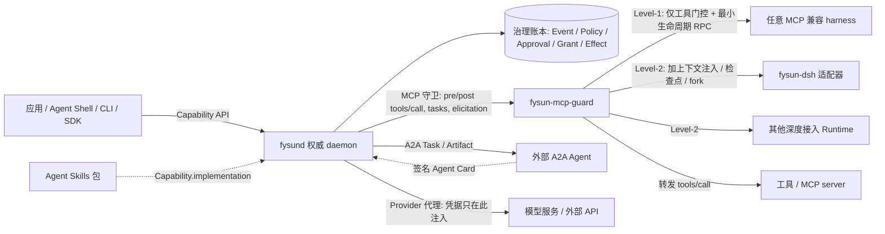

# 03 · 系统架构

- 状态：设计稿 v0.6.0（2026-09-07）
- 变更依据：[前沿对照审查报告](../research/20260907-frontier-review-and-recommendations.md) 与 ADR-0002 ~ ADR-0006
- 前置：[01 定义](01-definition-and-principles.md)、[02 对象模型](02-object-model.md)
- 决策依据：[ADR-0001](../adr/0001-founding-decisions.md)（Rust daemon、event-sourced 账本）、[ADR-0002](../adr/0002-protocol-first-runtime-boundary.md)（协议优先的 Runtime 边界）、[ADR-0003](../adr/0003-policy-object-and-language.md)（Policy 对象与 Cedar 子集）

## 1. 分层

```text
┌────────────────────────────────────────────────────────────────────────────────────┐
│ 应用层   Personal / OPC 数字员工 · IoT 应用 · Agent Shell · 其他产品                   │
├────────────────────────────── Capability API ──────────────────────────────────────┤
│ FysunOS（fysund）                                                                   │
│   Capability 子系统   契约注册、谱系与证据、health、环境匹配（按 control_points[]）       │
│   Activity   子系统   Activity/Execution 生命周期、触发、input_required、检查点、Handoff   │
│   Authority  子系统   Principal/Scope、Grant/预算、Policy、Approval、ActionIntent/Effect、 │
│                       Verifier、账本                                                  │
│   Resource   子系统   模型代理、Secret Store、上下文装配与来源标签、Memory 准入、          │
│                       Skills / MCP 工具 / 设备目录、计量                                │
├──── Runtime ABI（MCP 守卫 + 最小生命周期 RPC + 可选控制点）· A2A（外部 Handoff）────────┤
│ Runtime 层  Level-1：任意 MCP 兼容 harness（Claude Code / Codex / Goose / OpenCode /     │
│                      DSH headless…）                                                  │
│            Level-2：DSH（fysun-dsh 参考适配器）与其他深度接入 Runtime                    │
│            边缘 Runtime · 外部 A2A Agent                                              │
└────────────────────────────────────────────────────────────────────────────────────┘
```

应用通过 Capability API 使用系统；对话助手、GUI、CLI、无人值守服务都只是入口，不决定架构。
Runtime 通过 Runtime ABI 接入：MCP 守卫是所有 Runtime 的必经之路，最小生命周期 RPC 是所有 Runtime 必须实现的面，
可选控制点按 Runtime 声明并记入 `runtime/qualified{control_points[]}`。OS 不知道也不关心 Runtime 内部的 loop 与 prompt。
Level-1 / Level-2 只是文档速记，环境匹配依据 `control_points[]`，不依据 Level 标签。

## 2. 四个子系统

### 2.1 Capability 子系统

- 注册与解析 Capability 契约、实现引用（含 Agent Skills 目录引用）、运行要求；维护谱系与证据。
- **环境匹配**：把 `requirements` 对照目标环境的实际资源与 Runtime 声明的 `control_points[]`——满足则运行，
  可替代则重绑定（换模型/工具/Runtime），缺少必要条件则**明确报告**不可运行或部分满足。
  不设兼容等级制度，不静默降质。
- Adjustment 的记录、应用、回退、晋升与谱系；记录 `predicted_effect`，在后续 Verification 到达时填充 `evaluated_against`；
  `evidence_gate` 开启时在 promote 前对回归集跑评估。
- `health` 投影：从 evidence 与 Adjustment 历史折叠冗余、过期、反复失败项。
- 提供发现接口：应用或 Agent Shell 可以按行为描述查找可用能力，结果附 evidence 摘要与最低 verifier 要求。

### 2.2 Activity 子系统

- Activity / Execution 生命周期状态机；触发（人工、事件、周期、webhook）与调度。
- `waiting`（等触发）与 `input_required`（等人）分开处理：Approval 未决或需要用户输入时 Activity 进入 `input_required`、
  Execution 进入 `waiting`；待决 Approval 达到 `max_pending_approvals` 时停止签发新 Approval，直到回落。
- 检查点与恢复：检查点的 OS 侧水位同时含 Effect 水位与 Approval 水位；恢复顺序固定——先读账本投影，
  再校验 `fencing_epoch`，再对账 outcome-unknown 的 Effect，最后才通知 Runtime `resume_execution`（见 §6）。
- Handoff 的签发、状态推进（对齐 A2A TaskState）、交付、验证关联；目标为外部 Agent 时以 A2A client 身份发起 Task。
- 等待、取消、超时、预算耗尽的统一处理；daemon 拥有 wait/switch/escalate 策略，不允许
  Runtime 静默无限重试；`assurance` 映射出的 `retry` / `fallback` 动作在此承担。

### 2.3 Authority 子系统

- Principal/Scope 管理；Grant 签发、衰减、撤销、预算记账（含审批容量）。
- ActionIntent/Effect/Receipt 协议执行；outcome-unknown 的 reconcile / quarantine。
- **Policy 版本管理与评估**：加载、换版、退役 Policy 对象；每个准入决定（Effect 候选、Grant 签发、Approval 创建、
  Memory 准入）在 Cedar 子集上评估并产出 `policy_decision{policy_version, rule_id, outcome, obligations[]}`，随事件入账本
  （[ADR-0003](../adr/0003-policy-object-and-language.md)）。
- **Approval 签发与关闭**：`outcome = approve` 时创建 Approval；接受 Principal 的决定；`approve_for_activity` 派生衰减 Grant，
  `approve_for_capability` 派生 Adjustment；到期按 `on_expiry` 处理（[ADR-0005](../adr/0005-approval-and-evidence-gated-evolution.md)）。
- **F9 的机械化执行**：Execution 内有效权限集 = Grant ∩ Policy 允许集 ∩ 工具面；MCP 守卫的 `tools/list` 按此过滤改写，
  看不见就调不了；收窄自动生效，扩张只能经 Approval（[ADR-0004](../adr/0004-provenance-labels-and-monotonic-privilege.md)）。
- 独立 Verifier 调度：确定性检查优先；按 Policy 的最低 verifier 要求调度 `human` 与 `model_judge`；记录
  `independence` 与 `calibration_ref`。
- 事件账本的唯一写入者；所有投影由它折叠。

### 2.4 Resource 子系统

- Provider 代理：Runtime 的模型请求经 daemon 转发，daemon 注入凭据、计量 Token 与费用。
- Secret Store：批准的后端（OS keyring / 文件加密 / 硬件），只对外暴露 `SecretRef`。
- 上下文装配服务：按 Grant 与预算过滤候选片段（authorize-before-rank），产出带 digest 与
  显式损失说明的受控上下文视图，交 Runtime 渲染。
- **来源标签赋予**：装配时为每个片段、每个工具结果、每个 Artifact 赋予 `label{source_principal, integrity, origin_ref}`；
  `context/assembled` 记录 `labels_digest`；Runtime 不能改写标签。
- **Memory 准入 / 撤回 / 矛盾保留**：Runtime 提交的记忆候选经 Policy 与来源标签检查才成为 durable 知识；
  撤回与 supersession 是事件；矛盾记录不合并，标记 `conflict_with`。记忆引擎可插拔。
- 目录：Agent Skills 目录登记（digest、`allowed-tools`、`compatibility`、来源）；MCP 工具目录（server、工具描述符、可用性）；
  适配器与设备目录（隔离状态、离线行为、绑定的安全包络 Policy）；`resource/quarantined` 表达隔离。
- 计量：Token、费用、调用次数、设备使用。

## 3. 进程拓扑



```text
  fysun CLI ──▶ ┌────────────────────────────────┐
  Web UI    ──▶ │ fysund (Rust)                  │   MCP（stdio / Streamable HTTP）
  Agent Shell ▶ │  ├ fysun-mcp-guard ◀───────────┼──────▶ Runtime 进程（隔离子进程或外部进程）
  应用 SDK  ──▶ │  │   tools/list · tools/call   │        Level-1 harness / Level-2 fysun-dsh / 边缘 Runtime
                │  │   tasks · elicitation ──────┼──────▶ 工具 / MCP server（位于守卫之后）
                │  ├ 最小生命周期 RPC ◀──────────┼──────▶ 同一 Runtime 进程（stdio JSON-RPC）
                │  ├ 治理账本 SQLite WAL          │
                │  └ Provider 代理               │
                └────────┬──────────────┬────────┘
                         │ 凭据只在此注入  │ A2A Task / Artifact
                         ▼              ▼
                  模型服务 / 外部 API   外部 A2A Agent（签名 Agent Card）
```

- `fysund` 是唯一权威写入者，本机 owner-local、单主体启动（MVP），预留多主体与多节点的
  Scope 模型但不预建 RBAC。
- Runtime 是 `fysund` 管理的**隔离子进程**或外部进程，通过 MCP（stdio / Streamable HTTP）与最小生命周期 RPC
  （stdio JSON-RPC，MVP）连接；不进程内链接，不共享地址空间。
- `fysun-mcp-guard` 是 `fysund` 内的 MCP 守卫组件，位于 harness 与所有工具 / MCP server 之间：harness 把 `fysund`
  视为唯一 MCP server，或 `fysund` 前置在 harness 配置的所有 MCP server 之前。守卫结果语义 `Pass` / `Reject` / `Mutated`。
  是否复用 agentgateway（作为库嵌入 / 独立进程前置 / 仅借用语义自实现）待评估（[08 开放问题](08-mvp-plan.md#7-开放问题待后续-adr)）；
  无论哪种形态，均采用相同的结果语义与 Cedar 策略格式。
- 外部 A2A Agent 不是 Runtime：`fysund` 作为 A2A client 发起 Task，只交换 Artifact 与状态，不签发 Grant。
- Web UI 由 daemon 静态服务，Approval 呈现面是其第一优先级；Agent Shell 是运行在某个 Runtime 上的一个普通 Capability 组合，
  没有特殊系统身份，其可操作范围由 Grant 决定。
- 边缘节点运行 `fysund-edge`（同一账本模型的精简实现，内含确定性包络校验器）与边缘 Runtime（只需 MCP 客户端 + 最小 RPC）；
  与中心节点之间通过 Handoff 与产物引用协作，不承诺进程或模型状态迁移。

## 4. 双账本

| 账本 | 拥有者 | 内容 | 真源范围 |
|---|---|---|---|
| **治理账本** | `fysund` | Principal/Scope、Capability、Activity/Execution、Grant、Policy、Approval、ActionIntent/Effect/Receipt、Verification、Handoff、Adjustment、Memory、Resource 生命周期、来源标签摘要 | 一切治理事实 |
| **会话账本** | Runtime（如 DSH session log） | 模型消息、工具调用与结果原文、chunk、compaction、fork 谱系 | 模型所见与所答 |

关联字段：`execution_id`、`session_id`、`task/handoff_id`、`approval_id`、`causation_id`、`correlation_id`、
`fencing_epoch`。两账本**关联不合并**：合并会让 OS 真源依附于某个 harness；不关联会产生
双重状态与重复恢复逻辑。跨账本 replay 测试是必备验证。Level-1 Runtime 的会话账本可能不可访问，此时关联义务
退化为 MCP 守卫记录的 `tools/call` 配对（每个 `tools/call` 对应一个 Effect 或一条审计快路径事件）。

## 5. Event-sourced 治理账本

采用**有边界的 event-sourced** 模型（ADR-0001）：

- 事件是唯一真源；状态是投影；缓存/索引是派生数据，可删可重建，带 watermark 与 digest。
- **边界**：模型流式 chunk、KV cache、高频传感器采样、Runtime 内部步骤不进入治理账本；
  它们属于会话账本或遥测。
- SQLite WAL 单文件存储；事件表 append-only；投影表可重建。schema 变更走编号迁移，只追加
  步骤不改写已合并步骤。
- 每次 replay 产生的投影 digest 必须稳定，作为回归测试的客观面。

### 5.1 事件族

```text
principal/created | principal/revoked
scope/defined | scope/revised

capability/registered | capability/revised | capability/derived
capability/evidence-recorded | capability/withdrawn

activity/created | activity/activated | activity/waiting | activity/input-required
activity/paused | activity/resumed | activity/blocked | activity/completed | activity/cancelled
activity/policy-bound | activity/triggered

execution/started | execution/checkpointed | execution/resumed | execution/forked
execution/finished | execution/failed | execution/cancelled

handoff/submitted | handoff/working | handoff/input-required | handoff/auth-required
handoff/completed | handoff/verified | handoff/failed | handoff/rejected | handoff/cancelled

grant/issued | grant/attenuated | grant/consumed | grant/revoked

action-intent/recorded | action-intent/rejected | action-intent/replayed
effect/authorized | effect/dispatch-started | effect/receipt
effect/outcome-unknown | effect/reconciled | effect/quarantined | effect/compensated

verification/requested | verification/reported | verification/inconclusive

approval/requested | approval/granted | approval/denied | approval/modified | approval/expired

policy/loaded | policy/revised | policy/retired

memory/proposed | memory/admitted | memory/rejected | memory/superseded | memory/retracted

adjustment/applied | adjustment/predicted | adjustment/evaluated
adjustment/reverted | adjustment/promoted

context/assembled

resource/registered | resource/bound | resource/metered | resource/unavailable | resource/quarantined
runtime/attached | runtime/qualified | runtime/health | runtime/detached
```

每个事件携带 `seq`、`time`、`principal`、`causation_id`、`correlation_id`，与 Execution 相关的
事件另带 `execution_id` 与 `fencing_epoch`。另外：

- 准入类事件（`effect/authorized`、`action-intent/rejected`、`approval/requested`、`grant/issued`、`memory/admitted`、
  `memory/rejected`）携带 `policy_decision{policy_version, rule_id, outcome, obligations[]}`；
- `context/assembled` 携带 `labels_digest`（本次 context_view 全部片段 `label` 的摘要）；
- `runtime/qualified` 携带 `control_points[]`；
- `adjustment/reverted` 携带 `reason`；
- `grant/issued` 若由 Approval 派生，携带 `approval_id`。

## 6. 恢复模型

1. 进程启动：读取账本，重建投影，校验 digest。
2. **Policy 版本校验**：载入的 `active` Policy 版本与 digest 必须与账本中最近的 `policy/loaded | revised` 一致；
   不一致则拒绝恢复任何需要准入的动作，直到 Policy 重新加载并入账。
3. 对每个非终态 Execution：读取 `fencing_epoch`，递增得到新 epoch；旧 epoch 的后续写入被拒。
4. 对所有 `dispatch-started` 但无 `receipt` 的 Effect：进入 outcome-unknown，按适配器提供的
   对账能力 reconcile；无法对账的进入 quarantine 并阻塞相关 Activity（`blocked` 带恢复动作）。
5. **Approval 水位**：崩溃前 `pending` 的 Approval 恢复后仍为 `pending`；已到 `expiry` 的按 `on_expiry` 处理；
   任何情况下不得被 Runtime 或 daemon 视为已批。所属 Activity 恢复为 `input_required`。
6. 只有对账完成后，才向 Runtime 发 `resume_execution`（携带 OS 侧 Effect 水位与 Approval 水位）。
7. Activity 是否自动恢复由 `policy_binding` 引用的 Policy 决定；缺省是"恢复等待态、不自动发起新外部
   动作、等待触发"。

崩溃后**不是一律重跑**；外部结果未知时先对账；不承诺无条件 exactly-once。

负例向量（进入 M1 / M3 验收）：

- 恢复后 Runtime 提交的第一个候选，若与崩溃前 `dispatch-started` 但无 `receipt` 的 Effect 幂等键相同，
  必须命中 `action-intent/replayed` 并返回该 Effect 的对账状态，**不得**新建 Effect；
- 恢复后对一个 `pending` Approval 关联的候选再次提交，必须返回 `needs_human(approval_id)`，账本中不得出现无
  `approval/granted` 的 `effect/authorized`。

## 7. 部署策略模型

部署环境提供的策略是版本化的 Policy 对象（[02 §2.12](02-object-model.md)），规则以 Cedar 子集书写，
经 `policy.load(source)` 入账本并产生 `policy/loaded`；换版产生新 version（`policy/revised`），旧版本保留以解释历史决定。
每个准入决定都引用 `policy_version` 与 `rule_id`，因此"这条 Effect 当时为什么被放行"总有答案。

Policy 至少回答：

- 哪些 Effect 类别可自动执行、哪些需 Approval、哪些禁止；
- 哪些 Effect 类别或 Capability 需要何种最低 verifier（`verifier_kind`、`independence`）才算通过；
- 来源标签规则：哪些参数位置不接受 `untrusted_external` 来源，或接受但需 Approval；
- 预算与速率上限；审批容量（`max_pending_approvals`、`approval_sla` 的缺省）；
- 允许的 Runtime 类型与 `control_points[]` 要求、允许的 Resource 类型；
- Memory 准入规则与矛盾解析（优先最新 / 请求澄清 / 忽略）；
- Adjustment 的 `evidence_gate` 是否开启；
- Activity 崩溃后是否自动恢复；
- 边缘离线保守规则：离线期间只允许本地 Policy 已预授权的 Effect 类别，需要 Approval 的一律阻塞
  （见 [07 边缘](07-evolution-and-edge.md)）。

评估输入至少包含 principal、action（Effect 类别 + 工具名）、resource（Scope / 设备 / 账号）、context
（参数摘要、来源标签、预算余量、可逆性、`assurance.level`、Runtime 类型与 `control_points[]`）。

OS 只负责执行策略边界；不内置统一风险等级；不自造策略语言。产品（如 Personal）可以提供自己的默认 Policy
（例如"低风险自动、高风险确认"），但那是应用层选择。

## 8. 可观测性

- 治理账本仍是唯一真源；可观测性导出是派生数据，丢失不影响恢复。
- 以 OTLP 导出 Execution / Effect / Handoff / Verification / Approval 为 span 与事件：`execution_id` 为 trace 关联键，
  `causation_id` 为 span parent；Runtime 的会话账本若也导出 OTLP，通过 `execution_id` 与 `session_id` 关联。
- OpenTelemetry `gen_ai.*` 语义约定截至 2026-08 全部为 Development 且无 tagged release：实现**钉住具体 commit**，
  用 `fysun.*` 命名空间承载可能改名的属性（如 `fysun.policy_version`、`fysun.approval_id`、`fysun.label.integrity`），
  避免把账本 schema 绑到不稳定约定上；`gen_ai.*` 稳定后是否替代 `fysun.*` 属性另议。
- 度量从事件折叠，不单独记账：人工介入率（`approval/requested` / Execution）、回滚率（`adjustment/reverted` /
  `adjustment/applied`）、验证独立性比例（`independence != not_independent` 的 Verification 占比），以及
  [08 MVP 计划](08-mvp-plan.md) 的既有指标。
