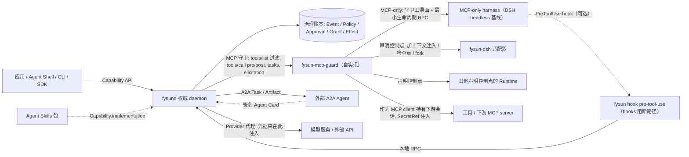

# 03 · 系统架构、账本与恢复

- 状态：设计稿 v0.7.0（2026-09-08）
- 变更依据：[v0.7.0 全量重构蓝图](../research/20260908-v0.7.0-refactor-blueprint.md)；ADR-0001 ~ ADR-0006（v0.7.0 修订）与 ADR-0007 ~ ADR-0012
- 前置：[01 定义](01-definition-and-principles.md)、[02 对象模型](02-object-model.md)、[00 术语表](00-terminology.md)
- 决策依据：[ADR-0001](../adr/0001-founding-decisions.md)（Rust daemon、event-sourced 账本）、[ADR-0002](../adr/0002-protocol-first-runtime-boundary.md)（协议优先的 Runtime 边界）、[ADR-0003](../adr/0003-policy-object-and-language.md)（Policy 对象与 Cedar 子集）、[ADR-0007](../adr/0007-runtime-native-tools-and-conformance-scope.md)（Runtime 资格化纪元）、[ADR-0008](../adr/0008-effect-category-and-read-only-determination.md)（Effect 类别）、[ADR-0010](../adr/0010-edge-offline-ledger-consistency.md)（边缘离线一致性）、[ADR-0011](../adr/0011-approval-result-set-and-approval-surface.md)（Approval 与重新武装）、[ADR-0012](../adr/0012-mcp-guard-self-implementation.md)（守卫自实现）

事件族全集只在 [00 §4](00-terminology.md) 维护，本文 §5 只引用并说明携带字段规则。

## 1. 分层

```text
┌────────────────────────────────────────────────────────────────────────────────────┐
│ 应用层   Personal / OPC 数字员工 · IoT 应用 · Agent Shell · 其他产品                   │
├────────────────────────────── Capability API（04）─────────────────────────────────┤
│ FysunOS（fysund）                                                                   │
│   Capability 子系统   契约注册（tool_effects[] 必填校验）、谱系与证据、health、          │
│                       环境匹配（按 control_points[] 与 native_effect_tools[]）          │
│   Activity   子系统   Activity/Execution 生命周期、触发、input_required、waiting.reason、 │
│                       检查点、恢复与重新武装、Handoff                                  │
│   Authority  子系统   Principal/Scope、Grant/预算、Policy、Approval（审批面）、          │
│                       ActionIntent/Effect（类别合成）、Verifier、Node、账本               │
│   Resource   子系统   模型代理、Secret Store、上下文装配与来源标签、Memory 准入、          │
│                       Skills / MCP 工具 / 设备 / Runtime 目录、计量                      │
├── Runtime ABI（MCP 守卫 06 + 最小生命周期 RPC 与控制点 05）· A2A（外部 Handoff）──────┤
│ Runtime 层  MCP-only harness（DSH headless 为 M2a 基线；Claude Code / Codex / Goose / │
│                      OpenCode 为候选，均含原生工具，见 07 §3）                          │
│            声明控制点的 Runtime（fysun-dsh，声明全部六个控制点，见 08）                  │
│            边缘 Runtime · 外部 A2A Agent                                              │
└────────────────────────────────────────────────────────────────────────────────────┘
```

应用通过 Capability API 使用系统；对话助手、GUI、CLI、无人值守服务都只是入口，不决定架构。
Runtime 通过 Runtime ABI 接入：MCP 守卫是所有 Runtime 的必经之路，最小生命周期 RPC 是所有 Runtime 必须实现的面，
可选控制点按 Runtime 声明并记入 `runtime/qualified{control_points[], native_effect_tools[], describe_digest, bundle_digest}`。
OS 不知道也不关心 Runtime 内部的 loop 与 prompt，但要求 Runtime 如实声明其原生（非 MCP）工具。
叙述中把 MCP-only Runtime 速记为 Level-1、声明控制点的 Runtime 速记为 Level-2、附带 hooks.json 阻断路径的 MCP-only Runtime 速记为 Level-1b；
这些速记的定义与标识符禁令见 00 §1.3，环境匹配与资格化依据的是控制点清单与原生工具清单，不依据 Level 标签。

## 2. 四个子系统

### 2.1 Capability 子系统

- 注册与解析 Capability 契约、实现引用（含 Agent Skills 目录引用）、运行要求；维护谱系与证据。
  `capability.register` 校验 `contract.bounds.tool_effects[]` 必填且覆盖 `allowed-tools` 中每个工具，缺整个字段 → 拒绝（[ADR-0008](../adr/0008-effect-category-and-read-only-determination.md) §D2）。
- **环境匹配**：把 `requirements` 对照目标环境的实际资源、Runtime 已资格化的 `control_points[]` 与如实声明的 `native_effect_tools[]`
  （`requirements` 可声明拒绝含特定原生工具的 Runtime）——满足则运行，可替代则重绑定（换模型/工具/Runtime），缺少必要条件则**明确报告**
  不可运行或部分满足（`not_runnable.environment{missing[]}`）。不设兼容等级制度，不静默降质。
- Adjustment 的记录、应用、回退、晋升与谱系；`predicted_effect` 可选，给出时在后续 Verification 到达时填充 `evaluated_against`，为空时
  `evaluated_against.result` 恒 `inconclusive`；`evidence_gate` 开启时在 promote 前对回归集跑评估。
- `health` 投影：从 evidence 与 Adjustment 历史折叠冗余、过期、反复失败项与**未分类工具**（`allowed-tools` 中未在 `tool_effects[]` 列出的工具，
  运行时按 `external_mutation` 处理）。
- 提供发现接口：应用或 Agent Shell 可以按行为描述查找可用能力，结果附 evidence 摘要与最低 verifier 要求。

### 2.2 Activity 子系统

- Activity / Execution 生命周期状态机；触发（人工、事件、周期、webhook）与调度。
- `waiting`（等触发）与 `input_required`（等人）分开处理：Approval 未决或需要用户输入时 Activity 进入 `input_required`、
  Execution 进入 `waiting{reason: approval}` 或 `waiting{reason: input}`；等 Activity 触发时 Execution 为 `waiting{reason: trigger}`
  （事件 `execution/waiting{reason}`）。待决 Approval 达到 `max_pending_approvals`、或单位时间 `approval/asked` 达到 `approval_rate_limit` 时
  停止签发新 Approval（新的需审批候选按 `denied.budget` 拒绝并留痕），直到回落；连续 `rejected` 达到 `consecutive_rejections_alert` →
  `blocked{reason: consecutive_rejections}`，须 Principal `activity.resume`。
- 检查点与恢复：检查点的 OS 侧水位同时含 Effect 水位与 Approval 水位；恢复顺序固定——先读账本投影，校验 Policy 版本与 Runtime 资格化，
  再校验 `fencing_epoch`，再对账 outcome-unknown 的 Effect，再核对 Approval 水位，再**重新武装**，最后才通知 Runtime `resume_execution`（见 §6）。
- **恢复后重新武装**：进程重启后，Capability `tool_effects[]` 含非 `local_read` 类别的 Activity 缺省进入 `paused{reason: rearm_required}`，
  须 Principal `activity.resume` 或 Policy `auto_resume` 才继续；武装事实由账本事件 `activity/resumed` 承载，不是进程内存标志
  （[ADR-0011](../adr/0011-approval-result-set-and-approval-surface.md) §D8）。
- Handoff 的签发、状态推进（对齐 A2A TaskState）、交付、验证关联；目标为外部 Agent 时以 A2A client 身份发起 Task；
  `handoff_accept` Approval 只在 [02 §2.8](02-object-model.md) 的触发条件下创建。只有 Handoff 状态迁移与 `deliverables` 入治理账本。
- 等待、取消、超时、预算耗尽的统一处理；daemon 拥有 wait/switch/escalate 策略，不允许
  Runtime 静默无限重试。`retry` / `fallback` / `escalate` / `terminate`（以及 `proceed` / `proceed_with_warning`）是**本子系统的内部策略词汇**：
  对外只经 Policy 的 `outcome` 四值（`allow / deny / modify / approve`）表达，`escalate → approve`、`terminate → deny + cancel 并保留证据`。
- Runtime 资格化失效时运行中 Execution 的处置：`runtime/disqualified` 不强制终止运行中的 Execution；是否让其继续到下一检查点、暂停或取消
  由本子系统按 Policy 决定（§6、§7），但新的 `start_execution` / `resume_execution` 一律 `not_runnable.environment`。

### 2.3 Authority 子系统

- Principal/Scope 管理；Grant 签发、衰减、撤销、预算记账（含审批容量与审批速率）；escrow 子 Grant 的预扣与归还（[11 §3](11-edge-and-offline-ledger.md)）。
- ActionIntent/Effect/Receipt 协议执行；幂等冲突硬拒绝（`conflict.idempotency`）；outcome-unknown 的 reconcile / quarantine；补偿必须新 Grant + 新 ActionIntent。
- **Effect 类别合成**（三源合一，[06 §3](06-mcp-guard.md)、[ADR-0008](../adr/0008-effect-category-and-read-only-determination.md)）：
  Capability `tool_effects[]`、Resource 目录缺省类别、Policy 覆盖 → `effect_category` 六值之一；未分类 → `external_mutation`；
  只有 `local_read` 走审计快路径（`audit/observed`）。
- **Policy 版本管理与评估**：加载、换版、退役 Policy 对象；每个准入决定（Effect 候选、Grant 签发、Approval 创建、
  Memory 准入、Runtime 资格化）在 Cedar 子集上评估并产出 `policy_decision{policy_version, rule_id, outcome, obligations[]}`，随事件入账本
  （[ADR-0003](../adr/0003-policy-object-and-language.md)、[ADR-0009](../adr/0009-cedar-subset-and-entity-model.md)）。
- **Approval 签发与关闭**：`outcome = approve` 时创建 Approval 并写 `approval/asked`（与 `approval/decided` 必须配对，任一无法落账以
  `unavailable.approval` 拒绝整个请求）；接受 Principal 的决定；只有 `result = approved_once` 派生——`approve_for_activity` 派生衰减 Grant，
  `approve_for_capability` 派生 Adjustment；到期按 `on_expiry` 处理（[ADR-0011](../adr/0011-approval-result-set-and-approval-surface.md)）。
- **审批面的唯一提供者**：Web UI、CLI、`fysund` 发起的 elicitation；Runtime 文本输出与自绘卡片不构成审批面（T11）。
- **审批限流与连续拒绝告警**：`approval_rate_limit`、`consecutive_rejections_alert` 与 `max_pending_approvals`、`approval_sla` 一并作为预算维度记账，
  超限处置见 2.2。
- **F9 的机械化执行**：Execution 内有效权限集 = Grant ∩ Policy 允许集 ∩ 工具面；MCP 守卫的 `tools/list` 按此过滤改写，
  看不见就调不了；收窄自动生效，扩张只能经 Approval（[ADR-0004](../adr/0004-provenance-labels-and-monotonic-privilege.md)）。
- 独立 Verifier 调度：确定性检查优先；按 Policy 的最低 verifier 要求调度 `human` 与 `model_judge`；记录
  `independence` 与 `calibration_ref`。
- **节点归属与边缘合并**（[11 §3](11-edge-and-offline-ledger.md)、[ADR-0010](../adr/0010-edge-offline-ledger-consistency.md)）：Node 登记；
  每个 Activity / Execution / Effect 的 home 唯一；边缘事件按 `origin_seq` 合并并写 `ledger/merged`，冲突以 `ledger/conflict` 追加表达。
- 事件账本的唯一写入者；所有投影由它折叠。

### 2.4 Resource 子系统

- Provider 代理：Runtime 的模型请求经 daemon 转发，daemon 注入凭据、计量 Token 与费用。**只覆盖经 `fysund` 代理的请求**；harness 自持凭据
  直连 Provider 的请求不在范围（F5 范围限定，[07 §5](07-runtime-onboarding.md)）。
- Secret Store：批准的后端（OS keyring / 文件加密 / 硬件），只对外暴露 `SecretRef`。**SecretRef 三规则**：每次操作重解析（不缓存明文）、
  描述面无值槽（`resource.describe` / `tools/list` 中不存在可放明文的字段）、空值即未配置（不以空串或占位符表示）。
  **下游 MCP server 的凭据**同样以 `SecretRef` 登记，只在 `fysund`（守卫）连接该 server 时注入（[06 §8](06-mcp-guard.md)）。
- 上下文装配服务：按 Grant 与预算过滤候选片段（authorize-before-rank），产出带 digest 与
  显式损失说明的受控上下文视图，交 Runtime 渲染（MCP-only Runtime 的渲染路径见 [07 §3](07-runtime-onboarding.md)）。
- **来源标签赋予**：装配时为每个片段、每个工具结果、每个 Artifact 赋予 `label{source_principal, integrity, origin_ref, flags?}`；
  工具结果一律 `untrusted_external`；`context/assembled` 记录 `labels_digest`；Runtime 不能改写标签。
- **Memory 准入 / 撤回 / 矛盾保留**：Runtime 提交的记忆候选经 Policy 与来源标签检查才成为 durable 知识；写入为准入事件
  `memory/admitted`（带 `policy_decision`），不走 Effect 状态机；撤回与 supersession 是事件；矛盾记录不合并，标记 `conflict_with`。记忆引擎可插拔。
- 目录：Agent Skills 目录登记（digest、`allowed-tools`、`compatibility`、来源）；MCP 工具目录（server、工具描述符、可用性、
  **缺省 `effect_category` 登记**——类别来源 (b)，MCP tool annotations 只作登记时的建议输入）；
  **Runtime 目录**（已安装 Runtime 为 Resource 类型：类型、版本、来源、`bundle_digest`、`describe()` 快照、资格化纪元；
  `runtime.list` / `runtime.qualify`，[07 §1](07-runtime-onboarding.md)）；适配器与设备目录（隔离状态、离线行为、绑定的安全包络 Policy）；
  `resource/quarantined` 表达隔离。
- 计量：Token、费用、调用次数、设备使用。

## 3. 进程拓扑



```text
  fysun CLI ──▶ ┌────────────────────────────────┐
  Web UI    ──▶ │ fysund (Rust)                  │   MCP（stdio / Streamable HTTP）
  Agent Shell ▶ │  ├ fysun-mcp-guard ◀───────────┼──────▶ Runtime 进程（隔离子进程或外部进程）
  应用 SDK  ──▶ │  │   tools/list · tools/call   │        MCP-only harness / fysun-dsh（声明控制点）/ 边缘 Runtime
  fysun hook ─▶ │  │   tasks · elicitation ──────┼──────▶ 工具 / 下游 MCP server（位于守卫之后，会话由 fysund 持有）
  (本地 RPC)    │  ├ 最小生命周期 RPC ◀──────────┼──────▶ 同一 Runtime 进程（stdio JSON-RPC）
                │  ├ 治理账本 SQLite WAL          │
                │  └ Provider 代理               │
                └────────┬──────────────┬────────┘
                         │ 凭据只在此注入  │ A2A Task / Artifact
                         ▼              ▼
                  模型服务 / 外部 API   外部 A2A Agent（签名 Agent Card）
```

- `fysund` 是唯一权威写入者，本机 owner-local、单主体启动（MVP），预留多主体与多节点的
  Scope 模型但不预建 RBAC。MVP 单机部署下中心即唯一 Node，事件通用字段 `node_id` / `origin_seq` 仍存在（中心恒自身）。
- Runtime 是 `fysund` 管理的**隔离子进程**或外部进程，通过 MCP（stdio / Streamable HTTP）与最小生命周期 RPC
  （stdio JSON-RPC，MVP）连接；不进程内链接，不共享地址空间。MCP-only harness 的最小 RPC 由薄包装进程代为实现（[07 §3](07-runtime-onboarding.md)）。
- `fysun-mcp-guard` 是 `fysund` 内的 MCP 守卫组件，位于 harness 与所有工具 / MCP server 之间：harness 把 `fysund`
  视为唯一 MCP server，或 `fysund` 前置在 harness 配置的所有 MCP server 之前。守卫结果语义 `Pass` / `Reject` / `Mutated`，
  **自实现，借用 agentgateway 的三值语义与 Cedar 策略格式**（[ADR-0012](../adr/0012-mcp-guard-self-implementation.md)）；
  `fysund` 依赖清单不含 agentgateway。**守卫作为 MCP client 持有下游 server 的会话**（Streamable HTTP 的 `Mcp-Session-Id` 不暴露给 harness）
  并在连接时注入 `SecretRef` 解析出的凭据；harness 不直接持有任何工具连接。规范全文见 [06](06-mcp-guard.md)。
  与 DSH 的 `guard/` 包（loop 卫生插件）无关。
- `fysun hook pre-tool-use` 是 CLI 子命令，作为 harness hooks.json PreToolUse command hook 的命令端：读取 harness 传入的工具调用载荷，
  经 `fysund` 本地 RPC 做 Policy 评估，`deny` 时退出码 2 阻断；只能 deny / abstain，不产生 Effect（[06 §9](06-mcp-guard.md)、[07 §4](07-runtime-onboarding.md)）。
  它是对 MCP-only harness 原生工具的可选补充阻断，不计入 conformance 主路径。
- 外部 A2A Agent 不是 Runtime：`fysund` 作为 A2A client 发起 Task，只交换 Artifact 与状态，不签发 Grant；返回 Artifact 一律 `untrusted_external`。
- Web UI 由 daemon 静态服务，Approval 呈现面是其第一优先级，也是审批面的三种形态之一（Web UI / CLI / `fysund` 发起的 elicitation）；
  Agent Shell 是运行在某个 Runtime 上的一个普通 Capability 组合，没有特殊系统身份，其可操作范围由 Grant 决定。
- 边缘节点运行 `fysund-edge`（同一账本模型的精简实现，内含确定性包络校验器，持有 escrow Grant）与边缘 Runtime（只需 MCP 客户端 + 最小 RPC）；
  与中心节点之间通过 Handoff 与产物引用协作，不承诺进程或模型状态迁移；离线与合并规则见 [11 §3](11-edge-and-offline-ledger.md)。

## 4. 双账本

| 账本 | 拥有者 | 内容 | 真源范围 |
|---|---|---|---|
| **治理账本** | `fysund` | Principal/Scope、Node、Capability、Activity/Execution、Grant、Policy、Approval（含审批事实：`presentation`、`decided_by`、`reason`）、ActionIntent/Effect/Receipt、`audit/observed`、Verification、Handoff（状态迁移与 `deliverables`）、Adjustment、Memory、Resource 与 Runtime 资格化生命周期、来源标签摘要 | 一切治理事实 |
| **会话账本** | Runtime（如 DSH session log） | 模型消息、工具调用与结果原文、chunk、compaction、fork 谱系、**Loop 状态**（armed / step 计数 / 继续策略）、**Agent Teams 的 roster / mailbox / task DAG**、Runtime 自绘的审批呈现（若有，**视为无效**，不产生 `approval/decided`） | 模型所见与所答 |

关联字段：`execution_id`、`session_id`、`task/handoff_id`、`approval_id`、`causation_id`、`correlation_id`、
`fencing_epoch`、`context_view.digest`（声明 `context_injection` 的 Runtime 每次注入在会话账本写一条带此 digest 的事件）。
两账本**关联不合并**：合并会让 OS 真源依附于某个 harness；不关联会产生
双重状态与重复恢复逻辑。跨账本 replay 测试是必备验证。审批事实只在治理账本，不进入会话账本的模型可见面（Runtime 只收到
`approval_result{approval_id, result, params_digest, grants_summary?}`）。

MCP-only Runtime 的会话账本可能不可访问，此时关联义务退化为 MCP 守卫记录的**关联面 = `tools/call` 配对 + `audit/observed`**：
每个非快路径 `tools/call` 对应一个 Effect，每个 `local_read` 快路径调用对应一条 `audit/observed`；跨账本 replay 只对 Effect 与工具结果配对，
不对模型消息定位（[05 §6](05-runtime-abi.md)）。

## 5. Event-sourced 治理账本

采用**有边界的 event-sourced** 模型（ADR-0001）：

- 事件是唯一真源；状态是投影；缓存/索引是派生数据，可删可重建，带 watermark 与 digest。
- **边界**：模型流式 chunk、KV cache、高频传感器采样、Runtime 内部步骤、Loop 状态不进入治理账本；
  它们属于会话账本或遥测。
- SQLite WAL 单文件存储；事件表 append-only；投影表可重建。schema 变更走编号迁移，只追加
  步骤不改写已合并步骤。
- 每次 replay 产生的投影 digest 必须稳定，作为回归测试的客观面。
- 边缘节点的事件合并到中心时保留 `node_id` 与 `origin_seq`，中心 `seq` 只是合并序；中心不改写、不删除、不重排 edge 事件
  （[11 §3](11-edge-and-offline-ledger.md)）。

### 5.1 事件族与携带字段

事件族**完整集见 [00 §4](00-terminology.md)**（全仓库唯一全集，本文不再复制）。本节只固定携带字段规则：

- **通用字段**：`seq`、`time`、`principal`、`causation_id`、`correlation_id`、`node_id`（产生事件的节点）、`origin_seq`（该节点本地单调序；
  中心节点恒 `= seq`）；与 Execution 相关的事件另带 `execution_id` 与 `fencing_epoch`。
- **准入类事件**（携带 `policy_decision{policy_version, rule_id, outcome, obligations[]}`）：`effect/authorized`、`action-intent/rejected`、
  `approval/asked`、`grant/issued`、`memory/admitted`、`memory/rejected`、`runtime/qualified`。`audit/observed` 与 `approval/decided` **不是**准入类，
  不携带 `policy_decision`。
- **Approval 配对**：`approval/asked{approval_id, subject, subject_ref{action_intent_id?, params_digest?, object_ref?}, policy_decision, expiry}` 与
  `approval/decided{approval_id, result: approved_once | rejected | cancelled | unavailable, option?, params_digest?, decided_by, derived[]}`
  必须一一配对；`approval/asked` 不复制工具参数。
- **审计快路径**：`audit/observed{execution_id, tool, effect_category: local_read, params_digest, result_label, path: guard | hook | adapter, verdict?}`，
  只对 `local_read` 产生；`path` 取值 `guard`（MCP 守卫）/ `hook`（hooks 阻断路径，另带 `verdict`）/ `adapter`（声明控制点的 Runtime 经适配器拦截点 /
  `os.submit_candidate` 提交，如 `fysun-dsh` 对 DSH 原生只读工具的处理，[08 §2](08-dsh-adapter.md)）；`external_read` 走完整协议并产生 `action-intent/recorded`。
- **Execution 等待**：`execution/waiting{reason: trigger | approval | input}`。
- **Activity 暂停与阻塞**：`activity/paused{reason: user | rearm_required | …}`；`activity/blocked` 带原因（`consecutive_rejections` /
  `revoked_offline` / `policy_retired` / quarantine 待对账）与恢复动作。
- **Runtime 资格化纪元**：`runtime/qualified{resource_id, control_points[], native_effect_tools[], describe_digest, bundle_digest}`；
  `runtime/disqualified{resource_id, reason: describe_changed | bundle_changed | policy_revoked | adapter_precondition_failed}`。
- `context/assembled` 携带 `labels_digest`（本次 context_view 全部片段 `label` 的摘要）。
- `adjustment/reverted` 携带 `reason`。
- `grant/issued` 若由 Approval 派生，携带 `approval_id`（只可指向 `result = approved_once` 的 Approval）；若为边缘预留预算，携带
  `escrow?: {node_id}`。`adjustment/applied` 若由 Approval 派生，同一约束。
- `action-intent/rejected.reason` 取值：`denied.policy` / `denied.grant` / `denied.budget` / `denied.fencing` / `conflict.idempotency` /
  `unavailable.approval`；hooks 路径产生的另带 `path: hook`。
- **边缘与节点**：`node/registered | node/online | node/offline`；`ledger/merged{node_id, from_seq, to_seq, digest}`；
  `ledger/conflict{node_id, kind: revoked_offline | policy_retired | home_violation | clock_skew, refs[]}`。

## 6. 恢复模型

1. 进程启动：读取账本，重建投影，校验 digest。
2. **Policy 版本校验**：载入的 `active` Policy 版本与 digest 必须与账本中最近的 `policy/loaded | revised` 一致；
   不一致则拒绝恢复任何需要准入的动作，直到 Policy 重新加载并入账。绑定的 Policy 已 `retired` 的 Activity 进入 `blocked{reason: policy_retired}`
   （[ADR-0003](../adr/0003-policy-object-and-language.md) §D6）。
3. **Runtime 资格化校验**：对每个非终态 Execution，其 `runtime_binding.qualification_ref` 指向的 `runtime/qualified` 必须仍是该 Runtime Resource
   的当前纪元（此后无 `runtime/disqualified`，且重新 `describe()` 的 `describe_digest` 与 `bundle_digest` 未变）；否则写
   `runtime/disqualified{reason}`，该 Execution 不得 `resume_execution`（返回 `not_runnable.environment`），所属 Activity 按 Policy 处置
   （见步骤 7 与 §7）。
4. 对每个非终态 Execution：读取 `fencing_epoch`，递增得到新 epoch；旧 epoch 的后续写入被拒（`denied.fencing`）。
5. 对所有 `dispatch-started` 但无 `receipt` 的 Effect：进入 outcome-unknown，按适配器提供的
   对账能力 reconcile；无法对账的进入 quarantine 并阻塞相关 Activity（`blocked` 带恢复动作）。
6. **Approval 水位**：崩溃前 `pending` 的 Approval 恢复后仍为 `pending`，不得被 Runtime 或 daemon 视为 `approved_once`；已到 `expiry` 的
   按 `on_expiry` 处理（缺省 `deny` → `rejected`；`keep_waiting` / `escalate` 保持 `pending`）；`fysund` 在崩溃前已受理但无法完成配对的
   Approval 以 `result = unavailable` 写出 `approval/decided`。所属 Activity 恢复为 `input_required`。
7. **重新武装**（[ADR-0011](../adr/0011-approval-result-set-and-approval-surface.md) §D8）：Capability `tool_effects[]` 含非 `local_read` 类别的
   Activity 缺省恢复为 `paused{reason: rearm_required}`（事件 `activity/paused{reason: rearm_required}`），须 Principal `activity.resume`
   或 Policy `auto_resume` 允许时才恢复为 `waiting{reason: trigger}`，二者都产生 `activity/resumed`；纯只读 Activity 直接恢复为 `waiting{reason: trigger}`。
   步骤 3 判定 Runtime 已失格的 Activity 在此处按 Policy 的资格化失效处置规则决定：等待重新 `runtime.qualify` 后重绑（保持 `paused`）、
   换绑另一已资格化 Runtime、或取消并保留证据；缺省为保持 `paused{reason: rearm_required}` 并通知 Principal。
8. 只有对账与重新武装完成后，才向 Runtime 发 `resume_execution`（携带 OS 侧 Effect 水位与 Approval 水位）。
9. 运行中 Execution 在恢复之后遇到 `runtime/disqualified`（Runtime 升级、bundle 替换、Policy 撤销、适配器前置条件失效）时不被强制终止；
   Activity 子系统按 Policy 决定继续到下一检查点、暂停或取消（§7），新的 `start_execution` / `resume_execution` 一律拒绝
   （[ADR-0007](../adr/0007-runtime-native-tools-and-conformance-scope.md) §D7）。

崩溃后**不是一律重跑**；外部结果未知时先对账；不承诺无条件 exactly-once。武装状态由账本事件承载而非进程内存，这是与 DSH goal
"armed 不持久化、恢复后需人工 re-arm"的实质差异：FysunOS 同样要求重新武装，但武装事实入账本、可由 Policy 预授权、可审计。

负例向量（进入 M1 / M3 验收）：

- 恢复后 Runtime 提交的第一个候选，若与崩溃前 `dispatch-started` 但无 `receipt` 的 Effect 幂等键相同，
  必须命中 `action-intent/replayed` 并返回该 Effect 的对账状态，**不得**新建 Effect；
- 恢复后对一个 `pending` Approval 关联的候选再次提交，必须返回 `needs_human(approval_id)`，账本中不得出现无
  `approval/decided{result: approved_once}` 的 `effect/authorized`；
- 恢复后未经 `activity/resumed` 出现新的 `effect/authorized` → 失败；含 `external_mutation` 工具的 Activity 在无 `auto_resume` 的情况下
  重启后直接 `waiting` → 失败；
- 已 `runtime/disqualified` 的 Runtime 在恢复中被 `resume_execution` 成功 → 失败。

## 7. 部署策略模型

部署环境提供的策略是版本化的 Policy 对象（[02 §2.12](02-object-model.md)），规则以 Cedar 子集书写（实体模型、语法子集与 `outcome` 四值的
注解表达约定见 [ADR-0009](../adr/0009-cedar-subset-and-entity-model.md)），经 `policy.load(source)` 入账本并产生 `policy/loaded`；
换版产生新 version（`policy/revised`），旧版本保留以解释历史决定。
每个准入决定都引用 `policy_version` 与 `rule_id`，因此"这条 Effect 当时为什么被放行"总有答案。

Policy 至少回答：

- 哪些 `effect_category` 可自动执行（`allow`）、哪些需 Approval（`approve`）、哪些禁止（`deny`）、哪些改写后放行（`modify`）；
- **Effect 类别覆盖**：对某工具 / 某下游 MCP server 的 `effect_category` 覆盖（Policy 是唯一能降低类别的来源，[06 §3](06-mcp-guard.md)）；
- 哪些 `effect_category` 或 Capability 需要何种最低 verifier（`verifier_kind`、`independence`）才算通过；
- 来源标签规则：哪些参数位置不接受 `untrusted_external` 来源，或接受但需 Approval；结果 `flags`（`authority_claim` / `secret_shaped`）的处置；
- 预算与速率上限；审批容量与限流（`max_pending_approvals`、`approval_sla`、`approval_rate_limit`、`consecutive_rejections_alert` 的缺省）；
  **审批限流阈值**超限后的处置；
- 允许的 Runtime 类型与 `control_points[]` 要求、允许的 Resource 类型；**含特定 `native_effect_tools` 的 Runtime 是否允许资格化**
  （拒绝资格化，或允许但 conformance 按类型降级，[07 §2](07-runtime-onboarding.md)）；
- **Runtime 资格化失效时运行中 Execution 的处置**（`runtime/disqualified` 后：继续到下一检查点 / 暂停 / 取消；缺省暂停），
  以及恢复中失格 Activity 的处置（等待重新资格化 / 换绑 / 取消）；这些是 Activity 子系统读取的 Policy 设定，不引入新的评估 context 键；
- Memory 准入规则与矛盾解析（优先最新 / 请求澄清 / 忽略）；
- Adjustment 的 `evidence_gate` 是否开启；
- **`auto_resume`**：含非 `local_read` 类别的 Activity 崩溃恢复后是否免人工重新武装（缺省否，§6 步骤 7）；
- 特定 `Approval.subject` 是否强制带外审批（只接受 Web UI / CLI，不发起 elicitation）；`approval_wait_timeout` 与 `approval_result_ttl`
  （MCP-only Runtime 的投递路径参数，[07 §3](07-runtime-onboarding.md)）；`receipt_timeout`（适配器拦截路径下等待 `os.report_receipt` 的上限，
  超时 → `effect/outcome-unknown`，[08 §2](08-dsh-adapter.md)）——三者与 `auto_resume` 一样是 Policy 的部署设定，不是 Cedar 评估 context 键（[00 §5](00-terminology.md)）；
- **边缘预留预算与冲突处置**：escrow 子 Grant 的预算与到期；离线期间只允许本地 Policy 已预授权的 `effect_category`，需要 Approval 的一律阻塞；
  `ledger/conflict` 各 `kind` 的处置与 `clock_skew` 阈值（[11 §3](11-edge-and-offline-ledger.md)）。

评估输入至少包含 principal（含 Grant 链）、action（**`effect_category` + 工具名**）、resource（Scope / 设备 / 账号 / 下游 MCP server）、context
（参数摘要、来源标签、结果 `flags`、预算余量、可逆性、`assurance.level`、Runtime 类型与 `control_points[]`、`native_effect_tools[]`、
`offline`、未决 Approval 数）；context 由 `fysund` 构造，Runtime 不能提供或改写。固定键集合见 [ADR-0009](../adr/0009-cedar-subset-and-entity-model.md) §D1。

OS 只负责执行策略边界；不内置统一风险等级；不自造策略语言；**Policy 的唯一输出是 `outcome` 四值**，六控制动作是 Activity 子系统的内部词汇。
产品（如 Personal）可以提供自己的默认 Policy（例如"低风险自动、高风险确认"），但那是应用层选择。
DSH 把 approval policy / sandbox mode 放在会话日志最后一条事件里作为真源，FysunOS **不照搬**：真源是版本化 Policy 对象，会话账本中的任何策略
表述对 OS 只是 Runtime 内部状态。

## 8. 可观测性

- 治理账本仍是唯一真源；可观测性导出是派生数据，丢失不影响恢复。
- 以 OTLP 导出 Execution / Effect / Handoff / Verification / Approval 为 span 与事件：`execution_id` 为 trace 关联键，
  `causation_id` 为 span parent；Runtime 的会话账本若也导出 OTLP，通过 `execution_id` 与 `session_id` 关联；`audit/observed` 作为 span 事件导出，
  使 `local_read` 快路径在 trace 中可见。
- OpenTelemetry `gen_ai.*` 语义约定截至 2026-08 全部为 Development 且无 tagged release：实现**钉住具体 commit**，
  用 `fysun.*` OTLP 命名空间承载可能改名的属性（如 `fysun.policy_version`、`fysun.approval_id`、`fysun.label.integrity`、`fysun.effect_category`），
  避免把账本 schema 绑到不稳定约定上。`gen_ai.*` 与 `fysun.*` 的长期关系登记为开放问题（[12 §7](12-mvp-plan.md)）。
  注意：守卫系统工具前缀 `fysun.*`（`fysun.await_approval`、`fysun.pending_inputs`，MCP 工具名）与 OTLP 属性命名空间 `fysun.*` 是**不同域**，
  互不引用。
- 度量从事件折叠，不单独记账：人工介入率（`approval/asked` / Execution）、审批不可用率（`result = unavailable` / `approval/asked`）、
  回滚率（`adjustment/reverted` / `adjustment/applied`）、验证独立性比例（`independence != not_independent` 的 Verification 占比）、
  审计快路径占比（`audit/observed` / (`audit/observed` + `action-intent/recorded`)）、重新资格化次数（`runtime/disqualified`），以及
  [12 MVP 计划 §4](12-mvp-plan.md) 的既有指标。
