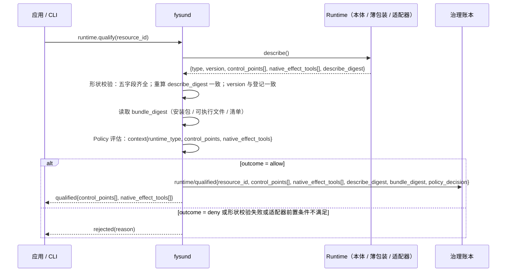
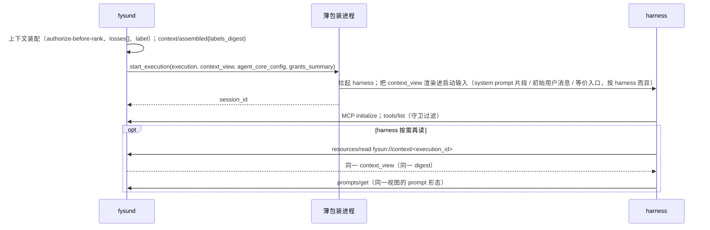
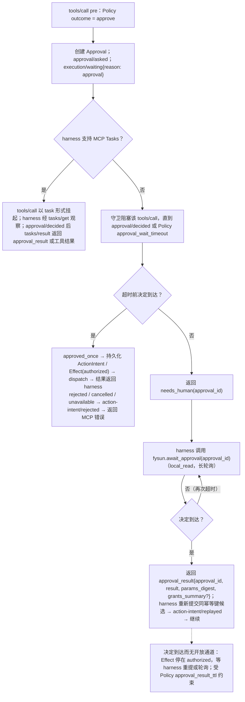

# 07 · Runtime 接入与资格化

- 状态：设计稿 v0.7.0（2026-09-08）
- 变更依据：[v0.7.0 全量重构蓝图](../research/20260908-v0.7.0-refactor-blueprint.md)；[ADR-0002](../adr/0002-protocol-first-runtime-boundary.md)（v0.7.0 修订）、[ADR-0007](../adr/0007-runtime-native-tools-and-conformance-scope.md)、[ADR-0008](../adr/0008-effect-category-and-read-only-determination.md)、[ADR-0011](../adr/0011-approval-result-set-and-approval-surface.md)、[ADR-0012](../adr/0012-mcp-guard-self-implementation.md)
- 前置：[00 术语表](00-terminology.md)、[02 对象模型](02-object-model.md)、[05 Runtime ABI](05-runtime-abi.md)、[06 MCP 守卫规范](06-mcp-guard.md)
- 决策依据：[ADR-0007](../adr/0007-runtime-native-tools-and-conformance-scope.md)（Runtime 原生工具、资格化与 conformance 范围）；[ADR-0002](../adr/0002-protocol-first-runtime-boundary.md)（协议优先的 Runtime 边界）
- 来源：拆分自归档 `docs/archive/v0.6.0/design/05-runtime-and-dsh-integration.md` §1 后半、§5、§6、§7；MCP-only 投递路径、hooks 阻断路径、Runtime 作为通用 Resource 类型与资格化纪元为 v0.7.0 新建

本文回答"一个 Runtime 如何进入 FysunOS、何时被视为可用、何时失效"。它对**任何** Runtime 成立：只实现 Runtime ABI 最小面的 MCP 兼容 harness、
声明控制点的 Runtime（参考实现 `fysun-dsh`，见 [08](08-dsh-adapter.md)）、边缘 Runtime。Runtime ABI 本身（最小生命周期 RPC、六控制点义务、
`os.*`、不得调用清单、A2A）在 [05](05-runtime-abi.md)；MCP 守卫的行为在 [06](06-mcp-guard.md)；本文只写接入、资格化与各类 Runtime 下
OS → Runtime 投递如何落地。

叙述中会用到 00 §1.3 的三个速记：MCP-only Runtime 对应速记 Level-1；声明控制点的 Runtime 对应速记 Level-2；MCP-only 加 hooks.json 阻断路径对应速记 Level-1b。
这些速记不进入任何标识符（00 §1.3 禁令），账本与 API 中只有 `control_points[]` 与 `native_effect_tools[]`。

## 1. Runtime 作为 Resource 类型与资格化纪元

### 1.1 登记：Runtime（已安装）是 Resource 的一种类型

v0.6.0 只对 DSH 登记"已安装 Runtime"；v0.7.0 把它推广为通用 Resource 类型（[02 §2.9](02-object-model.md)，[ADR-0007 §D7](../adr/0007-runtime-native-tools-and-conformance-scope.md)）。
每个已安装的 Runtime 是一条 Resource 记录，由 `resource.register(descriptor)` 登记，产生 `resource/registered`：

| 字段 | 内容 | 说明 |
|---|---|---|
| `resource_id` | Resource id | 多 Runtime 并存的唯一区分键；同一类型的不同版本是不同的 Resource |
| `type` | Runtime 类型（如 `dsh`、`claude-code`、`codex`、`edge-rs`） | 与 `describe().type` 一致 |
| `version` | 精确 revision（commit / tag / 安装清单版本） | 与 `describe().version` 一致；见 §7 钉版 |
| `source` | 来源（仓库 URL、发行渠道、本机路径）与登记者 Principal | 供应链审查用（[13](13-threat-model.md) T2） |
| `bundle_digest` | 安装包 / bundle 的 digest | 无 bundle 的 harness 记其可执行文件或安装清单的 digest；与 `describe_digest` 共同构成资格化纪元 |
| `describe_snapshot` | 最近一次 `describe()` 的返回：`{type, version, control_points[], native_effect_tools[], describe_digest}` | 资格化时刷新 |
| `qualification` | 资格化纪元：生效的 `runtime/qualified` 事件引用，或最近一次 `runtime/disqualified{reason}` | 投影字段，由账本折叠 |
| `attachment` | 进程 / 通道状态：`runtime/attached`（最小生命周期 RPC 通道可达）、`runtime/health`、`runtime/detached` | 与资格化无关：可达不等于已资格化 |
| `health` | `runtime.health()` 的最近结果与时间 | 投影 |

`describe()` 返回签名在 [00 §7](00-terminology.md)、[05 §2](05-runtime-abi.md)、本节、ADR-0002 §D1、ADR-0007 §D1 五处字面一致：

```text
describe() -> {type, version, control_points[], native_effect_tools[], describe_digest}
```

- `describe_digest` = 对 `{type, version, control_points[], native_effect_tools[]}` canonical 编码的 digest，由 Runtime（或其薄包装进程、适配器）计算，
  `fysund` 在资格化时**重算并比对**；不一致 → 拒绝资格化（声明面不自洽）。
- 登记不隐含任何 Grant，也不隐含资格化：`resource/registered` 之后 Runtime 仍不可被 `start_execution` 绑定（沿 ADR-0002 §D6 "组件图不是信任图"）。

### 1.2 `runtime.qualify(resource_id)` 流程



规则：

- `runtime/qualified` 是准入类事件（携带 `policy_decision`，[00 §4](00-terminology.md)）。Policy 的评估输入按 [ADR-0009](../adr/0009-cedar-subset-and-entity-model.md) §D1：
  principal 类型 `Runtime`，context 含 `runtime_type`、`control_points: Set<String>`、`native_effect_tools: Set<String>`。
- `outcome = deny` → 返回 `rejected(reason)`，**不产生 `runtime/qualified`**。资格化只接受 `allow` / `deny` 两种结果：`Approval.subject` 是封闭集合
  （[00 §5](00-terminology.md)），没有"Runtime 资格化"这一 subject，因此 `approve` 与 `modify` 对资格化无意义，一律按 `deny` 处理并在 `rejected(reason)` 中注明
  （fail-closed）；部署者要对某个 Runtime 的接入做人工把关，方式是先不放行、确认后换版 Policy 再 `runtime.qualify`。
- 形状校验失败的三种情形都不得资格化：缺 `native_effect_tools` 字段（空数组是合法值，缺字段不是）；缺 `describe_digest`；`describe_digest` 重算不一致。
- 适配器前置条件（如 `fysun-dsh` 检测到 DSH approval policy 为 `never`，或 bundle 的 `dsh_version` / `schema_digest` 不匹配，[08 §2、§6](08-dsh-adapter.md)）
  在资格化时一并检查，不满足则 `rejected(reason: adapter_precondition_failed)`。
- `runtime.list()` 返回全部已登记 Runtime 及其 `qualification` 投影，供应用与 `capability.match` 使用；`capability.match(id, environment)` 的环境匹配只对
  **有生效 `runtime/qualified`** 的 Runtime 进行。

### 1.3 资格化纪元与 `runtime/disqualified`

一次 `runtime/qualified` 对应一个 `(describe_digest, bundle_digest)` 组合，称为一个**资格化纪元**。纪元结束的四种原因：

| `runtime/disqualified.reason` | 触发 | 谁检测 |
|---|---|---|
| `describe_changed` | 重新 `describe()` 得到的 `describe_digest` 与纪元不一致（Runtime 升级、配置变化使控制点或原生工具集变化） | `fysund` 在 `runtime/attached`、`start_execution` 前、周期 `health` 时重算 |
| `bundle_changed` | 安装包 / bundle / 可执行文件 digest 与纪元不一致 | `fysund` 在 `start_execution` 前与周期检查时重算 |
| `policy_revoked` | Policy 换版后对该 Runtime 的 `native_effect_tools[]` / 类型不再 `allow` | `fysund` 在 `policy/revised` 后对全部已资格化 Runtime 重评估 |
| `adapter_precondition_failed` | 适配器前置条件失效（如 DSH approval policy 被切为 `never`；bundle 校验不过；适配器观察到治理路径被绕过，[08 §2](08-dsh-adapter.md)） | 适配器经 `os.report_failure` 上报，或 `fysund` 在前置检查时发现 |

规则：

- `runtime/disqualified` 之后，该 Resource 的 `start_execution` / `resume_execution` 一律返回 `not_runnable.environment{missing: [qualification]}`（[05 §2](05-runtime-abi.md) 大声失败），
  直到重新 `runtime.qualify` 开启新纪元。
- **正在运行的 Execution 不因 `runtime/disqualified` 被强制终止**：是否继续、暂停或取消由 Activity 子系统按 Policy 决定（[03 §2.2](03-architecture.md)）；
  但其 `runtime_binding.qualification_ref` 指向的纪元已结束，恢复（`resume_execution`）按上一条拒绝。
- 纪元变更是事件，不是覆盖：旧 `runtime/qualified` 保留以解释历史 Execution 的 `qualification_ref`。
- 度量："重新资格化次数"（`runtime/disqualified` 计数）进入 [12 §4](12-mvp-plan.md)。

### 1.4 多 Runtime 并存

- 同一台机器上可并存多个 Runtime（同类型不同版本、不同类型），按 `resource_id` 区分；`Execution.runtime_binding` 记录 `resource_id`、实例（如 `dsh@<version>#<pid>`）、
  `session_id`、`control_points[]`、`native_effect_tools[]`、`qualification_ref`（[02 §2.3](02-object-model.md)）。
- **资格化证据不跨 `resource_id` 转移**：DSH 的 conformance 证据不能用于 Claude Code；DSH 某 revision 的证据不能用于另一 revision（延续 ADR-0002 后果段）。
- Capability `requirements` 与 Policy 都以 `resource_id` / `type` / `control_points[]` / `native_effect_tools[]` 表达约束，不以 00 §1.3 的速记等级表达。

负例（M2a）：

1. `describe()` 缺 `native_effect_tools` 字段却产生 `runtime/qualified` → 失败。
2. `describe_digest` 变化后账本无 `runtime/disqualified` 而 `start_execution` 成功 → 失败。
3. `runtime/qualified` 缺 `native_effect_tools[]`、`describe_digest` 或 `bundle_digest` 任一 → 失败。
4. 已 `runtime/disqualified` 的 Runtime `resume_execution` 成功 → 失败。
5. 账本或资格化投影中出现 Level 字段 → 失败（00 §1.3）。

## 2. `native_effect_tools[]`：原生工具的如实声明

### 2.1 定义

`native_effect_tools[]` = Runtime **内置、不经 MCP 守卫、可产生外部效果**的工具清单。每项至少含 `{tool, effect_category}`，`effect_category` 取
[00 §5](00-terminology.md) 六值之一，作为该工具的缺省类别（Policy 可覆盖，[06 §3](06-mcp-guard.md) 来源 (c)）。典型成员：文件写入 / 编辑（`local_mutation`）、
shell / 命令执行（按最严重用法归 `external_mutation`，[ADR-0008 §D1](../adr/0008-effect-category-and-read-only-determination.md)）、内置网络抓取（`external_read`）、
内置浏览器（`external_mutation`）。只读的原生工具（本地文件读取、目录列举）可以不列，但列出不算错——声明面**宁多勿少**。

这些工具的调用**不经过** `tools/list` 过滤与 `tools/call` pre / post：没有 ActionIntent、没有 Effect、没有 receipt、没有来源标签。F3 / F7 / F9 的机制对它们
不起作用。两个例外路径在本文 §4（hooks 阻断，只能拦不能记）与 [08 §2](08-dsh-adapter.md)（DSH 原生工具经 `approval/request` 拦截 + `tools/post-execute` receipt，能记能拦）。

### 2.2 声明责任与后果

- 声明责任在 Runtime 本体、其薄包装进程或适配器（谁实现 `describe()` 谁负责）。**声明不实的 Runtime 不在 FysunOS 的承诺范围**——这是 [01 §1.1](01-definition-and-principles.md)
  可判定限定的一部分，与 ADR-0002 §D1 "对不可控制的内部机制，Runtime 必须如实声明"同一条原则。
- FysunOS 不能验证声明的完备性（那要求控制 Runtime 的执行语义），只能验证声明的**自洽性**（`describe_digest` 重算）与**稳定性**（纪元）。M2a 验收对基线 Runtime 的原生工具清单做一次人工查证并登记（§3.1）。
- `fysun-dsh` 的 `native_effect_tools[]` 必须如实列出 DSH 原生工具，**不为空**（[08 §2](08-dsh-adapter.md)）；DSH headless 的清单待查证（§3.1）。

### 2.3 Policy 的两种处置

| 处置 | 含义 | 落点 |
|---|---|---|
| (a) 拒绝资格化 | 含特定原生工具（如无沙箱的 shell）的 Runtime 在该 Scope 内不允许运行 | `runtime.qualify` → `rejected`；已资格化的在 Policy 换版后 `runtime/disqualified{reason: policy_revoked}` |
| (b) 允许但降级 conformance | Runtime 可运行；conformance 声明中 F3 / F7 / F9 的范围如实限定为"经 MCP 守卫的工具面" | [13 §6](13-threat-model.md) 按 Runtime 类型分列；本文 §3.7 |

此外：

- Capability `requirements` 可声明"拒绝含特定 `native_effect_tools` 的 Runtime"（[02 §2.1](02-object-model.md)）；`capability.match` 据此把该 Runtime 报为 `not_runnable(missing[])`。
- Policy 评估 Effect 候选时 context 含 `native_effect_tools[]`（[02 §2.12](02-object-model.md)）：部署者可对含无沙箱 shell 的 Runtime 上的 MCP 工具面采取更保守的 `outcome`
  （例如把 `external_mutation` 一律 `approve`）——原生工具不受控时，受控面收紧是合理补偿。Approval 触发率因此在 MCP-only Runtime 下更高，是可接受代价（§8）。

### 2.4 按 Runtime 类型的原生工具处理路径

| Runtime 类型 | 原生工具 | 处理 | conformance 范围（F3 / F7 / F9） |
|---|---|---|---|
| MCP-only harness | 有（Claude Code / Codex / Goose / OpenCode / OpenClaw / Gemini CLI / DSH headless 均含） | 只声明，不受控 | 限经守卫的 MCP 工具面 |
| MCP-only harness + hooks.json | 同上 | 声明 + `fysun hook pre-tool-use` 阻断（§4） | 限经守卫的 MCP 工具面；hooks 贡献只描述为"对原生工具的 Policy 阻断（尽力）" |
| `fysun-dsh`（声明全部六个控制点） | DSH 原生 fs / shell 等 | 声明 + `approval/request` 拦截持久化 ActionIntent + `tools/post-execute` receipt（[08 §2](08-dsh-adapter.md)） | MCP 工具面经守卫；原生工具经拦截路径；依赖 `fysun` profile 禁止 approval policy `never` |
| 边缘 Runtime | 通常无；物理动作以 MCP 工具暴露（§6） | 若有则声明 | 限经守卫的 MCP 工具面 |

负例（M2a）：

6. `native_effect_tools[]` 非空的 Runtime，其 conformance 声明对 F3 标 `implemented` 且未限定范围 → 失败（文档一致性检查）。
7. Capability `requirements` 声明拒绝某原生工具，`capability.match` 仍对含该工具的 Runtime 返回 `runnable` → 失败。

## 3. MCP-only Runtime 的直接接入

本节对应速记 Level-1。

### 3.1 候选清单与 M2a 基线

| Runtime | 地位 | 原生工具 | 备注 |
|---|---|---|---|
| DSH headless 模式 | **M2a 验收基线**（[ADR-0007 §D8](../adr/0007-runtime-native-tools-and-conformance-scope.md)） | 待查证 | 与 M2b 的 `fysun-dsh` 共享同一上游钉版与 CI；查证项"需查证 DSH headless 是否有独立于 bundle 的原生工具"登记于 [12 §7](12-mvp-plan.md)；查证前按 `dsh-base` 缺省工具集如实声明（宁多勿少），查证后修订。细节见 [08 §3](08-dsh-adapter.md) |
| Claude Code | 候选 | 有（文件编辑、shell、网络等） | 支持 hooks.json PreToolUse，可叠加 §4 路径 |
| Codex | 候选 | 有 | 支持 hooks.json PreToolUse，可叠加 §4 路径 |
| Goose / OpenCode / OpenClaw / Gemini CLI | 候选 | 有 | 接入时须按 §2 声明 |

候选不是验收对象；任何候选接入时都要走 §1 的登记与资格化，并对其原生工具清单做一次查证登记。它们也可以继续作为 DSH 内的委派目标
（`fysun-subagent` 经 DSH 的 Codex / Claude Code / ACP provider 执行，[08 §2](08-dsh-adapter.md)），此时被 OS 视为 Handoff 的执行载体，其内部状态留在远端进程，
OS 只记录 Handoff 状态迁移与 deliverables。

### 3.2 接入形态：`fysund` 为唯一 MCP server + 薄包装进程

```text
fysund ──── MCP（stdio / Streamable HTTP）────▶ harness（MCP 客户端）
  │  fysun-mcp-guard：tools/list 过滤 · tools/call pre / 执行 / post · tasks · elicitation
  │  资源与提示：resources/read fysun://context/<execution_id> · prompts/get
  │  守卫系统工具：fysun.await_approval · fysun.pending_inputs
  │
  └── 最小生命周期 RPC（stdio JSON-RPC）──▶ 薄包装进程 ──拉起 / 恢复 / 取消──▶ harness 进程
                                              │ describe()：type / version / control_points = [] / native_effect_tools[] / describe_digest
                                              │ start_execution：渲染 context_view 进启动输入
                                              │ deliver_input：在 turn 边界投递
                                              └ health()：harness 进程存活与 MCP 连接状态
```

- harness 把 `fysund` 配为**唯一** MCP server，或 `fysund` 前置在其配置的所有 MCP server 之前；下游工具 server 由 `fysund` 代为连接，harness 不直接持有工具连接
  （[06 §1、§8](06-mcp-guard.md)）。
- 最小生命周期 RPC 可由 harness 本体实现（若其提供等价的进程外驱动接口），否则由一个**薄包装进程**提供。薄包装进程的职责封闭为：
  实现 `describe()` 并如实声明该 harness 的原生工具；`start_execution` / `resume_execution` 时拉起或重连 harness 并渲染 context_view（§3.3）；
  `cancel` 时终止 harness 进程或会话；`deliver_input` 按 §3.4 / §3.5 投递；`checkpoint()` 返回 `unsupported`；`health()`。
  薄包装进程**不是** Runtime 会话账本的拥有者，也不做任何准入判定；它不在 TCB 内，其声明受 §2.2 约束。
- `describe().control_points` 为空数组：MCP-only Runtime 不声明任何控制点。`Execution.runtime_binding.session_id` 记薄包装进程返回的会话标识
  （harness 自身的 session id 若可得，否则为薄包装生成的句柄）。
- `resume_execution` 对 MCP-only Runtime = 以新 session 重新拉起 harness，把 context_view（含 `Activity.continuity` 与 OS 侧 Effect / Approval 水位摘要）作为初始投递；
  不承诺 harness 内部状态恢复（[05 §2](05-runtime-abi.md) `checkpoint()` 返回 `unsupported` 的后果）。

### 3.3 context_view 渲染路径（`start_execution`）

MCP-only harness 没有接收 OS 推送的入口；`start_execution(execution, context_view, agent_core_config, grants_summary)` 中的 context_view 按以下路径进入模型输入：



规则：

- **渲染责任在薄包装进程**：把 context_view 的结构部分（`trusted_system`）与片段（各自 `label`）渲染为 harness 可接受的启动输入。渲染是格式转换，
  不得增删片段、不得改写 `label`；渲染结果的 digest 由薄包装回报（`os.report_progress` 的 `summary` 字段或 `start_execution` 返回值的扩展字段），
  供跨账本定位。
- **同一视图的第二入口**：`fysund` 以 MCP `resources/read`（URI `fysun://context/<execution_id>`）与 `prompts/get` 暴露**同一** context_view（同一 digest），
  供 harness 在 compaction 后或长会话中按需再读。`resources/read` 归 `local_read`，产生 `audit/observed{path: guard}`。
- `context/assembled{labels_digest}` 照常记录；`resume_execution` 时重新装配并重新记录。
- **conformance 声明："仅初始投递，不保证每步刷新"**。每步刷新（在每个 step 前注入最新受控视图）需要 `context_injection` 控制点，MCP-only Runtime 没有；
  Policy 若要求某 Capability "每步注入"，`capability.match` 对 MCP-only Runtime 报 `not_runnable(missing: [context_injection])`。
- 来源标签：Effect 候选参数的标注责任在 MCP-only 下由 OS 承担——守卫按参数值与 context_view 片段 / 工具结果匹配**尽力标注**，无法归因的参数值记
  `untrusted_external`（fail-closed，[02 §2.15](02-object-model.md)）。

### 3.4 `deliver_input(approval_result)` 投递路径

Policy `outcome = approve` 时 `fysund` 创建 Approval、写 `approval/asked`，Execution 进入 `waiting{reason: approval}`、Activity 进入 `input_required`。
决定（`approval/decided`）如何到达一个只有 MCP 客户端的 harness，按优先级三条路径：



规则：

- **优先路径 = MCP Tasks**：harness 支持 `tasks/*` 时，`needs_human` 的 `tools/call` 以 task 挂起，`tasks/get` 读到 Effect / Approval 状态，`approval/decided` 后
  `tasks/result` 返回；`tasks/cancel` 使 Approval `cancelled`（subject 消失），不撤销已进入世界的效果（[06 §6](06-mcp-guard.md)）。
- **次优路径 = 守卫阻塞**：守卫把该 `tools/call` 挂起到决定到达或 Policy `approval_wait_timeout`；超时返回 **`needs_human(approval_id)`** 错误（不是成功），
  harness 据此调用守卫系统工具 **`fysun.await_approval(approval_id)`**（`local_read`，长轮询，[06 §7](06-mcp-guard.md)）继续等待。`approval_wait_timeout`
  应短于 harness 自身的工具调用超时，否则 harness 会把等待当作工具失败。
- **决定载荷**：无论哪条路径，harness 只收到 `approval_result{approval_id, result, params_digest, grants_summary?}`——不含 `decided_by`、`reason`、`presentation`、`options`
  （[ADR-0011 §D4](../adr/0011-approval-result-set-and-approval-surface.md)）。`result = approved_once` 时 harness 以同幂等键重提候选，命中 `action-intent/replayed`
  并沿 Effect 状态继续；`modify(params)` 的结果也是 `approved_once`，`params_digest` 为改写后的 digest，harness 须以改写后参数重提（否则同键不同参数
  → `conflict.idempotency`，[06 §4](06-mcp-guard.md)）。`rejected / cancelled / unavailable` → 候选 `action-intent/rejected`，harness 收到与 `denied.policy` 同形状的 MCP 错误。
- **决定到达而无开放通道**（harness 已放弃等待、未调用 `fysun.await_approval`、或进程重启）：Effect 停在 `authorized`，直到 harness 重新提交同幂等键候选
  （命中 `action-intent/replayed`，直接 dispatch）或轮询。这个等待受 Policy **`approval_result_ttl`** 约束：超期后放行作废——`fysund` 按该 Approval 的 `on_expiry`
  语义处置：`deny`（缺省）→ `fysund` 以 `effect/reconciled`（对账结论"未分发、无外部效果"）关闭该 Effect，之后同幂等键候选按新候选重新准入（可能再次 `approve`）；
  `keep_waiting` / `escalate` → 放行保持有效直至 Execution 终止或 Approval 被 `cancelled`。放行作废不产生第二条 `approval/decided`（配对规则不变）。
- **审批面不在 harness 内**：以上三条路径都是 OS → Runtime 的**投递**，不是审批面；决定只能来自 `fysund` 的 Web UI / CLI / `fysund` 发起的 `elicitation/create`
  （[ADR-0011 §D5](../adr/0011-approval-result-set-and-approval-surface.md)）。若 harness 支持 elicitation，`fysund` 可以在同一 session 内发起 elicitation 作为审批载体
  （应答绑定 session Principal），此时"审批面"与"投递"在同一连接上，但对象语义不变；Policy 可对特定 subject 强制带外。harness 的文本输出永不构成审批面（T11）。
- Execution 在整个等待期间为 `waiting{reason: approval}`；`execution.observe` 返回该 `reason`。

### 3.5 `deliver_input(message | event | handoff_result)` 投递路径

非审批类输入（用户消息、Activity 触发事件、Handoff 的 deliverables 到达）没有 MCP 原生的 server → client 推送语义，按以下两种方式落地：

| 方式 | 机制 | 适用 |
|---|---|---|
| 薄包装在 turn 边界投递 | `fysund` 调 `deliver_input`，薄包装进程把载荷渲染为 harness 的下一条用户消息（`message` 带原 `label`；`event` / `handoff_result` 为 `trusted_system` 结构 + 引用的 Artifact 带各自 `label`），在 harness 当前 turn 结束后投入 | 薄包装能观察 harness 的 turn 边界（stdio 交互式 harness、有会话 API 的 harness） |
| harness 主动拉取 | harness 调用守卫系统工具 **`fysun.pending_inputs()`**（`local_read`，[06 §7](06-mcp-guard.md)），一次性取走待投递队列；`fysund` 记 `audit/observed{path: guard}` | 薄包装观察不到 turn 边界，或 harness 以工具轮询为主循环 |

规则：

- **conformance 声明："尽力、下一 turn 边界"**——不保证在当前 turn 内送达，不保证顺序早于 harness 自己的下一步。需要实时投递的 Capability 应在 `requirements` 中要求
  `context_injection` 控制点。
- 投递队列由 `fysund` 持有（`fysund` 是 `deliver_input` 的发起方，队列是其内部状态），薄包装进程与 `fysun.pending_inputs` 是两种消费方式；同一载荷只被消费一次。
- `handoff_result` 的 deliverables 只含 Artifact 引用与 `summary`（≤ 4096 字节脱敏，[02 §2.8](02-object-model.md)），正文由 harness 按需经守卫读取 Artifact。
- Execution 等待此类输入时为 `waiting{reason: input}`；投递后回到 `running`。

### 3.6 守卫系统工具

`fysund` 在 `tools/list` 中向每个 harness 暴露两个系统工具（[06 §7](06-mcp-guard.md)）：

| 工具 | 类别 | 语义 |
|---|---|---|
| `fysun.await_approval(approval_id)` | `local_read` | 长轮询等待该 Approval 的 `approval/decided`；返回 `approval_result{approval_id, result, params_digest, grants_summary?}`；只能查询本 Execution 名下的 Approval |
| `fysun.pending_inputs()` | `local_read` | 拉取并清空本 Execution 的待投递 `message / event / handoff_result` 队列 |

它们不受 Capability `allowed-tools` 限制（否则每个 Capability 都得重复声明），但受 Policy 控制（部署者可禁用）；每次调用产生 `audit/observed{path: guard}`。
前缀 `fysun.*` 与 OTLP 命名空间 `fysun.*` 是不同域（[03 §8](03-architecture.md)）。

### 3.7 关联面与 conformance 范围

- MCP-only Runtime 的会话账本可能不可访问；跨账本关联面退化为 **`tools/call` 配对 + `audit/observed`**（每个非快路径 `tools/call` 对应一个 Effect，每个 `local_read`
  快路径调用对应一条 `audit/observed`，[03 §4](03-architecture.md)、[05 §6](05-runtime-abi.md)）；跨账本 replay 只对 Effect 与工具结果配对，不对模型消息定位。
- conformance（[13 §6](13-threat-model.md) "MCP-only（含 `native_effect_tools`）"列）：F3 / F7 / F9 **限经守卫的 MCP 工具面；原生工具不在范围**；context_view "仅初始投递"；
  `deliver_input` "尽力、下一 turn 边界"；F5 见 §5。状态用语只用 `specified / implementation available / test executed / implemented`。

负例（M2a）：

8. MCP-only Runtime 的 conformance 声明含"每步上下文注入"或"实时投递" → 失败。
9. `approval_wait_timeout` 超时后守卫返回成功而非 `needs_human(approval_id)` → 失败。
10. `fysun.await_approval` 返回的载荷含 `decided_by` 或 `reason` → 失败。
11. `result = approved_once` 且 `params_digest` 为改写后 digest，harness 以原参数重提被放行 → 失败（应 `conflict.idempotency`）。
12. 一条 `deliver_input(message)` 被薄包装投递且被 `fysun.pending_inputs` 再次返回 → 失败（重复消费）。
13. context_view 渲染结果与 `fysun://context/<execution_id>` 返回的视图 digest 不一致 → 失败。
14. harness 的文本输出"已批准"导致 `approval/decided` → 失败（T11，NV-T11-01）。

## 4. hooks.json 阻断路径

本节对应速记 Level-1b，规范正文在 06 §9，此处只写接入与定位。

### 4.1 接入

对支持 hooks.json 的 harness（Claude Code / Codex / DSH 兼容的 PreToolUse command hook 格式），部署者在 harness 的 hooks 配置中把 `PreToolUse` 指向 CLI 子命令
**`fysun hook pre-tool-use`**（示意，字段名以各 harness 文档为准）：

```json
{
  "hooks": {
    "PreToolUse": [
      { "matcher": "*", "hooks": [ { "type": "command", "command": "fysun hook pre-tool-use" } ] }
    ]
  }
}
```

命令从 stdin 读取 harness 传入的工具调用载荷（工具名、参数、会话标识）→ 经 `fysund` 本地 RPC 提交 → `fysund` 以 `execution_id`（由薄包装在拉起 harness 时注入环境）
定位 Execution → 类别合成 + Policy 评估 → `deny` 时**退出码 2**（harness 阻断本次调用），其余退出码 0（放行 = abstain）。`fysund` 不可达时退出码 2（fail-closed）。

### 4.2 能力边界

| 能做 | 不能做 |
|---|---|
| 对原生工具调用 deny 或 abstain | 持久化 ActionIntent、产生 Effect、采集 receipt |
| 账本留痕：deny → `action-intent/rejected{reason: denied.policy, path: hook}`（准入类，带 `policy_decision`）；abstain → `audit/observed{path: hook, verdict: abstain}`（非准入类） | `modify` 参数；触发 Approval（hook 是同步阻断，无等待语义；Policy 对该候选产出 `approve` 或 `modify` 时 hook 只能 abstain 并在 `audit/observed{path: hook, verdict: abstain}` 附 `outcome` 留痕，不能放行"等审批后再执行"的语义，[06 §9](06-mcp-guard.md)） |
| 对 MCP 工具面之外的原生工具提供尽力阻断 | 打来源标签；看到工具结果；替代守卫——对经守卫的 MCP 工具，hooks 判定只是 Runtime 内部意见（[05 §5](05-runtime-abi.md)） |

除上述两种事件外，hooks 路径**不得**产生任何其他准入类事件。

### 4.3 定位：仅阻断原生工具，不计入 conformance 主路径

- hooks 路径只对 `native_effect_tools[]` 中的工具有意义；MCP 工具已经过守卫，对它们再挂 hook 是冗余判定。
- **不计入 conformance 主路径**（[ADR-0007 §D3](../adr/0007-runtime-native-tools-and-conformance-scope.md)）：hook 由 harness 进程调用，harness 可被配置绕过；
  hook 失败时 harness 的缺省行为不受 `fysund` 控制；hook 看不到工具结果。13 §6 "MCP-only + hooks"列只把 hooks 的贡献描述为"对原生工具的 Policy 阻断（尽力）"，
  不据此把 F3 / F7 / F9 的范围扩大到原生工具。
- 多个 hooks 路径并存（harness 自带 + `fysun hook`）的先后与冲突处置待有第二个实例再定（ADR-0007 待后续段）。
- M2a 中 hooks 路径为**可选项**，不阻塞 M2a 验收。

负例（M2a，可选项）：

15. hooks 路径的 deny 被记为 `action-intent/rejected` 以外的准入类事件（如 `effect/authorized`） → 失败。
16. 设计文档或 conformance 声明把 hooks 路径描述为"安全边界"或据此对原生工具宣称 F3 → 失败。
17. `fysun hook pre-tool-use` 在 `fysund` 不可达时退出码为 0 → 失败。
18. hooks 判定被当作守卫放行，导致一次非快路径 MCP `tools/call` 无 `action-intent/recorded` → 失败（NV-T9-03）。

## 5. F5 在 MCP-only Runtime 下的限定与部署指引

### 5.1 范围

F5 "secret 隔离"的范围定为：**OS 管理的 secret 与经 `fysund` 代理的 Provider**（[00 §6](00-terminology.md)，[ADR-0007 §D4](../adr/0007-runtime-native-tools-and-conformance-scope.md)）。
在此范围内表述不变：明文只进 Secret Store 与批准的非日志输入路径，Runtime 只见 `SecretRef`（三规则：每次操作重解析、描述面无值槽、空值即未配置）。

**harness 自持的模型凭据**（其配置文件或环境变量中的 API key，直连 Provider）不在 F5 范围：`fysund` 看不到这些请求，无法注入、计量或撤销。
[13 §4](13-threat-model.md) "明确不防"登记"harness 自持模型凭据外泄"。

### 5.2 部署指引（部署者选择，不是资格化前提）

1. 把 harness 的 OpenAI 兼容 base URL 指向 `fysund` 的 Provider 代理端点；harness 侧的 API key 字段填入 `fysund` 为该 Execution 签发的本地代理凭据（不是 Provider 凭据）。
   Provider 凭据只在 `fysund` 注入，请求进入 F5 范围并被计量（Token / 费用进入 `resource/metered`）。
2. harness 需要的其他凭据（下游 MCP server、外部 API）不配置在 harness 内：下游 MCP server 由 `fysund` 代为连接并注入 `SecretRef`（[06 §8](06-mcp-guard.md)）；
   harness 直接访问外部 API 属原生工具行为，在 F5 范围外。
3. 对原生工具能读取的位置（工作区、环境变量）不放置任何 secret 明文；这是 §2 原生工具不受控的直接后果。
4. 对含无沙箱 shell 的 harness，Policy 可选择处置 (a) 拒绝资格化（§2.3）。

负例（M2a）：

19. 设计文档或 conformance 声明对 MCP-only Runtime 宣称"所有模型请求经 `fysund` 代理"而未附部署前提 → 失败。
20. `resource.describe` / `tools/list` 中出现可放明文的字段（描述面值槽） → 失败。

## 6. 边缘 Runtime

- 边缘 Runtime（Rust / Python）只需 **MCP 客户端 + 最小生命周期 RPC**；决策核心可以是本地小模型、规则模块或远端调用；`checkpoint()` 可返回 `unsupported`。
  这是 OS ≠ DSH 的直接理由：Node 依赖不适合部分边缘设备（§8）。
- 边缘节点运行 `fysund-edge`（同一账本模型的精简 daemon，内含确定性包络校验器）与边缘 Runtime；边缘 Runtime 把 `fysund-edge` 配为唯一 MCP server，
  物理动作以 MCP 工具暴露并在目录登记为 `physical_action`，绑定安全包络 Policy（[11 §2](11-edge-and-offline-ledger.md)）。边缘 Runtime 通常没有原生工具；若有（如内置串口写入），按 §2 声明。
- 边缘 Runtime 与中心 Runtime 之间通过 Handoff 与产物引用协作，不承诺进程或模型状态迁移；离线期间的账本行为见 [11 §3](11-edge-and-offline-ledger.md)（escrow Grant、`approve` 一律阻塞、`ledger/merged`）。
- 每个边缘 Runtime 按 §1 独立登记与资格化（`resource_id` 含 `node_id` 归属）；资格化由中心节点完成（Approval 与 Policy 的 home 恒为中心），
  `runtime/qualified` 事件带 `node_id`。
- conformance（13 §6 "边缘 Runtime"列）：范围同 MCP-only；物理 Effect 的额外字段与包络校验见 11。

## 7. 通用钉版与 CI 漂移预警

- **任何 Runtime 以精确 revision + digest 登记**：`version` 为 commit / tag / 安装清单版本，`bundle_digest` 为安装包 / 可执行文件 / bundle 的 digest（§1.1）。
  "同一版本号、不同 digest"是两个 Resource；升级 = 新 `resource_id` 或同 `resource_id` 的新纪元（`runtime/disqualified{reason: bundle_changed}` → 重新 `runtime.qualify`）。
- 破坏性变更时先在隔离环境跑适配测试与 conformance，再切换钉版；切换是一次 `runtime.qualify`，不是配置覆盖。
- **CI 漂移预警**：每个适配器（首先是 `fysun-dsh`，[08 §6](08-dsh-adapter.md)）与每个薄包装进程的 CI 每日对上游**最新 tag**（DSH 为最新 alpha）跑 conformance 套件，
  结果作为**非阻塞**漂移预警：预警不改变钉版、不阻塞发布，只登记"上游第 N 天起 X 项不通过"，供决定何时升级。conformance 套件即 [13 §6](13-threat-model.md) 的负例集。
- Agent Skills 包（实现包）以**来源登记 + digest + `allowed-tools` 上界**登记；任何 Runtime 侧自行加载的 skills 目录不绕过这一登记（供应链威胁见 13 T2）。
- 许可证与不 vendor / 不 fork 的约束按 Runtime 各自登记（DSH / Cordis 见 08 §6）。

负例：

21. 已登记 Runtime 的 `bundle_digest` 变化后 CI 或 `fysund` 未产生 `runtime/disqualified{reason: bundle_changed}` → 失败。
22. CI 漂移预警不存在或以阻塞方式阻止 `fysun-dsh` 发布 → 失败（前者为 M2b 验收项，后者违反"非阻塞"定位）。

## 8. 代价与对策

| 代价 | 对策 |
|---|---|
| 双账本的关联与 replay 复杂度 | 关联字段固定；跨账本 replay 测试进入 MVP 验收；MCP-only 下关联面退化为 `tools/call` 配对 + `audit/observed`（§3.7） |
| 进程外 broker 延迟 | `local_read` 走审计快路径；Effect 协议只在 `external_read` 及以上 |
| MCP 守卫引入的每次 `tools/call` 往返 | `local_read` 快路径；同类候选批量提交与批量审批（`batch_ref`） |
| MCP-only 下 context_view 只能初始投递、输入只能 turn 边界投递 | 如实声明；需要每步注入或实时投递的 Capability 在 `requirements` 要求 `context_injection`，`capability.match` 大声报缺 |
| MCP-only 下原生工具不受控，Approval 触发率更高 | Policy 处置 (a)/(b)（§2.3）；hooks 阻断作补充（§4）；`approval_rate_limit` 防轰炸 |
| 资格化纪元使每次 Runtime 升级都要重新 `runtime.qualify` | 纪元是可判定边界，换来 `qualification_ref` 可解释；CI 漂移预警提前暴露不兼容（§7） |
| Runtime 破坏性变更 | 精确钉版；适配测试；升级前隔离验证；每日非阻塞漂移预警 |
| Node 依赖不适合部分边缘设备 | 这正是 OS ≠ DSH 的理由；边缘 Runtime 只需 MCP 客户端 + 最小 RPC（§6） |

MCP 守卫的实现形态已由 [ADR-0012](../adr/0012-mcp-guard-self-implementation.md) 关闭（自实现，借用 agentgateway `Pass` / `Reject` / `Mutated` 语义与 Cedar 格式），不再是代价项。

## 9. 负例索引

本文负例 1–22 按里程碑归属：1–14、19、20 → M2a；15–18 → M2a 可选项（hooks）；21、22 → M2b。威胁向量编号（`NV-T9-03`、`NV-T9-04`、`NV-T11-01` 等）与本文负例的对应
在 [13 §5](13-threat-model.md) 维护；里程碑验收清单在 [12 §3](12-mvp-plan.md)。
