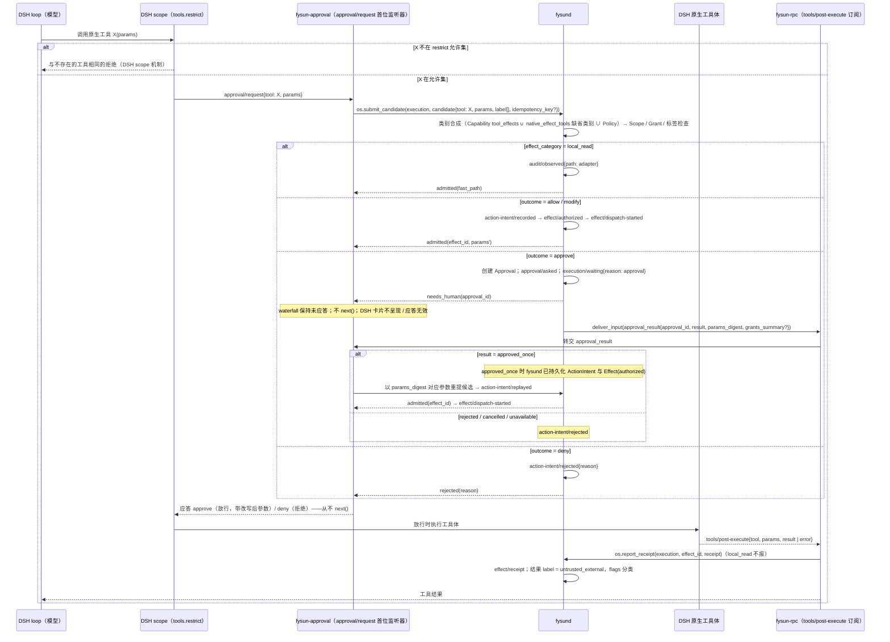

# 08 · DSH 参考适配器 `fysun-dsh`

- 状态：设计稿 v0.7.0（2026-09-08）
- 变更依据：[v0.7.0 全量重构蓝图](../research/20260908-v0.7.0-refactor-blueprint.md)；[ADR-0001](../adr/0001-founding-decisions.md)、[ADR-0002](../adr/0002-protocol-first-runtime-boundary.md)（v0.7.0 修订）、[ADR-0007](../adr/0007-runtime-native-tools-and-conformance-scope.md)、[ADR-0011](../adr/0011-approval-result-set-and-approval-surface.md)、[ADR-0012](../adr/0012-mcp-guard-self-implementation.md)
- 前置：[00 术语表](00-terminology.md)、[02 对象模型](02-object-model.md)、[05 Runtime ABI](05-runtime-abi.md)、[06 MCP 守卫规范](06-mcp-guard.md)、[07 Runtime 接入与资格化](07-runtime-onboarding.md)
- 决策依据：[ADR-0002 §D5 / §D6](../adr/0002-protocol-first-runtime-boundary.md)（DSH 为声明全部六个控制点的参考适配器；内部适配器生命周期）、[ADR-0011 §D5](../adr/0011-approval-result-set-and-approval-surface.md)（`approval/request` 拦截、审批面只由 `fysund` 提供）、[ADR-0007 §D1 / §D8](../adr/0007-runtime-native-tools-and-conformance-scope.md)（`native_effect_tools[]`、M2a 基线 = DSH headless）
- 基线：DeepSeek Harness 本机只读副本 `cd5ef8148158c3a752a658978873241fdf8e2bbc`；Cordis 为上游 cordis 4.0.0-rc.7（DSH vendored；DSH 清单版本 4.0.1），上游最新 v4.0.0-rc.9（见 [来源登记](../research/sources.md)）
- 来源：拆分自归档 `docs/archive/v0.6.0/design/05-runtime-and-dsh-integration.md` §1–§5；附录 A 迁自归档 `docs/archive/v0.6.0/design/04-abi.md` 附录 A

本文只写 DSH 这一个 Runtime 的适配：定位、组件、DSH 原生工具的治理路径、headless 模式、双账本关联、不吸收项、钉版、`guard/` 包消歧与 Cordis 生命周期映射。
对任何 Runtime 都成立的登记、资格化、原生工具声明、MCP-only 投递路径与 hooks 阻断路径在 [07](07-runtime-onboarding.md)，本文不重复。

## 1. 为什么 DSH 是参考适配器而不是 OS、也不是唯一 Runtime

DSH 的设计哲学（其文档原文）："不存在需要打补丁的特权内核"、"一切皆插件"、"模型可见即已记录"（append-only session log 是真源）、能力以 seam
（Definition / Provider / Consumer）表达可替换性、profile / bundle / patch 逐层叠加。它的安全立场克制而诚实：未经审计、沙箱不保证隔离、审批一次性且 turn 级、
动态 Cordis 包是临时实验且 VM 不是安全边界、schedule 仅为 session-local 提醒、goal 恢复后需人工 re-arm。

这恰好把 FysunOS 的职责边界勾出来了：

| 重建版概念 | DSH 现状 | 结论 |
|---|---|---|
| 决策核心（loop、prompt、工具选择、继续 / 停止） | 完整 | **直接用** |
| Runtime（执行引擎及适配） | 完整：subagent 六种 provider、sandbox、subprocess、terminal、e2b、Web UI、sdk / acp、headless | **直接用** |
| Resource | 有 seam（`ctx.llm`、`ctx.credentials`、`ctx.skills`、token meter），进程本地，凭据由 provider 持有 | 换 provider，接到 OS |
| Activity / Execution（跨会话、跨进程、跨 Runtime） | goal 同会话且需人工 re-arm、armed 不持久化；schedule session-local；Teams 身份是 Root SessionId、凭据是"exact live Agent" | **OS 拥有** |
| Capability 契约与可移植性 | seam 是进程内实现可替换；无跨 Runtime 契约、无环境匹配 | **OS 拥有** |
| 权威底线（Grant、ActionIntent / Effect、独立验证、secret 隔离、Approval、Policy） | 无，且明确不做；approval policy / sandbox mode 以会话日志最后一条事件为真源 | **OS 拥有** |
| 原生工具（fs、shell 等） | 完整，经 DSH 自己的 tools 流水线与 `approval/request` waterfall | 保留；经拦截路径治理（§2.3） |

把权威层放进 DSH 进程，会让它与模型驱动的工具执行、可自我修改的动态 Cordis 包同居——Cordis 论文把"自演化 harness 运行中替换自身组件"列为动机场景。
这与 F1–F5 直接冲突。DSH 又处于 developer preview、明言破坏性变更、单语言 Node；把 OS 身份绑在它上面等于放弃边缘 Runtime 的可能。

两条 v0.7.0 补入的事实（外部调研，[来源登记](../research/sources.md)）：

- **DSH 与 Cordis 是同一批作者（shigma、tianyicui）**，Cordis 的 rc 变更直接传导到 DSH；DSH 每 1–3 天发布一个 alpha。这是 §6 "精确钉 revision、而非钉版本号"
  与"每日漂移预警"的直接依据：上游节奏比任何合理的适配周期都快，只能钉住并观测，不能跟随。
- **Cordis `isolate` 只是服务名的命名空间符号，不是安全隔离**。它解决的是同名服务在不同 scope 下的并存，不提供任何权限、内存或进程边界；
  `fysun-dsh` 内部对 Cordis 生命周期的映射（附录 A）不得把 `isolate` 当作 quarantine 或 containment 的实现。

v0.5.0 通过 7 个 DSH 私有 seam / 扩展点接入（`ctx.credentials`、`ctx.approval`、`ctx.sessionPersistence`、`ctx.subagents`、`tools/pre-execute` waterfall、
`agent/pre-step`、`sdk` profile）。这使 [01 §1.1](01-definition-and-principles.md) "同一能力在任意 Agent 实现中运行"的承诺在实现路径上等价于"愿意实现 fysun bundle 的 Runtime"
——而 Claude Code、Codex、Goose、OpenCode、OpenClaw、Gemini CLI 都没有这些 seam，却都有 MCP 客户端。协议优先后（ADR-0002），承诺变为可判定：任何实现 Runtime ABI
最小面（MCP 客户端 + 最小生命周期 RPC）的 Runtime。

因此：**DSH = 声明全部六个控制点的参考适配器 `fysun-dsh`；FysunOS = 权威 + 活动 + 能力；任何 MCP 兼容 harness 都可作为 MCP-only Runtime 接入（[07 §3](07-runtime-onboarding.md)），
DSH headless 模式本身就是 M2a 的 MCP-only 基线（§3）。**

## 2. 接入形态：`fysun-dsh` 适配器

### 2.1 组件

技术形态仍是叠在 `dsh-base` 之上的 bundle，配一个 `fysun` profile；隔离子进程、不 fork、不 vendor、不进程内链接（ADR-0001 §D2 保留部分）。组件按 Runtime ABI 三块归类：

```text
dsh --profile fysun
  = dsh-base
  + fysun-dsh 适配器
      (a) MCP 守卫路径
      │     DSH 的 MCP 客户端配置：fysund（fysun-mcp-guard）为唯一 MCP server
      │     （v0.5.0 的 fysun-tool-gate 作为独立组件取消；MCP 工具面由守卫承担）
      (b) 控制点适配器（六个控制点全部声明）
      ├── fysun-credentials     替换 ctx.credentials provider（SecretRef / Provider 代理）
      ├── fysun-approval        在 approval/request waterfall 拦截、不 next()、全部转 fysund；
      │                         同时是 DSH 原生工具的 ActionIntent 持久化点（§2.3）
      ├── fysun-session-link    旁挂 ctx.sessionPersistence provider（session_link / compaction_hook）
      ├── fysun-context         订阅 agent/pre-step（context_injection；每次注入写一条会话事件）
      ├── fysun-subagent        新增 ctx.subagents provider（subagent_delegation → Handoff）
      (c) 最小生命周期 RPC
      └── fysun-rpc             经 sdk profile 实现最小生命周期 RPC（OS → Runtime）；
                                订阅 tools/post-execute 作为原生工具 receipt 采集点（§2.3）
```

| 类别 | 组件 | 说明 |
|---|---|---|
| (a) MCP 守卫路径 | （无适配器组件） | DSH 把 `fysund` 配为唯一 MCP server；MCP 工具的 `tools/list` / `tools/call` 经 MCP 守卫（[06](06-mcp-guard.md)）；`fysun-tool-gate` **作为独立组件取消**，其 v0.5.0 职责（工具面门控）由守卫承担，原生工具部分由 `fysun-approval` 拦截点承担 |
| (b) 控制点适配器 | `fysun-credentials` | `ctx.credentials` provider 只返回 `SecretRef`（三规则：每次操作重解析、描述面无值槽、空值即未配置）；`ctx.llm` 的 Provider 请求经 `fysund` 代理，明文只在 `fysund` 注入——因此 `fysun-dsh` 下模型请求在 F5 范围内（与 MCP-only harness 自持凭据的差别，[07 §5](07-runtime-onboarding.md)） |
| | `fysun-approval` | **在 DSH `approval/request` waterfall 拦截、不 `next()`、全部转给 `fysund`**：`fysund` 是唯一 answerer；按 Grant 与 Policy 可自动放行 / 拒绝的即时应答；需人工的保持 waterfall 未应答直到 `deliver_input(approval_result)` 到达；**无策略即 fail-closed**（拒绝）。DSH 自身审批卡片失效——用户在卡片上的点击不落账、不解除阻塞，审批 UI 由 `fysund` 提供（Web UI / CLI / `fysund` 发起的 elicitation）。此拦截点同时是 DSH 原生工具的 ActionIntent 持久化点（§2.3） |
| | `fysun-session-link` | 实现 `session_link` 控制点：提交 `session_id / execution_id / causation_id / fencing_epoch` 与会话水位；compaction 前后报告水位（`compaction_hook`） |
| | `fysun-context` | 实现 `context_injection` 控制点：在 `agent/pre-step` 注入 OS 装配的受控上下文视图，片段带 `label`；**每次注入在 DSH 会话日志写一条会话事件（含 `context_view.digest`）**，否则跨账本 replay 无法定位（[05 §3](05-runtime-abi.md)，M2b 验收） |
| | `fysun-subagent` | 实现 `subagent_delegation` 控制点：委派产生 Handoff 与子 Execution（可仍由 DSH in-process / ACP / Codex / Claude Code provider 实际执行）；**只上报 Handoff 状态迁移与 `deliverables`**（`summary` ≤ 4096 字节脱敏），Agent Teams 的 roster / mailbox / task DAG 留在 DSH 会话账本，经 `session_link` 关联 |
| (c) 最小生命周期 RPC | `fysun-rpc` | `describe / start_execution / resume_execution / cancel / deliver_input / checkpoint / health` 的 DSH 实现；`checkpoint` 与 `fork` 控制点经 DSH 的 session fork / resume 实现；**订阅 `tools/post-execute`** 采集原生工具 receipt 并回填（§2.3） |

`fysun-dsh` 在 `describe()` 中声明的 `control_points[]`：`context_injection`、`checkpoint`、`fork`、`compaction_hook`、`session_link`、`subagent_delegation`（六个全部）。

DSH 保持原样运行其 loop、prompt、compaction、session log、Web UI（审批卡片除外：在 `fysun` profile 下失效）。FysunOS 不改写 DSH 源码；升级 DSH 时维护的是这个适配器
与一组适配测试（§6）。

### 2.2 DSH 扩展点与 ABI 的对应

| DSH 扩展点 | FysunOS 接入 | 对应 ABI |
|---|---|---|
| `tools/pre-execute`（waterfall） | **不订阅**：原生工具的准入点在 `approval/request`（其 waterfall 语义天然承载"挂起直到应答"，与 Approval 等待语义对齐）；MCP 工具的准入点在守卫 `tools/call` pre | — |
| `tools/execute` | 不介入；DSH 执行原生工具体 | Effect dispatch（由 Runtime 执行，`fysund` 记 `effect/dispatch-started`） |
| `tools/post-execute` | **订阅**：作为 DSH 原生工具的 **receipt 采集点**，回填 `effect/receipt`；对 `local_read` 原生工具不产生事件（`audit/observed` 已在拦截点产生）；观察到无对应 ActionIntent 的非 `local_read` 调用 → 适配器前置条件失效（§2.3） | `os.report_receipt`（§2.3） |
| `approval/request`（waterfall） | 由 `fysun-approval` **拦截、不 `next()`**、全部转 `fysund`；同时是原生工具 ActionIntent 持久化点 | `os.submit_candidate` / Approval / `deliver_input(approval_result)` |
| `ctx.credentials` seam | provider 只返回 `SecretRef`；Provider 请求经 `fysund` 代理 | `os.request_resource` |
| `ctx.sessionPersistence` seam | 旁挂 provider，提交关联字段与会话水位 | `session_link` / `os.report_checkpoint` |
| `ctx.subagents` provider | "由 FysunOS 调度"的委派实现，Handoff 状态与 deliverables 落 OS 账本 | `subagent_delegation` / `os.request_handoff` |
| `agent/pre-step`（waterfall） | 注入受控上下文视图（authorize-before-rank、显式损失、digest 绑定、`label`）；改写已领取消息；写会话事件 | `context_injection` / `os.request_context` |
| `ctx.sandbox` seam | 视为 containment，不视为安全边界；Effect 协议不因沙箱而放松 | — |
| `tools.restrict`（`fysun` profile 的 scope 配置） | 承担 DSH 原生工具的 `tools/list` 过滤（§2.3） | 与守卫 `tools/list` 过滤同义（F7 / F9 机械化） |
| `dsh --profile sdk` / `acp` | 进程外驱动通道；`fysund` 以子进程方式启动 DSH，经 JSON-RPC 调用最小生命周期 RPC | 最小生命周期 RPC（[05 §2](05-runtime-abi.md)） |
| 会话日志最后一条事件（approval policy / sandbox mode 真源） | 启动与每次 session 恢复时读取校验前置条件（§2.4）；不作为 FysunOS 的 Policy 真源（§5） | — |

### 2.3 DSH 原生工具治理路径

DSH 原生 fs / shell 等工具**保留**，不经 MCP 守卫（蓝图所有者决策 H-3 选项 B）。它们的治理由三个点组成，缺一即为负例：

| 点 | 承担者 | 语义 |
|---|---|---|
| 准入点 = ActionIntent 持久化点 | `fysun-approval` 在 `approval/request` waterfall 拦截 → `os.submit_candidate` | persist-before-dispatch 成立：拦截发生在工具体执行前 |
| receipt 采集点 | `fysun-rpc` 订阅 `tools/post-execute` → `os.report_receipt` | Effect 从 `dispatch_started` 到 `receipt`；缺 receipt → `outcome_unknown` |
| 工具面过滤点 | `fysun` profile 的 `tools.restrict`（DSH scope 机制） | 被过滤的原生工具不在 prompt 里且拒绝执行，与不存在的工具不可区分 |



规则：

- **拦截即准入**：`fysun-approval` 是 `approval/request` waterfall 的**首位**监听器（`prepend`），对每个请求都应答（approve 或 deny）而**不 `next()`**——
  后续监听器（含 DSH 自身的审批卡片）永远收不到请求。`fysund` 是唯一 answerer。
- **每次原生工具调用都必须到达拦截点**：`fysun` profile 把 DSH approval policy 固定为"每次原生工具调用都发起 `approval/request`"的取值（该取值在钉住 revision 中的名称
  按 DSH approval 子系统文档确定，登记为 M2b 验收项）；**禁止 `never`**——DSH 的 `never` 策略在服务内部先于 waterfall 执行，`prepend` 的监听器也绕不过，无论其结果是放行
  还是拒绝，拦截点都看不到这次调用，原生工具调用将没有 ActionIntent。检测到 `never` → §2.4 前置条件失效处置。
- **类别合成**：原生工具的类别来源同 [06 §3](06-mcp-guard.md) 三源合一：(a) Capability `bounds.tool_effects[]`；(b) `native_effect_tools[]` 中声明的缺省类别（相当于目录登记）；
  (c) Policy 覆盖。`local_read` 走审计快路径，产生 **`audit/observed{path: adapter}`**（[00 §4](00-terminology.md)），不持久化 ActionIntent / Effect，`fysun-approval` 即时放行；
  其他五类走完整协议。
- **dispatch 由 Runtime 执行**：`fysund` 在返回 `admitted(effect_id)` 时写 `effect/dispatch-started`（控制权交给 DSH 执行工具体即视为分发开始，带 `fencing_epoch`）。
  `os.report_receipt(execution, effect_id, receipt)` 是 Runtime → OS 调用中专用于此路径的一条（[00 §7](00-terminology.md)）：对经 `os.submit_candidate` 准入、由 Runtime 自行执行
  工具体的 Effect 回填 receipt。Execution 终止、`fysun-rpc` 报错或 Policy `receipt_timeout` 内无 receipt → `effect/outcome-unknown`，按适配器提供的对账能力（读取 DSH 会话日志中的
  tool/result 记录）reconcile，无法对账则 quarantine。
- **`modify`**：`fysund` 返回改写后参数 `params'`，`fysun-approval` 以 `params'` 应答放行；DSH 执行的是改写后参数（按钉住 revision 查证 `approval/request` 应答是否可携带改写参数；
  不可携带时 `modify` 对原生工具按 `deny` 处理并留痕，登记为已知限制）。
- **Approval 等待**：`needs_human` 时 waterfall 保持未应答，DSH 侧该工具调用挂起，Execution `waiting{reason: approval}`；决定经 `deliver_input(approval_result)` 由 `fysun-rpc`
  送达 `fysun-approval`——`fysun-dsh` 有真实推送通道，不需要 [07 §3.4](07-runtime-onboarding.md) 的守卫阻塞 / `fysun.await_approval` 路径（那是 MCP-only 的替代）。
  `approved_once` → 重提命中 `action-intent/replayed` 后放行；`rejected / cancelled / unavailable` → 应答 deny，DSH 向模型返回其常规的拒绝结果。
  审批事实（`presentation`、`decided_by`、`reason`）不进入 DSH 会话日志的模型可见面。
- **工具面过滤**：`fysun-rpc` 在 `start_execution` 时按 `grants_summary`（有效权限集 = Grant ∩ Policy ∩ `allowed-tools`）计算允许的原生工具集合，写入 `fysun` profile 的
  `tools.restrict`；被过滤的原生工具不在 prompt 且拒绝执行，**不可区分性由 DSH scope 机制保证**（M2b 验收项）。Execution 中途 Grant 收窄时 `fysun-rpc` 同步收窄 restrict
  （scope 热更新还是下一 turn 生效按钉住 revision 查证，登记 M2b）；无论哪种，拦截点的 `denied.grant` 仍是最后一道判定。
- **安全网**：`fysun-rpc` 在 `tools/post-execute` 观察到一次非 `local_read` 原生工具调用而拦截点没有对应的 `os.submit_candidate`（DSH 侧绕过了 `approval/request`），
  即适配器前置条件失效：`fysun-rpc` 经 `os.report_failure` 上报，`fysund` 写 `runtime/disqualified{reason: adapter_precondition_failed}`，该 Execution 由 Activity 子系统
  按 Policy 处置（缺省 `cancel`）。这不是补记 Effect——没有 ActionIntent 的调用不能事后变成 Effect（ADR-0007 否决项）。
- **conformance**（[13 §6](13-threat-model.md) "声明全部六控制点（`fysun-dsh`）"列）：F3 / F7 / F9 对 MCP 工具面经守卫，对 DSH 原生工具经 `approval/request` 拦截 + `tools/post-execute`
  receipt 路径；须如实注明"依赖 DSH waterfall 顺序保证，DSH 侧 `never` 策略优先于 waterfall 的行为必须被 `fysun` profile 禁止"。
- `describe()` 的 `native_effect_tools[]` 必须**如实列出 DSH 原生工具（不为空）**（§2.5）；这不因治理路径存在而免除——Policy 与 Capability `requirements` 仍可据此拒绝。

### 2.4 `fysun` profile 的前置条件与失效处置

`fysun` profile 固定以下内容，`fysun-rpc` 在启动、`start_execution`、`resume_execution` 与每次 session 恢复时校验：

| 项 | 取值 | 校验来源 | 失效处置 |
|---|---|---|---|
| MCP 客户端 | `fysund` 为唯一 MCP server | profile 配置 | 拒绝启动 |
| approval policy | 每次原生工具调用经 `approval/request` 的取值；**禁止 `never`**；profile 禁用运行时切换入口 | profile 配置 **与** 会话日志最后一条事件（DSH 以此为该值的真源，§5） | 启动时：拒绝启动，`start_execution` 返回 `not_runnable.environment{missing: [approval_policy]}`；运行中检测到切换：`runtime/disqualified{reason: adapter_precondition_failed}` |
| `tools.restrict` | 由 `fysun-rpc` 按 `grants_summary` 写入 | profile / scope | 写入失败 → 拒绝启动 |
| bundle `dsh_version` / `schema_digest` | 与适配器构建时钉住的值一致（§6） | bundle 清单 vs 运行中 DSH | 拒绝启动；已资格化的 → `runtime/disqualified{reason: bundle_changed}` |
| `fysun-approval` 位于 waterfall 首位 | `prepend` | 启动自检（发一次探测请求确认首位应答） | 拒绝启动 |
| sandbox mode | 记录（containment），不作为任何判定依据 | 会话日志最后一条事件 | 无（不构成前置条件） |
| DSH `guard/` 包 | 可保留启用（loop 卫生） | — | 无（§7） |

前置条件失效不降级运行（ADR-0007 §D6 大声失败）。

### 2.5 `fysun-dsh` 的 `describe()`

```text
describe() -> {
  type: "dsh",
  version: "<钉住的 DSH revision>",
  control_points: [context_injection, checkpoint, fork, compaction_hook, session_link, subagent_delegation],
  native_effect_tools: [ {tool, effect_category}, … ],   // 按钉住 revision 的 DSH 原生工具清单如实列出，不为空
  describe_digest
}
```

`native_effect_tools[]` 的内容以钉住 revision 的 DSH 工具清单为准，不在本文硬编码工具名；缺省类别的归类原则（[ADR-0008 §D1](../adr/0008-effect-category-and-read-only-determination.md)）：

| DSH 原生工具类型 | 缺省 `effect_category` | 说明 |
|---|---|---|
| 文件写入 / 编辑 / 删除 | `local_mutation` | 沙箱不改变类别 |
| shell / 命令执行 | `external_mutation` | 按最严重用法归类（命令可触网、可推送） |
| 内置网络抓取 / 搜索 | `external_read` | 结果 `untrusted_external` |
| 内置浏览器 / 外发类 | `external_mutation` | |
| 文件读取 / 目录列举 / grep 类 | `local_read` | 可不列；建议列出（宁多勿少），走快路径 |

`describe_digest` 由 `fysun-rpc` 计算、`fysund` 重算比对；DSH 升级或 profile 变化导致工具集变化 → `describe_changed` 纪元结束（[07 §1.3](07-runtime-onboarding.md)）。

## 3. headless 模式：M2a 的 MCP-only 基线

M2a "MCP 守卫 + MCP-only 接入"的验收基线固定为 **DSH headless 模式**（`dsh --profile headless` 或等价），不再"任选现成 harness"（[ADR-0007 §D8](../adr/0007-runtime-native-tools-and-conformance-scope.md)）。
理由：与 M2b 的 `fysun-dsh` 共享同一上游钉版与 CI，避免为 M2a 引入第二个上游的漂移成本。

接入形态完全按 [07 §3](07-runtime-onboarding.md)：

- 不加载 `fysun-dsh` bundle；DSH headless 只把 `fysund` 配为唯一 MCP server；`describe().control_points = []`。
- 最小生命周期 RPC 由一个薄包装进程提供（拉起 / 恢复 / 取消 headless 进程；`start_execution` 时把 context_view 渲染进 headless 的启动输入；`deliver_input` 在 turn 边界投递
  或由 harness 经 `fysun.pending_inputs` 拉取；`checkpoint()` 返回 `unsupported`）。若钉住 revision 的 `sdk` / `acp` profile 可与 headless 叠加，薄包装可借其驱动，
  但仍不声明任何控制点。
- Approval 投递走守卫阻塞 / MCP Tasks / `fysun.await_approval` 路径（07 §3.4）；DSH headless 的原生审批卡片不存在或失效，审批面只由 `fysund` 提供。
- **查证项**（登记于 [12 §7](12-mvp-plan.md)）："需查证 DSH headless 是否有独立于 bundle 的原生工具"。本文不臆造结论：查证前 `describe().native_effect_tools[]` 按 `dsh-base`
  缺省工具集如实声明（宁多勿少），查证后修订并开启新纪元；查证结果决定 M2a 中 `native_effect_tools[]` 的实际内容，不影响任何规则。
- 若钉住 revision 的 DSH 支持 hooks.json PreToolUse，headless 可叠加 hooks 阻断路径（[07 §4](07-runtime-onboarding.md)），可选、不阻塞 M2a。
- M2a 不依赖 `fysun-dsh`；M2b 在同一钉版上叠加 `fysun` profile。两者的 Resource id 不同（profile 不同 → `describe_digest` 不同），资格化证据不互相转移。

## 4. 双账本关联

```text
DSH session log（会话账本）                          fysund 治理账本
  session/start ────── session_id ─────────────▶ execution/started{session_id}
  MCP tools/call（经守卫）── candidate ──────────▶ action-intent/recorded → effect/authorized → effect/dispatch-started
                                                  （local_read → audit/observed{path: guard}）
  原生 tool/call ── approval/request 拦截 ───────▶ action-intent/recorded → effect/authorized → effect/dispatch-started
                                                  （local_read → audit/observed{path: adapter}）
  tools/post-execute ── receipt ─────────────────▶ effect/receipt（os.report_receipt）
  approval/request（需人工）────────────────────▶ approval/asked … approval/decided → deliver_input(approval_result)
  context injection 会话事件{context_view.digest} ◀─ context/assembled{labels_digest}（fysun-context 每次注入写一条）
  step/end ────────── watermark ────────────────▶ execution/checkpointed{session_watermark}
  compaction 前后 ─── watermark / summary digest ▶ execution/checkpointed（compaction_hook）
  fork ────────────── parentSession ────────────▶ execution/forked
  subagent spawn ──── delegation ───────────────▶ handoff/submitted + execution/started(child)
  subagent result ─── deliverables（≤ 4096B 摘要）▶ handoff/completed
```

| 关联 | 会话账本侧 | 治理账本侧 | 备注 |
|---|---|---|---|
| 会话 | `session_id` | `execution/started{session_id}`、`Execution.runtime_binding.session_id` | `fysun-session-link` 在会话日志写入 `execution_id`、`fencing_epoch` |
| MCP 工具调用 | tool/call · tool/result（经守卫） | `action-intent/recorded` → Effect 链，或 `audit/observed{path: guard}` | 与 MCP-only 相同 |
| 原生工具调用 | tool/call · tool/result（经 `approval/request` 拦截） | `action-intent/recorded` → Effect 链，或 `audit/observed{path: adapter}` | §2.3 |
| receipt | `tools/post-execute` | `effect/receipt` | 缺失 → `effect/outcome-unknown`，对账读取会话日志 tool/result |
| 审批 | `approval/request`（卡片失效） | `approval/asked` … `approval/decided` → `deliver_input(approval_result)` | 审批事实不进入会话日志模型可见面 |
| 上下文注入 | 每次注入一条会话事件（含 `context_view.digest`） | `context/assembled{labels_digest}` | M2b 验收：缺会话事件 → 负例 |
| 检查点 / compaction | step/end、compaction 水位 | `execution/checkpointed{session_watermark}` | `compaction_hook` |
| fork | parentSession | `execution/forked` | `fork` 控制点 |
| 委派 | subagent spawn / result；roster / mailbox / task DAG **留在会话账本** | `handoff/*` + 子 `execution/started`；只有状态迁移与 deliverables | `subagent_delegation` |

- DSH 的 session log 仍是模型所见与所答的真源；OS 不复制消息正文。
- OS 的账本是治理事实的真源；DSH 不能推进 Execution 状态，也不能决定 Approval（`decide_approval` 不在 ABI；DSH 卡片应答不落账）。
- 跨账本 replay 测试：从两侧任一账本出发都能定位另一侧；Effect 与 tool/result 逐一配对，`local_read` 调用与 `audit/observed` 逐一配对，每次注入与会话事件逐一配对
  （见 [03 §4](03-architecture.md)）。

## 5. 明确不从 DSH 吸收为 OS 语义的东西

- 把 Session 当全局真源（OS 有自己的 Activity / Execution）；
- 一次性 turn 级审批当 Grant（OS 的 Grant 有 principal / scope / budget / expiry / revocation）；也不当 Approval（OS 的 Approval 有 subject / options / expiry / derived，结果集封闭）；
- **approval policy / sandbox mode 以会话日志最后一条事件为真源**——FysunOS 的真源是版本化 Policy（[02 §2.12](02-object-model.md)）；`fysun-dsh` 只把会话日志中的这两个值当作
  前置条件校验的**输入**（§2.4），不据此做任何准入决定；
- session-local schedule 当调度（OS 的 Activity triggers 跨进程持久）；
- **Loop 状态（armed / step 计数 / 继续策略）不入治理账本**——它属 DSH 会话账本；OS 只握预算、取消、恢复边界与重新武装事件（`activity/resumed`，[02 §2.2](02-object-model.md)）；
  DSH goal "armed 不持久化、恢复后需人工 re-arm"与 FysunOS "恢复后缺省 `paused{reason: rearm_required}`、武装事实入账本"是同一需求的两种落点，OS 不复制 DSH 的内存标志；
- 动态 Cordis 包（`cordis_define/run`）当持久扩展——它只能是 `ephemeral-experiment`，不能直接生成 durable Capability 实现；
- Agent Teams 的 "exact live Agent" 对象身份当授权凭据（OS 使用 Execution 作为 Principal）；Agent Teams 的 roster / mailbox / task DAG 不入治理账本（只有 Handoff 状态迁移与 deliverables）；
- DSH 的 skills 加载格式当实现包格式——若与 Agent Skills 规范不同，以 Agent Skills 为准；`Capability.implementation` 只引用 Agent Skills 目录（ADR-0002 §D4）；
- DSH 内部工具注册表当能力目录——OS 的工具面由 MCP 守卫的 `tools/list` 与 `fysun` profile 的 `tools.restrict` 共同决定，二者都从有效权限集推导；
- **DSH `guard/` 包当安全守卫**——它是 loop 卫生插件（§7）；
- DSH 审批卡片当审批面——审批面只由 `fysund` 提供（T11）；
- Cordis `isolate` 当安全隔离——它只是服务名的命名空间符号（§1、附录 A）。

## 6. 版本与供应链：精确钉版与漂移预警

- DSH 以**精确 revision + digest** 钉住（当前基线 `cd5ef8148158c3a752a658978873241fdf8e2bbc`），作为 Resource 类型"Runtime（已安装）"登记（版本、来源、健康、`bundle_digest`、
  `describe()` 快照、资格化纪元可见，[07 §1](07-runtime-onboarding.md)）。钉的是 revision 而不是版本号：DSH 每 1–3 天一个 alpha，且 vendored Cordis 的上游版本（4.0.0-rc.7）与其清单版本（4.0.1）
  并不一致，版本号不足以标识一份可复现的代码。
- **钉住 revision 是 M2a / M2b 的验收基线**：conformance 证据只对该 revision 的 Resource id 有效。
- **bundle 启动校验**：`fysun-dsh` bundle 在构建时固定 `dsh_version`（钉住 revision）与 `schema_digest`（适配器所依赖的 DSH 扩展点载荷 schema——`approval/request` 请求与应答、
  `tools/post-execute` 载荷、`agent/pre-step` 载荷、`ctx.credentials` / `ctx.sessionPersistence` / `ctx.subagents` seam 接口——的 canonical digest）；启动时与运行中的 DSH 比对，
  **不匹配拒绝启动**（`start_execution` → `not_runnable.environment`；已资格化的 → `runtime/disqualified{reason: bundle_changed}`）。这是防止"DSH 静默升级后适配器在错误的 seam 形状上继续运行"
  的机械化手段。
- **CI 每日漂移预警**：适配器 CI 每日拉取上游**最新 tag**（alpha），在隔离环境构建并对 [13 §6](13-threat-model.md) 的 conformance 负例集跑一次，结果为**非阻塞**预警
  （登记"上游第 N 天起 X 项不通过"，含 `schema_digest` 是否变化）；预警不改变钉版、不阻塞发布，只为决定何时升级提供数据（[07 §7](07-runtime-onboarding.md)）。
  Cordis rc 变更直接传导到 DSH（同一批作者），因此上游 Cordis 的 rc 发布（当前 v4.0.0-rc.9）也纳入预警观察面。
- **升级流程**：隔离环境跑适配测试与 conformance → 更新 `dsh_version` / `schema_digest` 重新构建 bundle → 以新 Resource id（或同 id 新纪元）登记 → `runtime.qualify`。
  不存在"适配器自动跟随 DSH 版本"的机制。
- Agent Skills 包以**来源登记 + digest + `allowed-tools` 上界**登记；DSH 侧加载的 skills 目录不绕过这一登记（供应链威胁见 [13](13-threat-model.md) T2）。
- DSH 与 Cordis 均为 MIT；FysunOS 不 vendor、不 fork、不进程内链接。

## 7. DSH `guard/` 包消歧

- DSH 的 `guard/` 包（`packages/guard`）是 **loop 卫生插件**：重复工具调用提醒、超时策略、空转检测等，作用于 DSH 进程内的 loop 决策。它**不是安全守卫**，不在 TCB 内。
- 全仓库"MCP 守卫"/ `fysun-mcp-guard` 指 [06](06-mcp-guard.md) 的组件（`fysund` 内，自实现，借用 agentgateway `Pass` / `Reject` / `Mutated` 语义与 Cedar 格式，[ADR-0012](../adr/0012-mcp-guard-self-implementation.md)）；
  提到 DSH 的 `guard/` 时必须带"DSH `guard/` 包（loop 卫生插件）"限定。
- `fysun` profile 可保留启用 DSH `guard/` 包（loop 卫生对 Runtime 有益），但其判定对 OS 只是 Runtime 内部意见（[05 §5](05-runtime-abi.md)），不替代守卫，不计入任何 conformance；
  它对重复调用的"提醒"不改变 `fysund` 侧 `action-intent/replayed` 的幂等语义。

## 8. 负例（M2b）

1. `fysun-approval` 对 `approval/request` 调用 `next()` → 失败。
2. DSH 原生审批卡片的应答落账为 `approval/decided`，或解除了 DSH 侧阻塞 → 失败（NV-T11-02）。
3. DSH approval policy 为 `never` 时 `fysun-dsh` 正常启动 → 失败（NV-T9-05）；运行中切换为 `never` 后无 `runtime/disqualified{reason: adapter_precondition_failed}` → 失败。
4. 一次非 `local_read` 的 DSH 原生工具调用无 ActionIntent 而被执行 → 失败；正例：每次非 `local_read` 原生工具调用对应一个 `action-intent/recorded` 与一个由 `tools/post-execute`
   产出的 `effect/receipt`。
5. 一次 `local_read` 原生工具调用无 `audit/observed{path: adapter}` → 失败。
6. `fysun` profile 的 `tools.restrict` 过滤掉的原生工具对模型可区分（出现在 prompt 中，或调用时的拒绝形状与不存在的工具不同） → 失败。
7. `describe().native_effect_tools[]` 为空或缺字段却 `runtime/qualified` → 失败。
8. `fysun-context` 一次注入后 DSH 会话日志无含 `context_view.digest` 的会话事件 → 失败。
9. bundle `dsh_version` 或 `schema_digest` 与运行中 DSH 不匹配却启动成功 → 失败。
10. Agent Teams 的 roster / mailbox / task DAG 出现在治理账本 → 失败；Handoff 状态迁移或 deliverables 未入治理账本 → 失败。
11. `deliverables[].summary` 超过 4096 字节或含栈迹 / 环境变量 / 宿主绝对路径 → 失败。
12. `deliver_input(approval_result)` 载荷含 `decided_by` / `reason` / `presentation`，或这些字段出现在 DSH 会话日志模型可见面 → 失败。
13. 设计文档或代码把 `fysun-tool-gate` 列为现役组件（而非"作为独立组件取消"） → 失败。
14. 设计文档把 DSH `guard/` 包描述为 FysunOS 安全机制的一部分，或把 Cordis `isolate` 描述为隔离 / quarantine 手段 → 失败。
15. CI 每日漂移预警任务不存在 → 失败；预警以阻塞方式阻止发布 → 失败（违反非阻塞定位）。
16. `effect/compensated` 的补偿 Effect 复用被补偿原生工具 Effect 的 Grant → 失败（ADR-0008 §D7）。

## 附录 A · 内部适配器生命周期（原 Composition ABI）

> ADR-0002 D6 修订：位置由旧 04 附录 A 移至 08 附录 A。正文迁自归档 `docs/archive/v0.6.0/design/04-abi.md` 附录 A，新增 A.2 Cordis 映射参考与 A.3 `isolate` 说明。

### A.1 定位与内部 trait

原 Composition ABI 抽取自 Cordis 的可撤销效果与反应式依赖语义（Shi, Zhang, Cui, *A Programming Paradigm for Spatiotemporal Composability*，arXiv:2608.25512），
解决的是进程内动态组合；FysunOS 的边界是进程外、权威与非权威之间。它从公共接口降为（ADR-0002 §D6）：

- (a) `fysund` 内部适配器 trait；
- (b) `fysun-dsh` 适配器内部对 Cordis 生命周期的映射；
- (c) 账本只保留 `resource/registered | bound | unavailable | quarantined` 事件。

内部 trait 参考（不是公共接口，不承诺跨版本稳定）：

```text
mount(component, scope, dependencies, config)   -> revision
unmount(component, revision)
replace(component, new_revision)
inspect(scope)                                  -> component graph
dependency_status(component)                    -> satisfied | waiting(missing[]) | broken
health(component)
dispose(component)
quarantine(component, reason)
```

后端：Rust 原生模块生命周期；DSH 适配器内的 Cordis 映射。WASM 后端无需求，不预留。

保留为 OS 语义的两条规则（由 Resource 生命周期事件与 Grant 撤销规则表达）：

- 组件消失（例如 Cordis service 卸载）**不得绕过** OS 的 Grant 撤销与 Effect 对账：`resource/unavailable` 或 `resource/quarantined` 必须触发关联 Grant 的 `grant/revoked`
  与未决 Effect 的对账（`effect/outcome-unknown` → `effect/reconciled` 或 `effect/quarantined`）；
- 组件图是依赖图，不是信任 / 委派图：`resource/registered` 不隐含任何 Grant。

### A.2 `fysun-dsh` 内部对 Cordis 生命周期的映射参考

以钉住 revision 的 vendored Cordis（上游 4.0.0-rc.7）为准；表中 Cordis 侧为语义而非精确 API 名，实现时按 revision 对照：

| 内部 trait | Cordis 语义 | 说明 |
|---|---|---|
| `mount` | 以插件形式加入上下文，得到一个 scope（可撤销效果的作用域） | `fysun-dsh` 六组件各为一个 scope；`revision` = scope 标识 + bundle digest |
| `unmount` / `dispose` | scope 释放：该 scope 内注册的效果（事件监听、seam provider、服务）被撤销 | `fysun-approval` 释放 = 其 waterfall 监听器被移除——此时**前置条件失效**（§2.4），`fysun-rpc` 必须同时报告，不允许 DSH 在无拦截点的状态下继续接受原生工具调用 |
| `replace` | 释放旧 scope + 加入新 scope（热替换） | 只用于适配器自身升级；替换期间 `fysun-rpc` 对 `start_execution` 返回 `not_runnable.environment` |
| `inspect` | 上下文的 scope 树 / 服务注册表 | 只读；用于启动自检（§2.4 首位监听器确认） |
| `dependency_status` | 反应式依赖：声明依赖的服务未就绪时 scope 处于等待，就绪后自动激活 | `waiting(missing[])` 对应"依赖的 seam 尚未有 provider"；`fysun-dsh` 六组件全部就绪前不向 `fysund` 报 `runtime/attached` |
| `health` | scope 状态（等待 / 活跃 / 已释放）与最近错误 | 汇总为 `runtime.health()` |
| `quarantine` | **无 Cordis 对应**——见 A.3 | 只能 `dispose` 该 scope 并由 `fysund` 侧 `resource/quarantined` 表达；不能靠 `isolate` 实现 |

### A.3 Cordis `isolate` 不是安全隔离

Cordis `isolate` 只是服务名的命名空间符号：让同名服务在不同 scope 下并存而不互相覆盖。它不提供权限、内存或进程边界，不能阻止一个 scope 访问另一个 scope 的服务实例，
也不能阻止动态 Cordis 包读取进程内的任何对象。因此：

- `quarantine` 不得以 `isolate` 实现；
- `fysun-credentials` 返回的 `SecretRef` 之所以安全，是因为**明文从不进入 DSH 进程**（在 `fysund` 注入），不是因为 Cordis 层的任何隔离；
- 动态 Cordis 包仍只能是 `ephemeral-experiment`（§5），且其存在不改变 `fysun-dsh` 各 scope 的信任状态——它们都在同一个非权威进程内。
