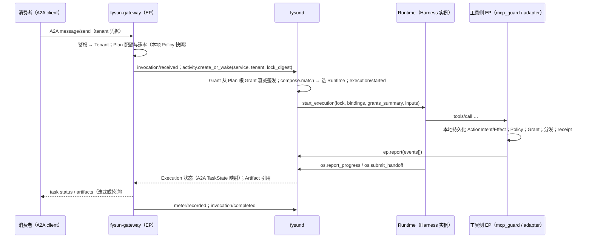

# 05 · Agent as a Service（服务平面）

- 状态：提案草案 v0.8.0-draft（2026-09-11）
- 决策依据：[ADR-0013 草案](adr-0013-draft-repositioning.md) §D1、§D6
- 前置：[03 组合](03-composition.md)、[04 Runtime 基座](04-runtime-substrate.md)、[06 治理](06-governance.md)

服务平面建立在能力管理与 Runtime 控制之上：一个 Service 就是"某个 Lock + 一组 Endpoint + 一组 Plan"，调用即创建租户 Scope 下的 Activity / Execution。
本文不设计计费系统、不设计聊天 UI。

## 1. 角色

| 角色 | 做什么 | 主要 API |
|---|---|---|
| **发布者（Publisher）** | 登记资产、定义 Agent、发布 Service、维护版本与证据 | `asset.*`、`agent.*`、`service.publish / rollout / retire` |
| **运营者（Operator）** | 运行 `fysund` 与 EP、登记 Runtime 与 Node、载入部署 Policy、处理审批与隔离 | `runtime.*`、`ep.*`、`policy.*`、`approval.*`、`asset.quarantine` |
| **消费者 / 租户（Tenant）** | 发现、订阅 Plan、调用 Endpoint、看用量与证据、（按 Policy）参与审批 | 发现接口、A2A / MCP / HTTP Endpoint、`tenant.usage`、`approval.decide`（被路由时） |
| **审核者（Reviewer）** | 证据门审查、供应链审查 | `verification.*`、`asset.health` |

同一 Principal 可兼多个角色；单机个人部署下三者合一。

## 2. 对象

### 2.1 Service / ServiceVersion / Endpoint

| 对象 | 字段 |
|---|---|
| Service | `id`、`publisher`、`agent_ref`（Agent Definition name）、`versions[]`、`endpoints[]`、`plans[]`、`agent_card_ref`、`status`（`draft / published / suspended / retired`）、`sla_declared?`、`tenant_visibility`（public / allowlist） |
| ServiceVersion | `version`、`lock_digest`、`variant`、`rollout{stage: staged \| canary{percent} \| stable \| rolled_back \| retired}`、`evidence_gate{result}`、`published_at` |
| Endpoint | `protocol ∈ a2a \| mcp \| http`、`url`、`auth`（tenant token / mTLS / OAuth，由 gateway 强制）、`exposes`（A2A：Agent Card skills；MCP：facade 工具名；HTTP：OpenAPI 引用）、`ep_id`（暴露它的 gateway） |

### 2.2 Tenant / Plan / Meter

| 对象 | 字段 |
|---|---|
| Tenant | `id`、`principal`、`scope`（含 Memory / Secret / Artifact 命名空间）、`plans[]`、`status`、`approval_contacts[]` |
| Plan | `service_id`、`quota{tokens, calls, effects{category}, runtime_seconds, concurrent_executions}`、`rate`、`allowed_effect_categories[]`、`approval_routing`（§10）、`data_residency?`、`period`；`plan/attached` 是准入类事件；Plan 派生该租户对该 Service 的**根 Grant** |
| Meter | `tenant_id`、`service_id`、`execution_id`、`dimension`、`amount`、`ep_id`、`policy_version?`；事件 `meter/recorded`，由 EP 回报或 `fysund` 从 Effect / Verification 折叠 |

## 3. 发布流程

```text
agent.define ─▶ compose.resolve ─▶ Lock ─▶ service.publish(service, lock_digest, endpoints, plans)
   ├─ Policy 评估（发布者可发布哪些 effect_category 的服务、是否要求签名 / 证据门）
   ├─ evidence_gate（可选）：对回归集运行一次 → Verification 全部 pass 才允许 stable
   ├─ 生成并签名 Agent Card（A2A）：skills 由 capabilities[] 派生；security schemes 由 Endpoint.auth 派生
   └─ service/published{service_id, version, lock_digest, endpoints[]}（准入类）
```

- `service.rollout(version, stage)`：`staged → canary{percent} → stable`；`canary` 由 gateway 按租户或按调用比例路由；`rolled_back` 把流量回到上一 `stable`，事件 `service/rollout`。
- 消费者可在 Plan 中**钉版本**（`pin: version`），否则跟随 `stable`。
- Lock 中任一资产 `quarantined` / `revoked` → 相关 ServiceVersion 自动 `suspended`，事件级联。

## 4. 发现

- **目录**：`service.search{capability_text?, labels?, effect_categories?, evidence_min?, price_hint?}` 返回 Service 摘要 + Agent Card + 证据摘要（按层：契约 / 组合 / Lock）+ `health`。
- **Agent Card**：由 `fysund` 生成、签名，gateway 在 `/.well-known/agent-card.json` 暴露；`skills[]` ↔ `capabilities[]`，`capabilities.streaming / pushNotifications` 由 gateway 能力决定。
- **MCP facade**：Endpoint `protocol = mcp` 时 gateway 把 Service 暴露为一个 MCP server，每个 Capability 一个工具（输入 = `behavior.input` schema），长任务经 MCP Tasks。
- 发现不隐含授权：`tenant_visibility` 与 Plan 决定可调用。

## 5. 调用路径



- 一次调用 = 一个 Activity（或唤醒既有长期 Activity，取决于 Service 声明的 `session_mode: per_call | per_context`），A2A `contextId` ↔ `Activity.id` / Handoff 链根。
- A2A TaskState ↔ Execution / Handoff 状态对照继承 v0.7.0 02 §2.8；`input_required` 与 `auth_required` 分别对应用户输入与 Approval。
- gateway 不看 Execution 内部，只做入口 EP 义务；它是水平可扩展的无状态组件（状态在 `fysund` 与其本地持久化队列）。

## 6. 租户与隔离

- Tenant Scope 是硬边界：资产可见性（`tenant_visibility`）、Memory / Knowledge / Artifact 命名空间、Secret、Activity 列表、审计视图都按 Scope 过滤。
- 租户数据驻留：Plan `data_residency` 约束 Runtime 选择（Node 标签）与 Memory provider 选择。
- 租户可带自己的资产（BYO prompt / skill / mcp_server / model 凭据）覆盖 Service 变体中允许覆盖的槽位——这是 Adjustment 的租户级 `scope`，受 Policy 与 F9 约束。

## 7. 配额、计量与预算

- Plan → 根 Grant（预算维度：tokens / calls / effects{category} / runtime_seconds / concurrent_executions / approvals）；每个 Execution 的 Grant 从根 Grant 衰减。
- 计量来源：gateway（calls、并发）、`provider_proxy` 或 Harness 自报（tokens；自报标 `untrusted_external`，Policy 决定是否计入）、工具侧 EP（effects）、`fysund`（runtime_seconds、approvals）。
- `quota.exceeded{dimension}` 在 gateway 或 `fysund` 记账时触发；Execution 进入 `waiting{reason: budget}` 或 `failed`，按 Plan 策略。
- **不做计费**：`meter/recorded` 可经 OTLP / 批量导出给外部计费；价格只在 `model.pricing_ref` 作换算提示。

## 8. SLA 与健康

- Service `health` 投影：可用性（`invocation/completed` 成功率）、P50/P95 时延、Verification 通过率、人工介入率、回滚率、依赖资产 `health`；
  全部由事件折叠，不单独记账。
- `sla_declared` 是发布者声明，`health` 是证据；发现接口同时展示。

## 9. 版本、回滚与弃用

- 版本单位是 Lock；同一 Lock 不同 Endpoint 配置不是新版本。
- 回滚 = `service.rollout(prev_version, stable)`；运行中的 Execution 不迁移，跑完为止。
- `service.retire(version)`：钉住它的 Plan 收到 `service.version_retired`，Policy 决定宽限期。

## 10. 跨租户审批路由

Approval（继承封闭结果集与审批面规则）在服务场景需要回答"谁批"。Plan `approval_routing`：

| 触发 | 缺省路由 | 可配置 |
|---|---|---|
| Effect 候选 `approve`（消费者数据上的外部动作） | 租户 `approval_contacts` | 运营者兜底 |
| Grant 扩张 / Adjustment 触及扩权 | 发布者 + 租户双签（`quorum: 2`） | Policy |
| `memory_admit`（租户 Memory） | 租户 | |
| 供应链隔离解除 | 运营者 | |

审批面仍只由 `fysund` 提供（Web UI / CLI / `fysund` 发起的 elicitation）；gateway 只透传 `needs_human(approval_id)`；Harness 文本不构成审批面（T11 继承）。

## 11. 生态联邦

- **服务调用服务**：Agent Definition `subagents[].service` 指向外部 Service（A2A）；`fysund` 作为 A2A client；外部 Artifact 一律 `untrusted_external`。
- **多基座**：多个 `fysund` 实例各自拥有租户与账本，通过 A2A 互调、通过 OCI 仓库共享资产；不共享账本。
- **信任**：跨基座调用需要 **Trust 对象**（v0.7.0 Q11）：对 Service / 发布者 / 基座的证据化信任（签名密钥、conformance 结果、历史 Verification），
  Policy 可引用；这是 R4 的必做项，不再是远期开放问题。
- **对外暴露为 A2A server** 即多主体场景，与本平面同时激活（关闭 v0.7.0 Q5）。

## 12. 负例（R3）

1. 未 `service/published` 的 Lock 可被 Endpoint 调用 → 失败。
2. 租户 A 的调用创建的 Execution 能读取租户 B 的 Memory / Artifact / Secret → 失败。
3. Plan 未允许的 `effect_category` 的候选在 EP 被放行 → 失败。
4. `quota.exceeded` 后仍有新 `execution/started` → 失败。
5. Agent Card `skills[]` 与 Lock 的 `capabilities[]` 不一致 → 失败。
6. Lock 内资产 `revoked` 后 ServiceVersion 仍 `stable` 并接受调用 → 失败。
7. gateway 本地产生 `approval/decided` 或转发 Harness 文本为审批决定 → 失败。
8. `canary` 阶段流量比例与 `service/rollout` 事件不一致（不可审计）→ 失败。
