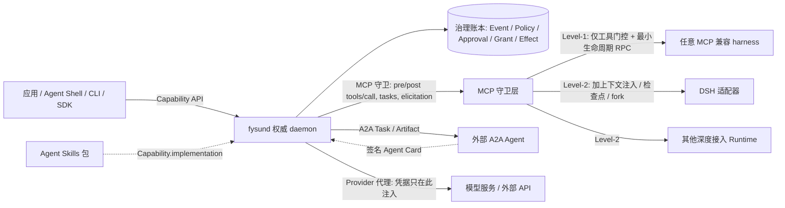

# FysunOS 前沿对照审查报告

- 日期：2026-09-07
- 审查对象：设计稿 v0.1（2026-09-06）全部 8 篇（[01](../design/01-definition-and-principles.md) –
  [08](../design/08-mvp-plan.md)）、[ADR-0001](../adr/0001-founding-decisions.md)、[README](../../README.md)
- 性质：**研究性审查报告**。本报告不修改任何设计文档或 ADR；所有建议列于第 8 部分的改动清单与 ADR 提案中，
  等待 owner 决定是否落地。
- 已由 owner 确认的方向：OS ↔ Runtime 边界采用 **协议优先**（工具/资源/上下文走 MCP，委派走 A2A，实现包走
  Agent Skills；DSH bundle 降为参考适配器之一）。本报告第 4 部分与第 7 部分按此方向展开。

## 0. 结论摘要

**总体判断：FysunOS 的定位、底线与对象模型方向正确，且与 2026 年 8 月发布的 AOS 参考架构（arXiv:2608.03214）
高度同构；主要差距不在"想法"而在"坐标"——它没有对齐已经收敛的协议标准（MCP / A2A / Agent Skills），
安全模型缺少数据流来源维度，HITL 与评估没有成为一级对象，Runtime 接入押在单一 developer-preview 项目上。**

八条最重要的发现（详细论证见对应部分）：

| # | 发现 | 级别 | 对应部分 |
|---|---|---|---|
| R1 | 三组自定义接口（Capability API / Harness ABI / Composition ABI）完全未提及 MCP、A2A、Agent Skills；"同一能力在任意 Agent 实现中运行"的承诺在 DSH 私有 seam 接入下不成立 | 必须 | §4 |
| R2 | 安全模型只有"权限/授权"维度（Grant、策略准入），没有"数据流来源"维度；2025–2026 的 prompt injection 防御共识是两者叠加（CaMeL / FIDES / Progent / RTBAS） | 必须 | §5 |
| R3 | HITL 只有 `needs_human` 错误码；生产数据显示 68% 的 Agent 在 ≤10 步后即人工介入、HITL 是永久性架构控制而非过渡阶段，应升为一级对象 `Approval` | 必须 | §2, §3 |
| R4 | 评估/验证的证据模型过于理想化：LLM-as-judge 在 agentic 场景噪声显著，74% 的生产团队依赖人工评估；Verification 需记录 verifier 身份、方法类别、校准证据；"人工复核"是一级 verifier 类型 | 应当 | §3, §5 |
| R5 | 演进模型缺"准入验证"与"库维护"两个阶段；Adjustment 应携带可证伪的预测（AHE 的决策可观测性），并提供可选的证据门控晋升 | 应当 | §3, §6 |
| R6 | Composition ABI 是从 Cordis 抽取的进程内组合语义，作为 OS 公共接口过度抽象；建议降为内部适配器生命周期 | 应当 | §4 |
| R7 | 术语 `Intent` 与 AOS / 业界用法冲突（业界指顶层目标，FysunOS 指效果级请求记录），建议改名 `ActionIntent` | 应当 | §2 |
| R8 | 缺显式威胁模型、conformance 声明与对外可比的定位坐标；AOS 提供了两平面模型与不变量表，FysunOS 应做自我声明而非自创坐标 | 应当 | §2, §5 |

**保留且被前沿证实的部分**（不建议动）：F1–F5 的权威写入者 / 候选而非事实 / 先记录再执行 / 独立验证 /
secret 隔离；Capability 契约与实现分离；event-sourced 治理账本与会话账本分离（与 Anthropic Managed Agents
的 session / harness / sandbox 三分完全同构）；不自建 loop（与 harness engineering 共识一致）；Grant 只能衰减
（与 AOS 委派单调性、Progent 单调收窄、Entra Agent ID 继承模型一致）。

---

## 1. 审查基线与方法

### 1.1 审查对象

| 文档 | 版本 | 审查重点 |
|---|---|---|
| 01 定义与设计原则 | v0.1 | 定义、八原则、底线 F1–F8、五个正交概念 |
| 02 对象模型 | v0.1 | 一级对象、状态机、事件族的完备性 |
| 03 系统架构 | v0.1 | 四子系统、进程拓扑、双账本、恢复模型、策略模型 |
| 04 接口与 ABI | v0.1 | 三组接口与业界协议的关系 |
| 05 Runtime 与 DSH 接入 | v0.1 | 单 Runtime 依赖、seam 接入形态 |
| 06 迁移清单 | v0.1 | 迁移项与新方向的兼容性 |
| 07 演进与边缘 | v0.1 | 轻量演进模型、物理 Effect、可移植性分层 |
| 08 MVP 计划 | v0.1 | 阶段划分、验收、开放问题 |
| ADR-0001 | accepted | D1–D8 是否需要 supersede |

### 1.2 对照来源（四类）

**A. 学术**

| 编号 | 资料 | 用于审查 |
|---|---|---|
| A1 | Sharma, Ye, Ge, Zhang 等，*The Agent Operating System (AOS): A Reference Operating Architecture for Distributed Agentic Systems*，AOS-0001，arXiv:2608.03214（2026-08） | 定位坐标、对象映射、不变量、威胁模型、conformance profile、Confidence 作为控制信号 |
| A2 | Mei 等，*AIOS: LLM Agent Operating System*，arXiv:2403.16971（COLM 2025） | Agent OS 内核词汇（已在 sources.md） |
| A3 | Debenedetti 等（Google DeepMind），*Defeating Prompt Injections by Design*（CaMeL），arXiv:2503.18813 | 值级 capability、控制流/数据流分离；AgentDojo 77% vs 84% |
| A4 | Shi 等，*Progent: Securing AI Agents with Privilege Control*，arXiv:2504.11703 | 符号化工具/参数策略、SMT 判定收窄 vs 扩张、单调限制（monotonic confinement）；AgentDojo 39.9%→1.0% |
| A5 | Narisetty 等，*Adaptive Evaluation of Out-of-Band Defenses Against Prompt Injection in LLM Agents*，arXiv:2606.26479（2026-06） | 把 CaMeL / FIDES / Progent / RTBAS / FORGE 统一为 Biba 完整性 + 引用监视器 + 最小权限；警告静态基准的局限；Progent 在自适应攻击下 25.8%→4.2%（自适应攻击 2.6%） |
| A6 | *Dynamic Agent Skills: A Lifecycle Survey and Taxonomy of Evolving Skill Libraries*，arXiv:2607.10113（2026-07） | 124 篇文献审计；八阶段生命周期；"准入与修复反复被证明重要"、"平面检索随库增长退化" |
| A7 | *SkillOps: Managing LLM Agent Skill Libraries as Self-Maintaining Software Ecosystems*，arXiv:2605.13716 | Skill Contract (P, O, A, V, F)；库健康（效用 / 冗余 / 兼容 / 失败风险） |
| A8 | Lin 等，*Agentic Harness Engineering: Observability-Driven Automatic Evolution of Coding-Agent Harnesses*（AHE），arXiv:2604.25850 | 组件 / 经验 / 决策三重可观测性；每次编辑附自声明预测并回溯验证；Terminal-Bench 2 69.7%→77.0% |
| A9 | *Self-Improvements in Modern Agentic Systems: A Survey*，arXiv:2607.13104；Weng，*Harness Engineering for Self-Improvement*（2026-07-04） | 自改进作为参数 + 脚手架的嵌套回路；harness-updating 与 harness-benefit 两轴分离 |
| A10 | *Can LLM-as-a-Judge Reliably Verify Rubrics in Agentic Scenarios?*（RuVerBench），arXiv:2606.29920 | 2,458 条实例；前沿模型作 judge 仍有显著噪声，agentic coding 中工具使用相关 rubric 最差 |
| A11 | *Measurement Without Validity: The Compounding Reliability Problem in Agentic AI Evaluation*，arXiv:2608.00794 | 评估可靠性阈值：探索 α≥0.67、安全 α≥0.70、部署门控 α≥0.80；模拟校准 ICC≥0.70 |
| A12 | *AdaRubric*，arXiv:2603.21362 | 任务自适应 rubric；人类相关 r=0.79、α=0.83 |
| A13 | Li 等，*MemOS: A Memory OS for AI System*，arXiv:2507.03724 | 记忆作为可调度资源；MemCube / MemScheduler / MemLifecycle；LoCoMo / LongMemEval 基线 |
| A14 | *ROSClaw: An OpenClaw ROS 2 Framework for Agentic Robot Control*，arXiv:2603.26997；URML（five-pass validator） | 执行层契约：能力发现、观测归一化、前置校验、结构化审计；模型间越界提议率差 4.8 倍 |
| A15 | Pan 等，*Measuring Agents in Production* / *Characterizing Agents in Production*（CAP），arXiv:2512.04123（ICML 2026） | 306 位从业者 + 20 个案例：68% ≤10 步即人工介入、47% <5 步、70% 仅提示词、74% 依赖人工评估、可靠性为首要挑战 |

**B. 协议与标准**

| 编号 | 资料 | 状态（2026-09） |
|---|---|---|
| B1 | Model Context Protocol，规范 2025-11-25；SEP-1686 Tasks；SEP-1036 URL-mode elicitation；SEP-1577 sampling with tools；SEP-1649 / SEP-1960 server cards（草案）；SEP-2663 将 Tasks 移入扩展 `io.modelcontextprotocol/tasks` | 2025-12-09 捐入 Linux Foundation AAIF；2026-03 月度 SDK 下载 9,700 万；2026 路线图：传输可扩展性、agent 通信、治理、企业就绪、更丰富的 agent-to-system 交互 |
| B2 | Agent2Agent（A2A）v1.0（2026-03） | TaskState 八态；Artifact 不可变；终态不可重启，细化 = 同 `contextId` 新 Task；签名 Agent Card；多租户；IBM ACP 已于 2025-08 合并；150+ 组织；已加入 AAIF |
| B3 | Agent Skills 规范（agentskills.io，2025-12-18 公开） | `SKILL.md` frontmatter：`name` / `description` / `license` / `compatibility` / `metadata` / `allowed-tools`（实验）；渐进披露三层（约 100 token 元数据 → <5,000 token 正文 → 按需资源）；2026-06 约 40 个产品支持；SemVer 提案（Discussion #415，2026-06-05） |
| B4 | agentgateway（Linux Foundation → AAIF，Rust） | 统一 HTTP / gRPC / MCP / A2A / LLM 数据面；`mcpAuthorization`（CEL）、Cedar 集成、1.3 版 `mcpGuardrails`（pre/post tool-call，Pass / Reject / Mutated）、ext_authz、xDS 控制面；路线图含 ACP 集成 |
| B5 | OpenTelemetry GenAI 语义约定 | 2026-06 v1.42.0 将 `gen_ai.*` 移出主仓库到 `semantic-conventions-genai`；截至 2026-08-13 63 个属性全部为 Development，无 tagged release；OTLP 传输与 span 模型稳定 |
| B6 | Microsoft Entra Agent ID | agent identity blueprint（类）/ agent identity（实例）；可继承权限；OBO 流程；sponsor 必填 |

**C. 工业实践**

| 编号 | 资料 | 用于审查 |
|---|---|---|
| C1 | Anthropic，*Scaling Managed Agents: Decoupling the brain from the hands*；Claude Managed Agents（2026-04-08 发布） | session（append-only 事件日志）/ harness / sandbox 三分且可独立替换；`getEvents()` 位置切片；"meta-harness"；自托管 sandbox 与 MCP tunnel；scheduled deployments |
| C2 | Amazon Bedrock AgentCore | Runtime（Firecracker microVM 会话隔离）/ Memory / Gateway（MCP）/ Identity / Policy（Cedar，拦截每次工具调用）/ Observability / Evaluations 的模块划分 |
| C3 | OpenClaw（本地优先个人 Agent，2026 年初 100k+ 星） | Gateway 作为会话与路由的单一真源；副作用方法强制幂等键；设备配对；ClawHub 社区 skill 的 Cisco / Snyk 安全发现（prompt injection、凭据窃取、恶意包） |
| C4 | Durable execution 实践：Temporal / Restate / Inngest / DBOS / LangGraph | LangGraph 恢复时节点重执行、副作用必须幂等；Restate journal 跳过已完成步骤；"工具层应返回 receipt 而非自然语言观察" |
| C5 | Zylos Research 2026-04 durable execution 综述；vadim.blog 对 LangGraph 的剖析 | 持久步边界、显式完成信号、可重放历史；"Dive into Claude Code"报告 1.6% 决策逻辑 / 98.4% 运维基础设施（二手引用） |

**D. 用户需求数据**

| 编号 | 资料 | 关键数字 |
|---|---|---|
| D1 | CAP（A15） | 见上 |
| D2 | LangChain，*State of Agent Engineering*（1,300+ 受访者，2026 初） | 57% 已有生产 Agent；质量为首要阻碍（32%）；89% 已有可观测性、52% 离线评估、37% 在线评估 |
| D3 | Forrester / Anaconda 2026 面板（经 digitalapplied 汇编，二手） | 88% 试点未上生产；阻碍：评估与可观测性 64%、治理 57%、可靠性 51%；有全量自动 eval 的 Agent 年回滚率 9%，无 eval 者 47%；41% 企业过去 12 个月至少一次生产回滚 |
| D4 | Gartner（经二手汇编） | 2027 年底前 >40% 的 agentic 项目将被取消，主因成本、价值不清、风险控制不足 |

### 1.3 标注方法

每条建议标注三项：

- **证据强度**：`学术共识`（≥2 篇独立论文或综述）/ `工业共识`（≥2 家独立厂商或基金会标准）/ `单一来源`；
- **影响范围**：`定义` / `对象模型` / `接口` / `架构` / `流程`；
- **建议级别**：`必须`（不改则定义或底线不成立）/ `应当`（不改则与业界脱节或留下已知缺口）/ `可选`。

二手汇编的数字（D3、D4、C5 的部分）只作趋势佐证，不作为单条建议的唯一依据。

---

## 2. 定位与定义审查（对应 01、ADR-0001 D1）

### 2.1 结论：定位正确，但缺少对外可比的坐标

01 §1.3 对"操作系统"的三点取舍（应用声明需求 / 系统提供稳定接口 / 运行结果有约定语义）是克制且正确的。
问题是它用自创坐标描述自己，外界（以及未来的 Runtime 实现者）无法快速判断 FysunOS 供给哪些职责、不供给哪些。

AOS-0001（A1）在 2026-08 给出了一个 vendor-neutral 参考坐标，并明确表示"不宣告任何一种解释无效，提供分层模型
让每个实现声明它供给哪些职责"。这正是 FysunOS 需要的。对照如下：

| AOS 平面 / 职责 | FysunOS 现状 | 供给声明建议 |
|---|---|---|
| **Control & Governance Plane** — intent、policy、trust、authority、confidence、auditability、observability、human oversight | Authority 子系统 + 部署策略 + 治理账本；无 confidence；human oversight 仅为 `needs_human` | **全量供给**（补 Approval 与轻量 assurance 后） |
| **Runtime & Coordination Plane** — agent lifecycle、workflow coordination、model/tool routing、context & memory coordination、scheduling、traffic management、runtime assurance | Activity 子系统（生命周期、触发、检查点、Handoff）、Resource 子系统（模型代理、上下文装配、记忆准入）、Verifier | **部分供给**：生命周期、调度、交接、上下文/记忆协调、验证；**不供给**：决策核心 loop、沙箱、traffic management（留给 Runtime / 网关） |
| **平台服务**（宿主 OS、容器、物理基础设施） | 01 §6 明确不做 | 不供给（一致） |

建议在 01 §1.3 之后新增一节"对外坐标"，直接写成上表形式（**应当 / 定义 / 学术共识 + 工业共识**：AOS 与 AgentCore /
Managed Agents 的模块划分互相印证）。

### 2.2 对象映射：FysunOS ↔ AOS

| AOS 概念 | FysunOS 对象 | 对齐程度 | 备注 |
|---|---|---|---|
| Intent（顶层目标 + 约束 + 权限 + 成功标准 + 时限） | `Activity.target` + `constraints` + `policy_binding` | 高 | 命名不同但语义相同 |
| Context（有界、带来源与新鲜度、可审计） | `os.request_context` 返回的 context_view（authorize-before-rank、digest、losses[]） | 高 | 缺 provenance / integrity 标签（见 §5） |
| Capability（稳定身份、契约、副作用声明、多 Provider） | `Capability`（contract / implementation / requirements / evidence / lineage） | 高 | AOS 把 side_effects 放进契约元数据；FysunOS 的 `bounds` 可承载 |
| Provider（可替换实现） | `Capability.implementation` + `Execution.runtime_binding` | 中 | FysunOS 没有把 Runtime 与实现明确合成"Provider"概念；可在文档中注明等价 |
| Plan（版本化、非授权） | 无（留给 Runtime 决策核心） | 有意不对齐 | P8 决策；但 Handoff 与 Activity.continuity 承担了"计划留痕"的最小面 |
| Policy（确定性、带版本与理由、可产生 obligations） | 部署策略（本地文件） | **低** | 无版本、无决策记录引用（见 §3.2） |
| Identity / Authority 分离 | Principal / Grant | 高 | 一致 |
| Delegation（scope ⊆ parent，expiry ≤ parent，budget ≤ remaining，lineage 可见） | Grant 衰减 + Handoff | 高 | 一致；可把三条不等式直接写成负例向量 |
| Trust（按 capability / 数据类 / 副作用类型区分） | 无显式对象 | 低 | MVP 单主体可不做；多 Runtime 资格化时需要 |
| Confidence（多维、证据支撑、映射到控制动作） | 无 | **缺位** | 见 §5.3 |
| Evidence & Provenance（不可变、引用精确版本、因果与时序分离） | 治理账本（seq / causation_id / correlation_id / fencing_epoch） | 高 | 一致 |
| Execution（唯一 id、单调生命周期、实际调用独立于计划记录） | `Execution` | 高 | 一致 |
| Semantic Resource（token / 审批容量 / 信任 / 时间预算作为可调度资源） | Grant.budget + Resource 计量 | 中 | "人工审批容量"未作为资源建模（OPC 场景里恰好是最稀缺资源） |

AOS 6.15 的七条概念不变量与 F1–F8 的对应：

| AOS 不变量 | FysunOS 底线 |
|---|---|
| 每次执行源于不可变 intent 或显式系统目标 | Activity.target（应补"target 不可变，修订走 Adjustment"） |
| 每次 provider 调用实现已声明的 capability 契约 | Execution.capability_snapshot |
| 每个 consequential action 被权限链与策略决定覆盖 | F1 + F3 + F7 |
| 委派权限单调不扩张 | Grant 衰减、F7 |
| 控制决定与执行动作分别可识别、共同可追溯 | 双账本 + causation_id |
| Confidence 决定保留证据并映射到显式动作 | **无对应** |
| 审计记录保留版本、谱系、因果 | 治理账本；但策略无版本（见 §3.2） |

### 2.3 术语冲突：`Intent`

FysunOS 02 §2.6 的 `Intent` 是"持久化的效果级请求记录（幂等键 = canonical 参数 digest）"。AOS、MCP 社区、
A2A 文档以及 Managed Agents 文档里的 "intent" 一律指用户/系统的顶层目标。两种用法在同一份 Harness ABI 文档中
并存会让 Runtime 实现者误解。

建议：改名为 `ActionIntent`（或 `EffectRequest`），事件族相应改为 `action-intent/recorded|rejected|replayed`
（**应当 / 对象模型 / 工业共识**）。原有语义（persist-before-dispatch、幂等键）不变。

### 2.4 "同一能力在任意 Agent 实现中运行"的承诺是否成立

01 §1.1 承诺"让同一能力在任意 Agent 实现、Runtime 与环境中持续、受控、可恢复地运行"。审视 05 的接入形态：
接入依赖 DSH 的 7 个私有 seam / 扩展点（`ctx.credentials`、`ctx.approval`、`ctx.sessionPersistence`、
`ctx.subagents`、`tools/pre-execute` waterfall、`agent/pre-step`、`sdk` profile）。这意味着：

- 任何非 DSH 的 harness 要成为 Runtime，必须重新实现一套等价的 seam 适配——而 Claude Code、Codex、OpenClaw、
  Gemini CLI、Goose 等都**没有**这些 seam，却都有 MCP 客户端与（多数）Agent Skills 加载；
- 05 §6 也承认"每个新 Runtime 独立资格化；DSH 的证据不可转移"。

结论：v0.1 的承诺在实现路径上等价于"任何愿意实现 fysun bundle 的 Runtime"。协议优先（§4）是让承诺成立的
唯一低成本路径（**必须 / 定义 + 接口 / 工业共识**：MCP 9,700 万月下载、A2A 150+ 组织、Agent Skills 40+ 产品）。

### 2.5 从用户需求校验设计目标

01 §5 列出六项设计目标与四个需实测的收益指标（完成率、成本、耗时、人工介入）。对照生产数据：

| 生产事实（来源） | 对 FysunOS 的含义 | 现状 | 建议 |
|---|---|---|---|
| 68% 的生产 Agent 在 ≤10 步后就需要人工介入，47% <5 步（A15） | HITL 不是异常路径，是主路径；OPC 场景中"人"是最稀缺资源 | `needs_human` 是一个错误码 + `request_id`；Activity 无 `input_required` 态 | `Approval` 一级对象（§3.1）；Activity 增 `input_required`；把审批容量纳入预算模型 |
| 74% 依赖人工评估；LLM judge 在 agentic 工具使用 rubric 上噪声最大（A15、A10） | "独立 Verifier"在多数能力上实际是人 | 02 §2.7 把 model-as-judge 当辅助，未把人工复核当 verifier 类型 | Verification 记录 verifier 类型与校准证据；人工复核为一级类型（§3.4） |
| 评估与可观测性缺口是最大阻碍（64%）；有 eval 覆盖的 Agent 回滚率 9% vs 47%（D3）；89% 已有可观测性但只有 52% 有离线评估（D2） | 每次"改 Prompt"（= Adjustment）都应能跑回归 | Adjustment 默认直接生效，无评估钩子 | 可选证据门控晋升（§3.6）；Verification 历史即回归集 |
| 41% 企业过去一年至少一次回滚（D3） | 回滚是常态成本，不是失败 | Adjustment 有 `rollback_target` | 保留；补"回滚触发原因"事件以便统计 |
| 质量（准确、一致、遵守品牌/策略）是首要阻碍（D2） | 契约中"怎样算做好"必须可判定 | 08 开放问题 4 未解 | checklist 化 rubric + verifier 分类（§6.1） |
| 本地优先个人 Agent 需求真实（OpenClaw 100k+ 星），同时社区 skill 供应链事故频发（C3） | owner-local 定位正确；实现包必须有来源与权限声明 | 05 §4 只拒绝了动态 Cordis 包作为持久扩展 | Agent Skills `allowed-tools` + 签名/来源登记（§4.4、§5.2） |

用户侧还有一条**未被 v0.1 覆盖的需求**：OPC 用户不会区分"Activity 暂停等待触发"与"Activity 等我批准"。
这两种等待在 UI 与通知语义上完全不同，必须在对象模型里区分（`waiting` vs `input_required`）。

---

## 3. 对象模型审查（对应 02）

02 的一级对象集合（Capability、Activity、Execution、Principal/Scope、Grant、Intent→Effect→Receipt→Verification、
Handoff、Resource、Adjustment、Event/Projection/Artifact）覆盖了 AOS 的大部分概念。下面是需要**新增**的三个对象、
需要**扩展**的四个对象、一处横切标签，以及事件族补充。

### 3.1 新增 `Approval`（HITL 审批）

**级别：必须 / 对象模型 / 学术共识 + 工业共识**（A15 生产数据；A4 Progent 的扩张需外部批准；AOS 的 ESCALATE
动作；A2A 的 `INPUT_REQUIRED` / `AUTH_REQUIRED` 中断态；MCP elicitation）。

现状：04 §4 只有 `needs_human`（策略要求人工确认，附请求 id）；03 §7 说部署策略回答"哪些需人工确认"；
Activity 的 `waiting` / `blocked` 不区分"等触发"与"等人"。

建议字段：

| 字段 | 内容 |
|---|---|
| `id`, `execution_id`, `activity_id` | 归属 |
| `subject` | 待批对象：`effect_candidate` / `grant_expansion` / `adjustment` / `handoff_accept` / `memory_admit` / `verification_override` |
| `reason` | 触发规则：策略引用（`policy_version` + rule id）、来源标签冲突（§3.7）、Progent 式权限扩张判定 |
| `presentation` | 呈现给人的最小上下文：候选摘要、参数（含来源标签）、预算影响、可逆性、Verifier 预检结果；引用 Artifact，不复制正文 |
| `options` | `approve_once` / `approve_for_activity` / `approve_for_capability` / `deny` / `modify(params)` / `defer(until)` |
| `decision`, `decided_by`, `decided_at` | 决定者必须是 Principal，不能是 Runtime |
| `expiry`, `on_expiry` | 到期动作：`deny` / `escalate` / `keep_waiting`（缺省 deny，fail-closed） |
| `derived` | `approve_for_activity` → 自动签发衰减 Grant；`approve_for_capability` → 自动产生 Adjustment（scope=capability_default）并留痕 |
| `batch_ref` | 同类候选可合并为一次审批（OPC 场景的"一次性批 20 条评论回复"） |

规则：

- Approval 是 **Authority 子系统**的对象，由 `fysund` 签发与关闭；Runtime 只能观察到 `needs_human(approval_id)`。
- `approve_for_*` 是权限扩张的**唯一合法路径**（与 §5.1 的单调收窄配套）。
- 人工审批容量进入预算模型：Activity.constraints 可声明 `max_pending_approvals`、`approval_sla`；超限时 Activity
  进入 `input_required` 而非继续堆积（AOS 6.14 把"human-approval capacity"列为语义资源）。
- Activity 状态机增加 `input_required`（等人）并与 `waiting`（等触发）区分；对应 A2A `TASK_STATE_INPUT_REQUIRED`。

### 3.2 `Policy` 升为版本化账本对象

**级别：必须 / 对象模型 + 架构 / 学术共识 + 工业共识**（AOS 6.7"决策含规则版本、结果、理由、obligations"；
AgentCore Policy 与 agentgateway 均用 Cedar 且在每次工具调用前评估）。

现状：03 §7 部署策略是"本地文件"，`policy.load(path)`；准入决定不引用策略版本；无法回答"这条 Effect 当时为什么被放行"。
F6 要求契约与负例不为实现让路，但策略本身没有进入可追溯范围。

建议：

- 账本对象 `Policy{id, version, digest, source, loaded_at, rules_ref}`；事件 `policy/loaded | policy/revised | policy/retired`。
- 每个准入事件（`effect/authorized`、`intent/rejected`、`approval/requested`、`grant/issued`）携带 `policy_decision{policy_version, rule_id, outcome, obligations[]}`。
  outcome 取 AOS 的四值：`allow` / `deny` / `modify` / `approve`（approve = 需要 Approval）。
- **策略语言不自造**。候选：Cedar（AWS 开源，有形式化验证与自动推理工具，AgentCore Policy 与 agentgateway 均已采用）
  或 CEL（agentgateway `mcpAuthorization`）。推荐 Cedar，理由：策略可静态分析（回答"这套策略是否允许某类动作"），
  与 F7"能力不得自扩权"的可判定表述一致。MVP 可以只支持 Cedar 子集。
- 策略评估输入至少包含：principal、action（Effect 类别 + 工具名）、resource（Scope / 设备 / 账号）、context
  （参数摘要、**来源标签**、预算余量、可逆性、Runtime 类型）。

### 3.3 新增 `Memory` 记录

**级别：应当 / 对象模型 / 学术共识**（A13 MemOS 把记忆作为带生命周期、来源、调度的资源；AOS 14.6"矛盾记录不静默平均，
保留版本并应用解析规则或请求澄清"；C2 AgentCore Memory 的短期/长期分层与跨 Agent 共享）。

现状：02 §2.9 把"记忆/知识"列为 Resource 类型，03 §2.4 有"记忆/知识准入"，04 有 `os.propose_memory`；
但没有 Memory 记录的字段、没有撤回与 supersession、没有作用域。

建议字段：`id, scope(principal | activity | capability | global), content_ref(Artifact), provenance(source execution,
source labels), admitted_by(verifier or principal), admitted_at, freshness(valid_until | supersedes | superseded_by),
retraction`。事件 `memory/proposed | admitted | rejected | superseded | retracted`。

规则：

- 记忆写入是**内部 Effect**（走审计快路径，不需外部 receipt，但必须有事件）；读取经上下文装配并携带来源标签。
- 记忆**引擎**（MemOS / Mem0 / Letta 等）作为可插拔 Resource 提供者接入，FysunOS 只拥有准入、作用域、撤回与可审计性。
  这是 P8 的直接推论：MemOS 在 LoCoMo / LongMemEval 上的表现远超自建能力，且 OmniMemEval 已在比较 14 个商业记忆产品。
- 矛盾记录不合并：保留双方，标记 `conflict_with`，由策略决定"优先最新 / 请求澄清 / 忽略"。

### 3.4 `Verification` 扩展

**级别：应当 / 对象模型 / 学术共识**（A10 RuVerBench、A11 可靠性阈值、A12 AdaRubric；AOS 14.5"记录使用了哪个
verifier 及其自身信任与信心"）。

现状：02 §2.7"由与执行者不同的 Verifier 执行；确定性优先；model-as-judge 辅助；报告不可变"。方向正确，但报告
没有可比较的字段，Capability.evidence 无法回答"这条证据有多可信"。

建议字段：

| 字段 | 内容 |
|---|---|
| `verifier_id`, `verifier_kind` | `deterministic`（测试 / schema / digest / 外部状态读取）/ `model_judge` / `human` / `downstream_outcome`（后续 Activity 的结果反推） |
| `independence` | 与执行者的独立性声明：不同进程 / 不同模型 / 不同 Principal；同模型自评标记为 `not_independent` |
| `rubric_ref` | 契约 quality 目标的 checklist 版本（见 §6.1） |
| `items[]` | 每条 checklist 项的判定、判定者、置信度（judge 给出）、引用的 Artifact |
| `calibration_ref` | judge 类 verifier 引用其校准集与一致性指标（Krippendorff α）；缺失则 `uncalibrated` |
| `assurance` | 汇总：`pass` / `pass_with_warning` / `fail` / `inconclusive`，以及依赖说明（哪些项来自同一 judge） |

规则：

- `human` 是一级 verifier 类型，不是"机械检查不存在时的兜底"。OPC 用户"看过再发"本身就是一次 Verification，
  应被记录并计入 evidence（同时计入人工介入指标）。
- 部署策略可为 Effect 类别或 Capability 设定最低 verifier 要求（例如"发布类动作至少需要 `deterministic` + `human`"），
  与 A11 的"部署门控 α≥0.80"思路一致：达不到就不叫通过。
- `inconclusive` 是合法结果，不能被 Runtime 或应用解释为通过（延续"not-run 永不等于 pass"）。

### 3.5 `Handoff` 状态机对齐 A2A v1.0 Task

**级别：应当 / 对象模型 + 接口 / 工业共识**（B2 A2A v1.0 已稳定；AAIF 治理；agentgateway / LiteLLM 已有 A2A 路由）。

现状：`issued / accepted / in_progress / delivered / verified / rejected / cancelled`。

对照表：

| A2A TaskState | FysunOS Handoff | 说明 |
|---|---|---|
| `SUBMITTED` | `issued` | 命名对齐即可 |
| `WORKING` | `accepted` + `in_progress` | 合并；A2A 无"已接受未开始"态，FysunOS 可保留为子状态 |
| `INPUT_REQUIRED` | **缺** | 子 Execution 需要父方或人提供输入；接 §3.1 Approval 或 `deliver_input` |
| `AUTH_REQUIRED` | **缺** | 子方需要额外授权；映射为 Grant 扩张请求 → Approval |
| `COMPLETED` | `delivered` | A2A 的 completed 不含验证语义 |
| （无） | `verified` | **FysunOS 叠加态**：父 Execution 或独立 Verifier 对 deliverables 的验证；这是 FysunOS 相对 A2A 的增量，应保留 |
| `FAILED` | **缺** | 现状只能用 `rejected` 或 `cancelled` 表达；需区分"拒绝接单"与"接单后失败" |
| `REJECTED` | `rejected` | 一致 |
| `CANCELED` | `cancelled` | 一致 |

其他对齐项：A2A 的 Artifact 不可变、终态不可重启、细化走同 `contextId` 新 Task——与 FysunOS 的内容寻址 Artifact
及"Handoff 不重开"一致；建议 Handoff 记录 `context_id`（= Activity id 或 Handoff 链根），便于外部 A2A Agent
把多次委派关联起来。

### 3.6 `Adjustment` 扩展：可证伪的预测 + 可选证据门控

**级别：应当 / 对象模型 + 流程 / 学术共识**（A8 AHE 的决策可观测性；A6 "准入与修复反复被证明重要"、
"单次成功不等于新配置更好"；D3 eval 覆盖与回滚率的关系）。

现状：`target / scope / source / effective_from / rollback_target / risk_class`；默认直接生效、自动留痕。
07 §1.3 已经说"系统只负责让对比可观察"，但没有给出对比的机制。

建议新增字段：

- `predicted_effect`：申请方（用户、Agent、评估器）对这次调整**预期改善什么**的声明（自然语言 + 可选指标名 + 方向）。
  AHE 的核心发现是：把每次编辑变成"预测 → 下一轮任务级结果回验"的可证伪契约，是自动演进不退化为试错的关键。
- `evaluated_against`：生效后 N 次 Execution 的 Verification 汇总与 `predicted_effect` 的对照结果
  （`supported` / `refuted` / `inconclusive`），由 daemon 在后续 Verification 到达时自动填充。
- `evidence_gate`（可选，由部署策略或用户开启）：`promote` 到 `capability_default` 前，要求对"回归集"跑一次评估。
  回归集 = 该 Capability 历史上已 `verified` 的 Execution 输入与验收 checklist（自然形成，不需人工构造）。

事件 `adjustment/predicted`、`adjustment/evaluated`。这不违背 D8"演进轻量"：默认仍直接生效；只是让"是否更好"
可被系统而非用户回答。

### 3.7 横切：上下文片段与工具结果的 provenance / integrity 标签

**级别：必须 / 对象模型 + 接口 / 学术共识**（A3 CaMeL 值级 capability；A4 Progent；A5 把五种防御统一为
Biba 完整性模型 + 引用监视器 + 最小权限，并指出"没有数据流污点追踪"是 Codex CLI 类 harness 的共同缺口）。

现状：context_view 有 digest 与 losses[]，Effect 有幂等键与 Grant 检查；但**没有任何字段表达"这个参数值来自哪里"**。
这意味着一段被注入的网页内容可以经模型改写后作为"收件人"参数进入一次外部发送 Effect，而策略引擎只看到
"principal 有权发送"。

建议：

- 每个进入上下文的片段、每个工具结果、每个 Artifact 携带 `label{source_principal, integrity(trusted_user |
  trusted_system | verified_data | untrusted_external), origin_ref}`。标签在装配时由 Resource 子系统赋予；
  Runtime 不能改写。
- Effect 候选提交时，Runtime 须（Level-2）或 OS 须尽力（Level-1，按参数值匹配）标注参数的来源标签。
- 策略可引用标签：例如"外部发送类 Effect 的 `recipient` 若含 `untrusted_external` 来源 → `approve`"。
- 这不是完整的 CaMeL 解释器（那要求控制 Runtime 的执行语义），而是 FIDES / Progent 一级的"标签 + 引用监视器"，
  在协议边界即可实现。完整信息流控制列为后续研究。

### 3.8 事件族补充

在 03 §5.1 之外新增：

```text
policy/loaded | policy/revised | policy/retired
approval/requested | approval/granted | approval/denied | approval/modified | approval/expired
memory/proposed | memory/admitted | memory/rejected | memory/superseded | memory/retracted
adjustment/predicted | adjustment/evaluated
context/assembled {labels digest}            （替代或补充 request_context 的审计事件）
handoff/input-required | handoff/auth-required | handoff/failed
activity/input-required
verification/inconclusive
runtime/qualified {level, control_points}     （见 §4.2）
```

并把 `intent/*` 改名为 `action-intent/*`（§2.3）。

---

## 4. 接口与 Runtime 边界审查（对应 03、04、05；方向已定：协议优先）

### 4.1 为什么 v0.1 的三组接口需要重排

04 定义了 Capability API（应用 ↔ OS）、Harness ABI（Runtime ↔ OS）、Composition ABI（组件图 ↔ OS），线协议为
自定义 JSON-RPC。对照 2026 年的协议格局：

| FysunOS 接口中的职责 | 业界已收敛的协议 | 成熟度 |
|---|---|---|
| 工具调用作为 Effect 候选（`submit_candidate`）；工具/适配器目录 | **MCP** `tools/call`、`tools/list`；网关层 pre/post tool-call 守卫（agentgateway `mcpGuardrails`、AgentCore Gateway + Policy） | 稳定；AAIF 治理 |
| 长任务与 outcome-unknown 的轮询 | **MCP Tasks**（`tasks/get` / `tasks/result` / `tasks/cancel`，`execution.taskSupport`） | 实验，正移入扩展 |
| 需要人提供输入或凭据 | **MCP elicitation**（含 URL-mode）；**A2A** `INPUT_REQUIRED` / `AUTH_REQUIRED` | 稳定 |
| Handoff（委派给其他 Agent） | **A2A** Task / Artifact / Agent Card（签名） | v1.0 稳定 |
| 能力发现 | **A2A Agent Card**；**MCP server card**（草案 SEP-1649 / SEP-1960） | 前者稳定、后者草案 |
| 实现包（Prompt / Skill / 脚本 / 引用资源） | **Agent Skills**（`SKILL.md` + `allowed-tools` + 渐进披露） | 事实标准（40+ 产品） |
| 上下文注入、检查点、fork、compaction | 无标准；harness 私有 | — |
| 组件生命周期（Composition ABI） | 无标准；Cordis 私有 | — |

结论：v0.1 把有标准的部分和没有标准的部分放在同一层抽象里，并统一用自定义协议表达。协议优先意味着
**把有标准的部分直接用标准表达**，把没有标准的部分（上下文注入、检查点、fork）作为可选控制点。

### 4.2 协议优先的 Runtime ABI（替代 Harness ABI）



**Runtime ABI 分为三块：**

1. **MCP 守卫（所有 Runtime 必经）**。fysund 以 MCP 中间层身份出现在 harness 与工具之间：harness 把 fysund 视为
   唯一的 MCP server（或 fysund 前置在 harness 配置的所有 MCP server 之前）。
   - `tools/list`：fysund 按 Grant 与策略过滤并改写工具面（对应 agentgateway 的"rewrite or restrict what the
     server exposes"），实现"能力不得自扩权"的机械化：看不见就调不了。
   - `tools/call`：pre 阶段 = `submit_candidate`（ActionIntent 持久化、策略、Grant、来源标签检查）；执行阶段 = Effect
     dispatch；post 阶段 = Receipt 回填。只读工具走审计快路径。
   - `tasks/*`：outcome-unknown 与长任务的标准表达；`effect/reconciled` 对应 `tasks/result`。
   - `elicitation/create`：Approval 的传输载体之一（MCP client 支持时）。
   - 复用选项：直接嵌入或 fork **agentgateway**（Rust、AAIF、`mcpGuardrails` 已提供 pre/post 拦截与
     Pass / Reject / Mutated 语义、Cedar/CEL 策略）。需要评估其作为库嵌入 `fysund` 的可行性；若不可行，
     fysund 自实现 MCP 守卫但**采用相同的 Pass / Reject / Mutated 语义与 Cedar 策略格式**，以便未来切换。
2. **最小生命周期 RPC（所有 Runtime 必须实现，语言无关 JSON-RPC）**：`describe() → {type, version, control_points[]}`、
   `start_execution`、`resume_execution`、`cancel`、`deliver_input`、`checkpoint()`（可返回 `unsupported`）、`health`。
   这是 v0.1 Harness ABI §2.1 的子集，去掉了 `fork_execution`（升为控制点）。
3. **可选控制点（能力位，Level-2）**：`context_injection`（`agent/pre-step` 注入受控上下文视图）、`checkpoint`、
   `fork`、`compaction_hook`、`session_link`（会话账本关联义务）、`subagent_delegation`（把 Runtime 内部
   subagent 转为 Handoff）。Capability.requirements 可以要求特定控制点，Capability 子系统据此做环境匹配——
   这与 v0.1 的能力位设计完全一致，**不引入等级制度**；"Level-1 / Level-2"只是文档中的速记，账本里记录的是
   `runtime/qualified{control_points}`。

**A2A 用于 Handoff 的外部形态**：当 Handoff 目标是外部 Agent（非本 fysund 管理的 Execution）时，fysund 作为 A2A
client 发起 Task，Handoff 状态直接映射 A2A TaskState（§3.5）；FysunOS 自己的 Capability 也可以通过 fysund 以
签名 Agent Card 对外暴露为 A2A server（多主体 / 多节点场景，非 MVP）。

**Agent Skills 用于实现包**：`Capability.implementation` 引用一个 Skills 目录（digest 固定），`allowed-tools`
成为 Grant 请求的初始上界（只能再收窄）；`compatibility` 映射到 `requirements`。渐进披露的三层与 FysunOS 的
上下文预算模型天然兼容。FysunOS **不定义**自己的实现包格式。

### 4.3 对 DSH 接入（05）的影响

- 05 §2 的 7 个 bundle 组件重新归类：`fysun-tool-gate` → 被 MCP 守卫取代（DSH 把 fysund 配为 MCP server 即可）；
  `fysun-credentials`、`fysun-approval`、`fysun-session-link`、`fysun-context`、`fysun-subagent` → Level-2 控制点适配器；
  `fysun-rpc` → 最小生命周期 RPC 的 DSH 实现。
- 05 §1"DSH = 默认参考 Runtime"改为"DSH = 第一个 Level-2 参考适配器"；不再是唯一路径。
- 05 §6"Codex / Claude Code / ACP 不直接接 OS，经 DSH subagent provider 接入" → 改为它们可作为 Level-1 Runtime
  直接接入（只要支持 MCP 客户端），也可继续作为 DSH 内的委派目标。
- 05 §7"代价与对策"中"Node 依赖不适合边缘"的论证依然成立，且协议优先使边缘 Runtime 只需实现 MCP 客户端 +
  最小 RPC。

### 4.4 Composition ABI 建议降级

**级别：应当 / 接口 + 架构 / 单一来源（本审查的结构性判断）+ 08 自己的"避免再做成白皮书"要求**。

04 §3 的 Composition ABI（mount / unmount / replace / inspect / dependency_status / health / dispose / quarantine）
抽取自 Cordis 的可撤销效果与反应式依赖，服务对象是"Rust 原生后端、Cordis adapter、未来 WASM 后端"。审视：

- 它解决的是**进程内**动态组合（Cordis 论文的时空可组合性），而 FysunOS 的边界是**进程外**、权威与非权威之间。
- 三个后端里，只有 Cordis adapter 是真实需求，且它完全位于 TS Runtime 一侧；Rust 原生后端的"最小 mount/unmount"
  就是普通的模块生命周期；WASM 后端尚无需求。
- 04 §3 末尾的两条规则（组件消失不得绕过 Grant 撤销与 Effect 对账；组件图不是信任图）是**真正的 OS 语义**，
  但它们可以由 `resource/registered | unavailable | quarantined` 事件与 Grant 撤销规则表达，不需要一组公共接口。

建议：Composition ABI 从公共接口降为 (a) `fysund` 内部适配器 trait；(b) DSH 适配器内部对 Cordis 生命周期的映射；
(c) 账本只保留 Resource 生命周期事件与"组件卸载触发 Grant 撤销 + Effect 对账"的规则。公共接口从三组减为两组
（Capability API、Runtime ABI）。ADR-0001 D2 中"Cordis 通过语言无关的 Composition ABI 以 adapter 方式服务 TS
Runtime"需要 supersede。

### 4.5 可观测性

**级别：应当 / 架构 / 工业共识**（B5；D2 89% 已有可观测性；AOS 要求控制决定与执行动作共同可追溯）。

- 治理账本仍是真源；同时以 **OTLP** 导出 Execution / Effect / Handoff / Verification 为 span 与事件，`execution_id`
  作为 trace 关联键，`causation_id` 作为 span parent。
- `gen_ai.*` 语义约定截至 2026-08 全部为 Development 且无 tagged release：**钉住具体 commit**，用
  `fysun.*` 命名空间承载稍后可能改名的属性，避免把账本 schema 绑到不稳定约定上。
- 度量指标（08 §4）中新增"人工介入率"与"回滚率"，直接从 `approval/*`、`adjustment/reverted` 事件折叠。

### 4.6 Capability API 的小幅调整

- 新增 `approval.list / approval.decide / approval.batch_decide`；`policy.describe()` 返回版本与 digest；
  `verification.report(id)` 返回 §3.4 的字段。
- `capability.find` 的自然语言查询结果应附 evidence 摘要与最低 verifier 等级，便于应用层选择。
- `capability.register` 接受 Skills 目录引用作为 implementation。

---

## 5. 可靠性底线与安全模型审查（对应 01 §4、03 §6–7）

### 5.1 F1–F8：保留，并补一条可形式化的性质

逐条对照前沿：

| 底线 | 前沿印证 | 判断 |
|---|---|---|
| F1 唯一权威写入者 | AOS 7.1"控制与执行分离，运行时不得把本地成功当作已授权的证明"；Managed Agents 把 session 日志放在 harness 之外 | 保留 |
| F2 概率组件只产候选 | AOS：模型输出是候选，策略决定为确定性；A5 把所有有效防御归为"确定性引用监视器在动作生效点执行策略" | 保留 |
| F3 外部效果先记录再执行 | C4 durable execution 共识（journal / 幂等键 / receipt）；OpenClaw 对副作用方法强制幂等键 | 保留 |
| F4 完成由独立验证判定 | AOS 14.5"验证是运行路径的一部分，不是部署后的可选评估"；A10/A11 补充：验证本身需要可靠性证据 | 保留 + 扩展（§3.4） |
| F5 secret 隔离 | Managed Agents"hands 不持有凭据"；AgentCore Identity；Entra Agent ID 的 blueprint 持凭据、instance 不持 | 保留 |
| F6 契约与负例不为实现让路 | AOS "后续规范可加强不变量但不得削弱" | 保留；把 Policy 纳入 F6 范围 |
| F7 部署策略声明、能力不自扩权 | AOS 委派单调性；Progent 单调限制；Entra 继承权限只在 blueprint 层放宽 | 保留 + **形式化**（下） |
| F8 未知外部改动受保护 | 无直接对应；是编码 Agent 领域的经验规则 | 保留 |

**建议新增 F9（或作为 F7 的可判定表述）：Execution 内有效权限单调收窄。**
在一次 Execution 的生命周期内，有效权限集（Grant ∩ 策略允许集 ∩ 工具面）只能因以下事件变化：
(a) Runtime 或用户提出的**收窄**自动生效；(b) 任何**扩张**必须经 `Approval`，且扩张后的集合仍 ⊆ 父 Grant。
Progent（A4）证明了"收窄自动、扩张需批准"在 AgentDojo 上把间接注入成功率从 39.9% 降到 1.0%，并在 A5 的自适应
攻击下仍保持 2.6%–4.2%。这条性质的价值在于**可以写成负例向量并在 M1 验收**：构造一条试图扩权的 candidate，
断言账本中不出现无 Approval 的 `grant/issued`。AOS 16 节也把"非扩张委派、无授权不执行、撤销安全"列为可用 TLA+
表达的候选性质。

### 5.2 缺口：显式威胁模型

**级别：应当 / 架构 + 流程 / 学术共识 + 工业共识**（AOS 附录 D；A5 强调静态基准不足；C3 OpenClaw 供应链事故）。

v0.1 的安全论述分散在 F1–F8、05 §1 对 DSH 安全立场的引用、07 §2.4 硬实时边界。没有一处回答"我们防谁、防什么、
不防什么"。建议新增 `docs/design/09-threat-model.md`，提纲如下（放在本报告供参考，不在本次落地）：

```text
1. 资产：治理账本、Secret Store、Grant、Approval 决定、Capability 实现包、Artifact、设备执行器
2. 信任边界：fysund（TCB）| Runtime 进程 | 工具/MCP server | 模型 Provider | 外部 Agent | 用户输入 | 网页/文件等外部内容
3. 攻击者与向量
   T1 间接 prompt injection（外部内容 → 模型 → 越权 Effect）        → 来源标签 + 策略 + F9
   T2 恶意/被投毒的实现包（Skills 目录、MCP server）                → 来源登记、digest、allowed-tools 上界、隔离
   T3 权限扩张（嵌套委派、工具适配器、异步队列中的隐式扩权）        → Grant 衰减不等式、F9、Approval 唯一路径
   T4 凭据外泄（日志、argv、Runtime 内存、工具参数）                 → F5、Provider 代理、日志扫描负例
   T5 账本篡改 / 重放 / 陈旧 epoch 写入                              → 单写者、fencing、digest 稳定性
   T6 验证欺骗（执行者自评、同模型 judge、伪造 receipt）             → independence 字段、verifier 最低要求
   T7 记忆投毒（不可信内容被准入为 durable 知识）                    → memory 准入 + 来源标签 + 撤回
   T8 物理动作越界（越过安全包络、绕过白名单的替代话题）              → 设备侧确定性校验器、双源确认、急停引用
   T9 Runtime 越权推进状态（伪造 complete/verified）                  → ABI 中不存在这些调用（04 §2.3）+ 负例
   T10 DoS / 预算耗尽（无限重试、审批洪泛）                          → 预算、wait/switch/escalate 策略、审批容量
4. 明确不防：模型权重后门；宿主 OS 被攻破；用户自己批准了恶意动作；沙箱逃逸（沙箱视为 containment）
5. 每条向量对应的负例向量编号（进入 conformance）
```

同时建议在 README 或 01 增加一段 **conformance 声明**（对应 AOS 附录 E 的 profile 思路，但不采用其命名）：
FysunOS MVP 满足哪些不变量、哪些控制点为可选、哪些威胁不在范围。

### 5.3 Confidence：不引入八维向量，但补"证据支撑的 assurance"

**级别：可选 / 对象模型 / 单一来源（AOS）+ 学术旁证（A11 关于虚假精度的警告）**。

AOS 把 Confidence 提升为控制信号（八个分量，映射到 PROCEED / PROCEED_WITH_WARNING / RETRY / FALLBACK /
ESCALATE / TERMINATE），并在 15.5 自己警告"数值会制造误导性精度，动作映射比数字更重要"。FysunOS 的 P1
（只结构化机器必须检查的部分）与之相符。建议取其**动作映射**而不取其**数值向量**：

- Effect 候选与 Verification 携带 `assurance{level: high | medium | low | unknown, basis[], dependence}`，
  `basis` 是证据引用（Verifier 报告、来源标签、Receipt、历史 evidence），不是分数；
- 部署策略可按 Effect 类别 × assurance 级别映射到六个控制动作；`RETRY` 与 `FALLBACK` 由 Activity 子系统的
  wait/switch/escalate 策略承担（03 §2.2 已有），`ESCALATE` = Approval，`TERMINATE` = cancel + 保留证据；
- 不做跨步骤传播计算（AOS 自己也把它列为未解决问题）。

### 5.4 恢复模型（03 §6）与 durable execution 实践的对照

03 §6 的固定顺序（读投影 → 校验 epoch → 对账 outcome-unknown → 才 resume）优于 LangGraph 的"节点重执行 +
应用层自管幂等"，与 Temporal / Restate 的 journal 语义等价。两点补充：

- `resume_execution` 携带的 `effect_watermark` 应同时携带 **Approval 水位**：崩溃前未决的 Approval 不能在恢复后
  被 Runtime 当作已批准；
- 恢复后的第一个 candidate 若与崩溃前 `dispatch-started` 但无 receipt 的 Effect 幂等键相同，必须命中
  `intent/replayed` 而不是新建 Effect——这已隐含在幂等键设计中，建议写成负例向量。

---

## 6. 演进与边缘审查（对应 07）

### 6.1 演进：对照技能库生命周期研究

A6 对 124 篇文献的审计给出八阶段生命周期：证据获取 → 提案 → **验证/准入** → 存储 → 检索/组合 → **维护**
→ 蒸馏/可移植 → 治理。对照 07 §1.4"系统提供的机制（仅此）：记录、应用、观察、回退、晋升、谱系"：

| 阶段 | FysunOS 覆盖 | 差距 |
|---|---|---|
| 证据获取 | Verification → Capability.evidence | 覆盖 |
| 提案 | Adjustment / `propose_adjustment` | 覆盖 |
| 验证/准入 | 只在风险边界检查 | **缺**：A6 结论"准入与修复反复被证明重要，verifier 质量实质影响结果"；§3.6 的可选证据门控补此项 |
| 存储 | Capability 版本 + digest | 覆盖 |
| 检索/组合 | `capability.find`、Handoff | 覆盖；A6 警告"平面检索随库增长退化"，OPC 场景库小，暂不成问题 |
| 维护 | 无 | **缺**：冗余（两个 Capability 契约近似）、过期（evidence 全部来自已退役 Runtime）、失败模式（反复 fail 的 checklist 项）。建议 Capability 子系统提供 `capability.health(id)`，从 evidence 与 Adjustment 历史折叠 |
| 蒸馏/可移植 | 契约与实现分离、Skills 包 | 覆盖（协议优先后更强） |
| 治理 | 谱系、回退、风险类 | 覆盖 |

**对 08 开放问题 4（质量目标的机器可判定表示法）的建议**：采用 A7 SkillOps 的 Skill Contract 结构
`(P 前置条件, O 操作, A 产物, V 验证器, F 已知失败模式)` 作为 `Capability.contract.quality` 的骨架，其中 V 是
**checklist**（分解为可独立判定的是/否项，每项标注 verifier 类型：deterministic / judge / human）。
A10、A12 与 Galileo 等工业实践都指向"把复杂标准分解为单项是/否问题"能显著提升 judge 可靠性；A11 的阈值
（部署门控 α≥0.80）则给出"judge 项何时可以替代人工"的客观标准。这样"怎样算做好"可以由用户与 Agent 对话生成
（P1 保留自然语言），而系统只结构化 checklist 项与其 verifier 类型。

**关于 harness 自演进**：A8 AHE 与 A9 Weng 都把"harness 文件级可编辑 + 每次编辑带预测 + 回归门控"作为自演进
的前提；A9 进一步发现 9B 模型写出的 skill 与 Opus 在结构上同构，即"harness-updating 能力"不是瓶颈，
"harness-benefit"（模型能否用好）才是。对 FysunOS 的含义：Adjustment 的 `predicted_effect / evaluated_against`
（§3.6）是让"改进策略作为普通 Capability"（07 §1.4）真正可行的最小系统支持；不需要在内核里实现任何优化算法。

### 6.2 边缘：模式已被验证，需明确三个边界

A14 ROSClaw、PhysicalMCP、URML 三个独立项目在 2026 年收敛到同一执行层契约：能力发现（affordance 注入）、
观测归一化、**前置校验器 + 安全包络 + 接口白名单**、结构化审计。与 07 §2.3 的物理 Effect 扩展字段一致。
ROSClaw 的实测（三平台 × 四模型，越界提议率相差 4.8 倍）也印证了 F2：模型只产候选，越界由确定性层拦截。

建议明确三点：

1. **安全包络是绑定到设备 Resource 的 Policy 对象**（而非 Effect 字段）：`velocity_bounds`、`geofence`、
   `interface_allowlist`、`rate_limit`、`deadman`、`emergency_stop_ref`；Effect 只引用它并记录校验结果。
   这样同一能力在不同设备上自然适用不同包络（07 §2.2 的"策略下发"即下发包络）。
2. **校验器在 `fysund-edge` 内以确定性代码运行**，不经模型；PhysicalMCP 把"次级急停"放在桥接层的做法对应
   FysunOS 的"硬实时留在宿主控制器"。
3. **"通过校验 ≠ 世界安全"**（URML 原话：验证器只能保证程序符合**声明的**包络，不能保证声明与世界一致）。
   07 §2.2 已有"软件模拟中的成功不等于硬件动作已通过验证"，建议把包络声明本身的校准列为部署者责任并写进策略模型。

**边缘账本一致性**是 v0.1 未触及的开放问题：`fysund-edge` 离线期间的本地 Grant 消耗、Effect 与 Approval 如何在
联网后与中心账本合并（AOS 13 节讨论了 regional profile 中"哪些数据强一致、哪些最终一致、哪些决定需要在线全局
权威"）。建议先声明一个保守规则："离线期间只允许本地策略已预授权的 Effect 类别；需要 Approval 的一律阻塞"，
其余留待 ADR。

### 6.3 可移植性的三个层次（07 §2.5）

协议优先后，"能力可移植"的承诺从"兼容环境"具体化为"任何 Level-1 Runtime + 满足 requirements 的工具面"；
"执行可恢复"仍以 Activity.continuity 与 Artifact 为单位——这与 Managed Agents 的做法一致（harness 崩溃后新
harness 读 session 日志续接，不搬进程）。不需改动。

---

## 7. MVP 计划审查（对应 08）

### 7.1 结构性风险：M2 押在单一 developer-preview 项目上

08 §3 的 M2"Runtime 接入"完全等于"fysun bundle + DSH 子进程管理"，且 M3–M5 全部依赖 M2。05 §1 自己列出了
DSH 处于 developer preview、明言破坏性变更、单语言 Node。协议优先后，风险可以拆开：

| 原阶段 | 建议拆分 | 验收（新增或替换） |
|---|---|---|
| M2 Runtime 接入 | **M2a MCP 守卫 + Level-1 接入**：fysund 作为 MCP 中间层，接入任意一个现成 MCP 兼容 harness（选择标准：开源、本地可跑、有 Skills 加载；候选 DSH headless、Goose、OpenCode 等，按当时可用性挑一个） | 每个 `tools/call` 配对一个 Effect；`tools/list` 按 Grant 过滤（负例：被过滤的工具不可调用）；F9 负例：扩权 candidate 不产生无 Approval 的 `grant/issued` |
| | **M2b DSH Level-2 适配**：上下文注入、检查点、session_link、subagent → Handoff | 跨账本 replay 双向定位（原 M2 验收）；`runtime/qualified{control_points}` 事件正确 |
| M3 Activity 闭环 | 增 **Approval 闭环**与 **A2A Handoff 对齐** | 闭环第 2 步"先看过再发布"通过 Approval 对象实现（不再是策略注释）；Handoff 状态可无损映射到 A2A TaskState；崩溃恢复后未决 Approval 不被视为已批 |
| M4 演进与入口 | 增 **Adjustment 预测→评估** | 一次 Adjustment 带 `predicted_effect`，下一 Execution 的 Verification 自动填充 `evaluated_against`；负例：`evidence_gate` 开启时未跑回归集的 promote 被拒 |
| M5 第一个应用 | 不变 | 不变 |

M0、M1 不变，但 M1 增两项验收：`policy_decision` 附在每个准入事件上（含 `policy_version`）；来源标签在
context_view 与 Effect 参数上可见，且策略可基于标签产生 `approve` 结果（负例：`untrusted_external` 来源的收件人参数
直接放行 → 测试失败）。

### 7.2 度量指标（08 §4）补充

在现有五项之外增加：**人工介入率**（`approval/requested` / Execution）、**回滚率**（`adjustment/reverted` /
`adjustment/applied`）、**验证独立性比例**（`independence != not_independent` 的 Verification 占比）。前两项直接对应
用户侧最关心的数字（§2.5），第三项防止"独立验证"在实现中退化为自评。

### 7.3 开放问题（08 §7）更新

| 原问题 | 建议 |
|---|---|
| 1 传输：stdio JSON-RPC 还是 socket/gRPC | 协议优先后拆为两问：MCP 传输（stdio + Streamable HTTP，跟随 MCP）；最小生命周期 RPC（stdio JSON-RPC，MVP） |
| 2 Secret Store 后端 | 不变 |
| 3 Web UI 技术栈 | 不变；但 Approval 呈现面成为 UI 的第一优先级（§2.5） |
| 4 质量目标的机器可判定表示法 | 建议采纳 §6.1：Skill Contract 骨架 + checklist 化 V + verifier 类型标注 |
| 5 多主体 Scope 何时激活 | 不变；补充：对外暴露 A2A server（签名 Agent Card）是多主体的第一个触发点 |
| 6 许可证 | 不变；注意 agentgateway 为 Apache-2.0、Agent Skills 规范为 Apache-2.0、DSH / Cordis 为 MIT |
| **新 7** 策略语言 | Cedar 子集 vs CEL；建议 Cedar（§3.2） |
| **新 8** `Intent` 改名 | `ActionIntent` vs `EffectRequest`（§2.3） |
| **新 9** 边缘账本离线一致性 | 保守规则先行（§6.2），完整方案待 ADR |
| **新 10** agentgateway 复用形态 | 作为库嵌入 / 作为独立进程前置 / 仅借用语义自实现（§4.2） |

### 7.4 证据纪律（08 §5）

不变。补一句：**本报告引用的所有外部基准数字（AgentDojo、Terminal-Bench、LoCoMo 等）只用于说明方向，
不构成对 FysunOS 任何性能或安全声明**——与 08 §6"非声明"一致。

---

## 8. 建议改动清单与 ADR 提案

### 8.1 按文档编号的改动清单

级别：必须 / 应当 / 可选。所有改动均**未执行**。

**README**

- 应当：状态段增加"对外坐标"一句（AOS 两平面供给声明的摘要）与 conformance 声明链接。
- 应当：命名表中 `fysun-dsh` 改为"DSH 的 Level-2 参考适配器"；新增 `fysun-mcp-guard`（或说明复用 agentgateway）。

**01 定义与设计原则**

- 应当：§1.3 后新增"对外坐标"节（§2.1 的表）。
- 应当：§1.1 定义句中"在任意 Agent 实现、Runtime 与环境中"补充限定"任何实现 Runtime ABI 最小面（MCP 客户端 +
  最小生命周期 RPC）的 Runtime"，使承诺可判定。
- 必须：§4 新增 F9（Execution 内权限单调收窄，扩张唯一路径为 Approval）或把它写为 F7 的可判定表述。
- 应当：§4 底线表下方补"来源标签"作为 F2 的配套机制说明。
- 应当：§6"明确不做"增加"不定义自己的实现包格式（采用 Agent Skills）、不自造策略语言"。
- 可选：§7 五个正交概念表中 Runtime 一行改为"通过 Runtime ABI（MCP 守卫 + 最小 RPC + 可选控制点）暴露控制点"。

**02 对象模型**

- 必须：新增 §2.x `Approval`（§3.1）。
- 必须：新增 §2.x `Policy`（§3.2）。
- 必须：§2.6 `Intent` 改名 `ActionIntent`；协议图中相应改名。
- 必须：§2.9 Resource 表"上下文源"与"工具/适配器"行增加来源标签说明；新增 §2.x 横切标签定义（§3.7）。
- 应当：新增 §2.x `Memory`（§3.3）。
- 应当：§2.7 Verification 扩展字段（§3.4）。
- 应当：§2.8 Handoff 状态机对齐 A2A 并叠加 `verified`（§3.5）。
- 应当：§2.2 Activity 状态增 `input_required`；`target` 标注不可变。
- 应当：§2.10 Adjustment 增 `predicted_effect`、`evaluated_against`、`evidence_gate`（§3.6）。
- 可选：§2.6 与 §2.7 增 `assurance` 字段（§5.3）。
- 应当：§3"不进入 OS 对象模型的概念"补一句"Plan（决策核心的内部规划）"以明确与 AOS 的有意差异。

**03 系统架构**

- 应当：§1 分层图中"Harness ABI · Composition ABI"改为"Runtime ABI（MCP 守卫 + 最小生命周期 RPC + 可选控制点）
  · A2A（外部 Handoff）"。
- 应当：§2.3 Authority 子系统职责增加 Approval 签发与关闭、Policy 版本管理。
- 应当：§2.4 Resource 子系统职责增加来源标签赋予、Memory 准入与撤回。
- 应当：§3 进程拓扑图改为 §4.2 的 mermaid 图内容。
- 必须：§5.1 事件族按 §3.8 补充并改名 `action-intent/*`。
- 应当：§6 恢复模型增加 Approval 水位与幂等键重放负例（§5.4）。
- 必须：§7 部署策略模型改为版本化 Policy 对象 + Cedar 子集；策略输入包含来源标签。
- 可选：新增 §8 可观测性（OTLP 导出、`gen_ai.*` 钉版策略）。

**04 接口与 ABI**

- 必须：§2 Harness ABI 重写为 Runtime ABI 三块结构（§4.2）；`submit_candidate` 等 Runtime→OS 调用保留为 Level-2
  控制点的内部语义，Level-1 通过 MCP 守卫隐式完成。
- 应当：§3 Composition ABI 整节删除或降为附录"内部适配器生命周期"（§4.4）。
- 应当：§1 Capability API 增 `approval.*`、`policy.describe` 版本返回、`capability.register` 接受 Skills 目录（§4.6）。
- 应当：§4 错误语义增 `input_required` / `auth_required`（对齐 A2A）、`inconclusive`（Verification）。

**05 Runtime 与 DSH 接入**

- 必须：标题与 §1 结论改为"DSH 作为第一个 Level-2 参考适配器"；§2 七个 bundle 组件按 §4.3 重新归类。
- 应当：§6 其他 Runtime：Codex / Claude Code / Goose / OpenCode 等可作为 Level-1 直接接入。
- 应当：§4"不从 DSH 吸收为 OS 语义"新增"DSH 的 skills 加载格式若与 Agent Skills 不同，以 Agent Skills 为准"。

**06 迁移清单**

- 应当：§1 迁入表补"来源标签"不是迁移项（CognitiveOS 无此机制），标注为新建。
- 应当：§3 DSH 复用表中"tools 注册与执行流水线"改为"经 MCP 守卫使用"。
- 应当：§4 Cordis 吸收项收窄为 DSH 适配器内部实现。

**07 演进与边缘**

- 应当：§1.4 系统机制增"预测记录、评估对照、可选证据门控、健康查询"（§6.1）。
- 应当：§2.3 物理 Effect 扩展中，安全包络字段改为引用绑定到设备 Resource 的 Policy 对象（§6.2）。
- 应当：§2.4 边界增加"包络声明的校准是部署者责任"与"离线期间的保守规则"。

**08 MVP 计划**

- 必须：§3 M2 拆为 M2a / M2b；M1、M3、M4 验收按 §7.1 补充。
- 应当：§4 度量增三项（§7.2）。
- 应当：§7 开放问题按 §7.3 更新。

**docs/research/sources.md**

- 应当：合并附录 A 的来源登记增补表。

### 8.2 待新增 ADR 提案

| 编号 | 标题 | 决策要点 | supersedes |
|---|---|---|---|
| ADR-0002 | 协议优先的 Runtime 边界 | Runtime ABI = MCP 守卫（必经）+ 最小生命周期 RPC + 可选控制点；Handoff 外部形态 = A2A；实现包 = Agent Skills；DSH 降为 Level-2 参考适配器；Composition ABI 降为内部接口；agentgateway 复用形态待评估 | ADR-0001 D2 中"fysun bundle 为接入形态"与"Cordis 经 Composition ABI 服务 TS Runtime"两句；D8 不受影响 |
| ADR-0003 | Policy 对象与策略语言 | Policy 版本化入账本；每个准入决定引用 `policy_version`；策略语言采用 Cedar 子集（或记录选择 CEL 的理由）；策略输入包含来源标签 | ADR-0001 D7 的"部署策略声明"保留，补充其载体 |
| ADR-0004 | 来源标签与权限单调收窄（F9） | 上下文片段 / 工具结果 / Artifact 携带 integrity 标签；Execution 内有效权限只能自动收窄，扩张唯一路径为 Approval；进入负例向量 | 无（新增） |
| ADR-0005 | Approval 一级对象与证据门控演进 | Approval 由 Authority 子系统拥有；`approve_for_*` 派生 Grant / Adjustment；审批容量入预算；Adjustment 携带 `predicted_effect / evaluated_against`；`evidence_gate` 为可选策略 | ADR-0001 D8"默认直接生效"保留，补充可选门控 |
| ADR-0006（可选） | 术语：`Intent` → `ActionIntent` | 避免与 AOS / MCP / A2A 的 intent 用法冲突 | 无 |

### 8.3 实施建议的优先顺序

1. ADR-0002 + ADR-0004（它们决定 M1 / M2a 的验收面，且 F9 的负例向量必须在 M1 前登记）；
2. ADR-0003 + ADR-0005（M1 需要 `policy_decision` 字段，M3 需要 Approval）；
3. 按 §8.1 修订 02 → 04 → 03 → 05 → 08 → 01 → 07 → 06 → README（先对象模型与接口，再架构与计划，最后定义与叙述）；
4. 新增 09 威胁模型（可与 M1 并行）。

---

## 附录 A · 来源登记增补表（供合并进 sources.md）

### A.1 论文与一手资料

| 资料 | 精确标识 | 用途 |
|---|---|---|
| Sharma, Ye, Ge, Zhang 等，*The Agent Operating System (AOS): A Reference Operating Architecture for Distributed Agentic Systems*（AOS-0001） | arXiv:2608.03214（2026-08） | 对外坐标、对象映射、不变量、威胁模型与 conformance profile 的参照；Confidence 控制动作六元组 |
| Debenedetti 等，*Defeating Prompt Injections by Design*（CaMeL） | arXiv:2503.18813 | 值级 capability 与控制/数据流分离 |
| Shi 等，*Progent: Securing AI Agents with Privilege Control* | arXiv:2504.11703 | 符号化策略、SMT 收窄/扩张判定、单调限制 → F9 |
| Narisetty 等，*Adaptive Evaluation of Out-of-Band Defenses Against Prompt Injection in LLM Agents* | arXiv:2606.26479（2026-06） | 引用监视器 + 最小权限 + 完整性标签的统一框架；静态基准局限 |
| *Dynamic Agent Skills: A Lifecycle Survey and Taxonomy of Evolving Skill Libraries* | arXiv:2607.10113（2026-07） | 八阶段生命周期 → 演进模型缺口 |
| *SkillOps: Managing LLM Agent Skill Libraries as Self-Maintaining Software Ecosystems* | arXiv:2605.13716 | Skill Contract (P,O,A,V,F) → 质量目标表示法 |
| Lin 等，*Agentic Harness Engineering* | arXiv:2604.25850 | 决策可观测性 → Adjustment.predicted_effect |
| *Self-Improvements in Modern Agentic Systems: A Survey* | arXiv:2607.13104 | 自改进的参数/脚手架双回路 |
| Weng，*Harness Engineering for Self-Improvement* | lilianweng.github.io，2026-07-04 | harness 定义；harness-updating vs harness-benefit |
| *Can LLM-as-a-Judge Reliably Verify Rubrics in Agentic Scenarios?*（RuVerBench） | arXiv:2606.29920 | judge 噪声 → Verification 校准字段 |
| *Measurement Without Validity: The Compounding Reliability Problem in Agentic AI Evaluation* | arXiv:2608.00794 | 可靠性阈值 α≥0.67 / 0.70 / 0.80 |
| *AdaRubric* | arXiv:2603.21362 | 任务自适应 rubric |
| Li 等，*MemOS: A Memory OS for AI System* | arXiv:2507.03724 | 记忆作为可调度资源；不自建记忆引擎的依据 |
| *ROSClaw: An OpenClaw ROS 2 Framework for Agentic Robot Control and Interaction* | arXiv:2603.26997 | 执行层契约、前置校验器、安全包络 |
| URML（robot intent language + five-pass validator） | github.com/URML-MARS/URML | "通过校验 ≠ 世界安全" |
| Pan 等，*Measuring Agents in Production* / CAP | arXiv:2512.04123（ICML 2026） | 生产 Agent 的 HITL、评估与可靠性数据 |
| Shi, Zhang, Cui，*A Programming Paradigm for Spatiotemporal Composability* | arXiv:2608.25512（已登记） | Composition ABI 降级后仅作 DSH 适配器内部参考 |

### A.2 协议与规范

| 资料 | 版本 / 日期 | 用途 |
|---|---|---|
| Model Context Protocol 规范 | 2025-11-25；SEP-1686（Tasks）、SEP-1036（URL elicitation）、SEP-1577（sampling with tools）、SEP-1649 / SEP-1960（server cards，草案）、SEP-2663（Tasks 移入扩展，草案） | Runtime ABI 的 MCP 守卫层 |
| Agent2Agent 协议 | v1.0（2026-03） | Handoff 外部形态与状态机对齐 |
| Agent Skills 规范 | agentskills.io，2025-12-18 公开；Discussion #415 SemVer 提案（2026-06-05） | Capability.implementation 的实现包格式 |
| agentgateway | AAIF 项目；1.3 版 `mcpGuardrails` | MCP 守卫层复用候选；Cedar/CEL 策略 |
| Cedar 策略语言 | AWS 开源 | Policy 对象的策略语言候选 |
| OpenTelemetry GenAI 语义约定 | `semantic-conventions-genai` 仓库（2026-06 起），截至 2026-08-13 全部 Development | 可观测性导出的钉版策略 |
| Microsoft Entra Agent ID | learn.microsoft.com/entra/agent-id（2026） | 委派身份与继承权限的工业对照 |

### A.3 工业实践（信息性）

| 资料 | 用途 |
|---|---|
| Anthropic，*Scaling Managed Agents: Decoupling the brain from the hands*；Claude Managed Agents 文档（2026-04-08 发布） | session / harness / sandbox 三分对双账本设计的印证 |
| Amazon Bedrock AgentCore 开发者指南（Runtime / Memory / Gateway / Identity / Policy / Observability / Evaluations） | 企业级模块划分对照 |
| OpenClaw 架构文档与安全指南；Cisco / Snyk 对 ClawHub skill 的审计报道 | 本地优先需求与供应链威胁 |
| Zylos Research，*Durable Execution for AI Agent Runtimes*（2026-04-24 / 04-27）；LangGraph durable execution 文档 | 恢复模型对照 |
| LangChain，*State of Agent Engineering*（2026） | 用户需求数据 |
| Forrester / Anaconda 2026 面板、Gartner 预测（经二手汇编，仅作趋势） | 用户需求数据 |

## 附录 B · 本报告未展开的问题

- 多主体与多节点下 Grant / Approval 的分布式一致性（AOS 13 节、A2A 多租户）；
- 完整信息流控制（CaMeL 级）是否需要 Level-3 控制点；
- 模型 Provider 的路由与 fallback（AOS 12.5 的可行集 + 效用排序）是否进入 Resource 子系统；
- Trust 对象（按 Runtime / 工具 / 外部 Agent 的证据化信任）何时引入；
- OTel `gen_ai.*` 稳定后是否用其替代 `fysun.*` 属性。
